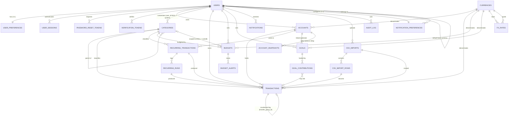

# SpendIO — Personal Finance / Expense Tracker
## Complete System Architecture & Implementation Blueprint

> **Status:** DESIGN ONLY — no implementation code written yet. Awaiting approval.
> **Shape:** Modular monolith (Spring Boot) + separate SPA (React/Vite/TS). No microservices.
> **Repo:** Single monorepo (`backend/`, `frontend/`, `infra/`, `docs/`).

---

## 0. Executive summary

| Concern | Decision |
|---|---|
| Backend | Java 21, Spring Boot 3.4, Spring MVC (blocking) + virtual threads, Spring Security 6, Spring Data JPA / Hibernate 6 |
| Persistence | MySQL 8.4, Flyway, `utf8mb4`, strict SQL mode |
| Money | `BIGINT` minor units + ISO-4217 code. Never `double`, never `BigDecimal` for storage |
| Multi-tenancy | Single schema, `user_id` discriminator on every owned table, enforced in repository/spec layer |
| Auth | Short-lived HS256 JWT access token (client memory) + opaque rotating refresh token (httpOnly cookie), BCrypt cost 12, lockout, reuse detection |
| Base currency | Per user. Every transaction **freezes** `base_amount_minor` at write time (FX snapshot). History never recomputes |
| Recurring | In-process `@Scheduled` worker + DB-level claim (`FOR UPDATE SKIP LOCKED`) + unique run constraint for idempotency |
| CSV import | State machine over `csv_imports` + `csv_import_rows`, streaming parse, batched idempotent insert |
| Frontend | React 19 + Vite + TS (strict), React Router v7 data router, TanStack Query, Zustand, React Hook Form + Zod, Tailwind, Recharts |
| API style | `/api/v1/**`, resource-shaped JSON, RFC-9457 `ProblemDetail` errors, `PageResponse<T>` envelope |
| Testing | JUnit 5 + AssertJ + Mockito, `@WebMvcTest`, `@DataJpaTest` (Testcontainers MySQL), `@SpringBootTest`, Vitest + MSW, Playwright E2E |
| Delivery | Multi-stage Dockerfiles, `docker compose` locally, GitHub Actions CI/CD, Actuator + Prometheus |

**Local toolchain note:** this machine currently has `java` and `node`/`npm` but **no Maven, no Gradle, no Docker**. Before Phase 1 begins we must install Maven (or use the Maven Wrapper `mvnw`, which is bootstrapped from the repo) and Docker Desktop.

---

# A. System Architecture

## A.1 Container / runtime view

```
+----------------------------------------------------------------------------------+
|                            Browser (Client SPA)                                   |
|  React 19 + Vite + TS + Router + TanStack Query + Zustand + RHF/Zod              |
|  Access token: in-memory   |   Refresh token: httpOnly SameSite=Strict cookie     |
+-------------------------+---------------------------------------+------------------+
                          | HTTPS /api/v1/**                      | /actuator/**
                          | (Bearer access token)                  |
+------------------v-------v---------------------------------------v------------------+
|                     Reverse Proxy  (nginx / Caddy / ALB)                         |
|  TLS termination - static SPA - gzip/brotli - rate limit - request id            |
+-----------------------------------+-----------------------------------------------+
                                    |
+-----------------------------------v-----------------------------------------------+
|                        SpendIO Backend (Modular Monolith)                       |
|                                                                                  |
|  +--------------------------------------------------------------------------+   |
|  | Cross-cutting: SecurityConfig | JwtAuthenticationFilter | RateLimitFilter|   |
|  | GlobalExceptionHandler | RequestIdFilter | MailService | AuditLog |     |   |
|  | Actuator/Micrometer | Caching | Async | Scheduling                          |   |
|  +--------------------------------------------------------------------------+   |
|                                                                                  |
|  +-----------+-----------+------------+-----------+-----------+---------------+   |
|  |   auth    |   users   |  accounts  | categories| reference  |     fx        |   |
|  +-----------+-----------+------------+-----------+-----------+---------------+   |
|  | transactions        |  recurring  |  budgets  |  goals    |    imports      |   |
|  +---------------------+-------------+-----------+-----------+------------------+   |
|  |   notifications     |   analytics  |   audit   |  (mail templates)                |   |
|  +---------------------+-------------+-----------+----------------------------+   |
|    Controllers -> Services -> Repositories (Spring Data JPA) -> MySQL           |
+----+--------------------+---------------+----------------+----------------+-------+
     |                    |               |                |                |
+----v---------+  +-------v-------+  +----v--------+  +-----v-------+  +-----v------+
|  MySQL 8.4  |  | Local FS / S3 |  | SMTP relay  |  | FX provider |  | Prometheus |
|  (container) |  | (CSV files)   |  | (Mailpit)   |  | (HTTP)      |  | (metrics)  |
+--------------+  +---------------+  +-------------+  +-------------+  +------------+

+----------------------------------------------------------------------------------+
|  Scheduled worker (same JVM):                                                   |
|   - RecurringTransactionExecutor   (cron: 0 */15 * * * *)                       |
|   - FxRateRefreshJob                (daily 02:15 UTC)                            |
|   - BudgetRolloverJob               (daily 00:10 UTC)                            |
|   - NotificationDigestJob           (daily 07:00, per user timezone)             |
|   - RetentionJob                    (weekly; purge soft-deleted > N days)      |
|   - OrphanFileCleanupJob            (daily; unlink unreferenced uploads)        |
+----------------------------------------------------------------------------------+
|  Observability: Actuator (/health,/info,/metrics) | Prometheus scrape            |
|  Logging: Logback JSON (prod) with traceId | per-endpoint Micrometer timers    |
+----------------------------------------------------------------------------------+
```

## A.2 Layered request flow (backend)

```
HTTP Request
   |
   +-> Reverse proxy (TLS, gzip, X-Request-Id injection)
   |
   +-> RequestIdFilter          -> adds/propagates request id, populates MDC + logback
   +-> RateLimitFilter          -> Bucket4j per IP and per route (auth routes strict)
   +-> CsrfFilter               -> enforced only on cookie-bearing endpoints (/auth/refresh, /auth/logout)
   +-> JwtAuthenticationFilter  -> verify signature, exp, nbf, and claim typ=access; build principal
   +-> AuthorizationFilter      -> route rules from SecurityConfig
   |
   +-> @Controller              -> @Valid @RequestBody, @CurrentUserId, paging/sorting
   |      +-> maps to request DTO; NEVER exposes JPA entities
   |
   +-> @Service                 -> @Transactional boundary; owns business rules
   |      +-> ownership assertion via TenantGuard (user_id scoping is mandatory)
   |      +-> Money + FxConversionService  (freeze base_amount_minor + exchange_rate)
   |      +-> NotificationPublisher (in-app notification, best-effort)
   |      +-> AuditLogService
   |      +-> MapStruct mapper -> response DTO
   |
   +-> @Repository (Spring Data JPA)
   |      +-> Specification<T> for dynamic filters (always AND-ed with user_id)
   |      +-> JPQL / native projection DTOs for aggregates (no entity hydration)
   |      +-> pessimistic locking / SKIP LOCKED for scheduler + money writes
   |
   +-> MySQL (schema owned by Flyway)
```

**Error path:** any exception -> `GlobalExceptionHandler` -> `ProblemDetail` JSON:

```json
{
  "type": "https://docs.spendio.app/errors/ACCOUNT_NOT_FOUND",
  "title": "Account not found",
  "status": 404,
  "detail": "Account 42 does not belong to the current user",
  "instance": "/api/v1/accounts/42",
  "code": "ACCOUNT_NOT_FOUND",
  "fieldErrors": [],
  "traceId": "8f2c1b7e4a9d4c1f"
}
```

The frontend switches on `code` (stable enum), never on `detail` (human text).

## A.3 Frontend request flow

```
User event -> component
   -> feature hook (useMutation / useQuery from TanStack Query)
      -> feature api.ts (typed endpoint call, Zod input validation)
         -> services/http/apiClient (fetch)
            -> authInterceptor   (attach Bearer access token from in-memory store)
            -> [network]
            <- 401 -> refreshInterceptor (single-flight queue) -> POST /auth/refresh
                        -> on success: replay original request once
                        -> on failure: authStore.clear() -> redirect /login?redirect=...
            <- ProblemDetail -> errorInterceptor (toast for 5xx, typed ApiError for 4xx)
      -> on success: invalidate/patch query cache (optimistic where safe)
   -> re-render
```

## A.4 External / background components

| Component | Purpose | Coupling | Failure behaviour |
|---|---|---|---|
| **FX rate provider** (HTTP) | daily + on-demand rates | `FxProviderClient` SPI; `HttpFxProviderClient` (default), `NoopFxProviderClient` (tests/offline) | cached last-known-good rate reused; a write never fails because FX is down |
| **SMTP / Mailpit** | password reset, welcome, import-complete, digest | `MailService` SPI; `@Async`; console impl in dev/test | logged + retried with backoff; never fails the originating request |
| **Scheduler** (same JVM) | recurring generation, FX refresh, budget rollover, digests, retention | `@Scheduled` + DB claim | multi-instance safe via `SKIP LOCKED` + unique run constraint |
| **File storage** | uploaded CSVs | `CsvStorage` SPI; `LocalFileCsvStorage` now, `S3CsvStorage` later | orphan cleanup job + size/time limits |
| **MySQL** | system of record | — | nightly dump + binlog for PITR |
| **Prometheus** | metrics | scrape only, optional | non-blocking |

Deliberately **not** built now (see §I for reasoning): message broker, Redis, read replicas, Elasticsearch, microservice split, external scheduler (Quartz cluster), event store, CQRS read models, Kubernetes.

---

# B. Complete Project Folder Structure

## B.1 Repository root

```
spendio/
├── README.md
├── ARCHITECTURE.md                    <-- this document
├── CONTRIBUTING.md
├── CHANGELOG.md
├── LICENSE
├── .gitignore
├── .editorconfig
├── .env.example                       <-- shared local env template
├── docker-compose.yml                 <-- local dev stack
├── docker-compose.prod.yml            <-- prod-shaped override
│
├── backend/
├── frontend/
├── infra/
├── .github/workflows/
└── docs/
```

## B.2 Backend structure

```
backend/
├── pom.xml
├── mvnw / mvnw.cmd / .mvn/wrapper/maven-wrapper.properties
├── Dockerfile
├── .dockerignore
└── src/
    ├── main/
    │   ├── java/com/spendio/
    │   │   ├── SpendioApplication.java
    │   │   │
    │   │   ├── sharedkernel/                          <-- cross-cutting; NO feature logic
    │   │   │   ├── domain/
    │   │   │   │   ├── BaseEntity.java
    │   │   │   │   ├── AuditableEntity.java
    │   │   │   │   ├── SoftDeletableEntity.java
    │   │   │   │   ├── Money.java
    │   │   │   │   ├── CurrencyCode.java
    │   │   │   │   ├── DateRange.java
    │   │   │   │   └── enums/
    │   │   │   │       ├── AccountType.java
    │   │   │   │       ├── AccountStatus.java
    │   │   │   │       ├── TransactionType.java
    │   │   │   │       ├── TransactionDirection.java
    │   │   │   │       ├── TransactionStatus.java
    │   │   │   │       ├── CategoryType.java
    │   │   │   │       ├── RecurrenceFrequency.java
    │   │   │   │       ├── RecurringStatus.java
    │   │   │   │       ├── RunStatus.java
    │   │   │   │       ├── BudgetPeriodType.java
    │   │   │   │       ├── GoalStatus.java
    │   │   │   │       ├── GoalContributionMethod.java
    │   │   │   │       ├── NotificationType.java
    │   │   │   │       ├── NotificationSeverity.java
    │   │   │   │       ├── NotificationChannel.java
    │   │   │   │       ├── ImportStatus.java
    │   │   │   │       ├── ImportRowStatus.java
    │   │   │   │       ├── ImportMatchSource.java
    │   │   │   │       ├── MatchConfidence.java
    │   │   │   │       ├── RevocationReason.java
    │   │   │   │       └── AdjustmentKind.java
    │   │   │   └── period/PeriodCalculator.java
    │   │   ├── error/
    │   │   │   ├── ErrorCode.java                      <-- stable machine codes (API contract)
    │   │   │   ├── BusinessException.java
    │   │   │   ├── ResourceNotFoundException.java
    │   │   │   ├── ConflictException.java
    │   │   │   ├── ForbiddenException.java
    │   │   │   ├── UnprocessableEntityException.java
    │   │   │   ├── TooManyRequestsException.java
    │   │   │   ├── GlobalExceptionHandler.java
    │   │   │   └── exception/
    │   │   │       ├── AccountArchivedException.java
    │   │   │       ├── AccountNotFoundException.java
    │   │   │       ├── AccountLockedException.java
    │   │   │       ├── CategoryInUseException.java
    │   │   │       ├── CurrencyNotSupportedException.java
    │   │   │       ├── DuplicateResourceException.java
    │   │   │       ├── FxRateUnavailableException.java
    │   │   │       ├── ImportNotReadyException.java
    │   │   │       ├── ImportRowLimitExceededException.java
    │   │   │       ├── InvalidPasswordException.java
    │   │   │       ├── RecurringNotDueException.java
    │   │   │       └── TransactionNotReversibleException.java
    │   │   ├── web/
    │   │   │   ├── RequestIdFilter.java
    │   │   │   ├── ApiLoggingFilter.java
    │   │   │   ├── CorsConfig.java
    │   │   │   ├── CurrentUserId.java                  <-- annotation
    │   │   │   ├── CurrentUserIdArgumentResolver.java
    │   │   │   ├── PageResponse.java                   <-- {content,page,size,totalElements,totalPages}
    │   │   │   ├── PageRequestFactory.java
    │   │   │   ├── SortRequest.java
    │   │   │   └── IdempotencyKeyFilter.java
    │   │   ├── persistence/
    │   │   │   ├── AuditingConfig.java
    │   │   │   ├── JpaConfig.java
    │   │   │   ├── TenantGuard.java                    <-- ownership assertion helper
    │   │   │   ├── SpecificationUtils.java
    │   │   │   └── JsonColumnConverter.java
    │   │   ├── security/
    │   │   │   ├── SecurityConfig.java
    │   │   │   ├── JwtProperties.java
    │   │   │   ├── JwtService.java                     <-- sign/verify + claim contract
    │   │   │   ├── JwtAuthenticationFilter.java
    │   │   │   ├── RefreshTokenService.java
    │   │   │   ├── RefreshTokenProperties.java
    │   │   │   ├── CookieService.java
    │   │   │   ├── RateLimitFilter.java
    │   │   │   ├── LockoutService.java
    │   │   │   ├── LockoutProperties.java
    │   │   │   ├── PasswordPolicy.java
    │   │   │   ├── UserPrincipal.java
    │   │   │   ├── SecurityUtils.java
    │   │   │   ├── RestAuthenticationEntryPoint.java
    │   │   │   ├── RestAccessDeniedHandler.java
    │   │   │   └── CsrfCookieFilter.java
    │   │   ├── money/
    │   │   │   ├── CurrencyRegistry.java                <-- minor-unit lookup, cached
    │   │   │   ├── MoneyFormatter.java
    │   │   │   └── MoneyArithmetic.java
    │   │   ├── notification/NotificationPublisher.java  <-- SPI other modules call
    │   │   ├── mail/
    │   │   │   ├── MailService.java                     <-- interface
    │   │   │   ├── SmtpMailService.java
    │   │   │   ├── ConsoleMailService.java              <-- dev + test
    │   │   │   ├── MailTemplates.java
    │   │   │   └── templates/{password-reset,welcome,import-complete,budget-alert}.{html,txt}
    │   │   ├── audit/service/AuditLogService.java
    │   │   ├── util/
    │   │   │   ├── HashUtils.java                       <-- SHA-256 for token storage
    │   │   │   ├── TextNormalizer.java                  <-- dedupe normalisation
    │   │   │   ├── DateParserUtils.java
    │   │   │   └── Ids.java
    │   │   └── config/
    │   │       ├── OpenApiConfig.java
    │   │       ├── JacksonConfig.java
    │   │       ├── WebClientConfig.java
    │   │       ├── AsyncConfig.java
    │   │       ├── SchedulingConfig.java
    │   │       ├── CacheConfig.java                     <-- Caffeine
    │   │       ├── MetricsConfig.java
    │   │       ├── ImportProperties.java
    │   │       ├── FxProperties.java
    │   │       └── WebProperties.java
    │   │   │
    │   │   ├── auth/                                   <-- MODULE 1: authentication
    │   │   │   ├── controller/{AuthController,SessionController}.java
    │   │   │   ├── service/
    │   │   │   │   ├── AuthService.java
    │   │   │   │   ├── RegistrationService.java
    │   │   │   │   ├── LoginService.java
    │   │   │   │   ├── TokenRotationService.java
    │   │   │   │   ├── LogoutService.java
    │   │   │   │   └── PasswordResetService.java
    │   │   │   ├── domain/{UserSession,PasswordResetToken,VerificationToken}.java
    │   │   │   ├── repository/{UserSessionRepository,PasswordResetTokenRepository,VerificationTokenRepository}.java
    │   │   │   ├── dto/request/{RegisterRequest,LoginRequest,RefreshTokenRequest,ForgotPasswordRequest,
    │   │   │   │             ResetPasswordRequest,ChangePasswordRequest,RevokeSessionRequest}.java
    │   │   │   ├── dto/response/{AuthResponse,TokenResponse,SessionResponse,MessageResponse}.java
    │   │   │   ├── mapper/UserMapper.java
    │   │   │   ├── validation/ValidPassword.java
    │   │   │   └── support/{EmailNormalizer,PasswordStrengthValidator,SecureTokenGenerator}.java
    │   │   │
    │   │   ├── users/                                 <-- MODULE 2: profile & preferences
    │   │   │   ├── controller/{ProfileController,PreferenceController}.java
    │   │   │   ├── service/{ProfileService,PreferenceService,UserDeletionService}.java
    │   │   │   ├── domain/{User,UserPreference}.java
    │   │   │   ├── repository/{UserRepository,UserPreferenceRepository}.java
    │   │   │   ├── dto/request/{UpdateProfileRequest,UpdatePreferencesRequest,
    │   │   │   │             ChangeBaseCurrencyRequest,DeleteAccountRequest}.java
    │   │   │   ├── dto/response/{UserResponse,UserPreferenceResponse}.java
    │   │   │   └── mapper/UserPreferenceMapper.java
    │   │   │
    │   │   ├── reference/                             <-- MODULE 3: currency reference data
    │   │   │   ├── controller/CurrencyController.java
    │   │   │   ├── service/CurrencyService.java
    │   │   │   ├── domain/Currency.java
    │   │   │   ├── repository/CurrencyRepository.java
    │   │   │   └── dto/CurrencyResponse.java
    │   │   │
    │   │   ├── fx/                                    <-- MODULE 4: FX rates & conversion
    │   │   │   ├── controller/FxController.java
    │   │   │   ├── service/{FxRateService,FxConversionService,FxCacheService,FxRateRefreshJob}.java
    │   │   │   ├── client/{FxProviderClient,HttpFxProviderClient,NoopFxProviderClient}.java
    │   │   │   ├── domain/FxRate.java
    │   │   │   ├── repository/FxRateRepository.java
    │   │   │   ├── support/FxRateResolver.java         <-- direct -> inverse -> triangulated
    │   │   │   ├── dto/request/{ManualRateRequest,ConvertRequest}.java
    │   │   │   ├── dto/response/{FxRateResponse,ConvertResponse}.java
    │   │   │   └── mapper/FxRateMapper.java
    │   │   │
    │   │   ├── accounts/                              <-- MODULE 5
    │   │   │   ├── controller/AccountController.java
    │   │   │   ├── service/{AccountService,AccountQueryService,AccountBalanceService,
    │   │   │   │           AccountArchiveService}.java
    │   │   │   ├── domain/{Account,AccountSnapshot}.java
    │   │   │   ├── repository/{AccountRepository,AccountBalanceRepository}.java
    │   │   │   ├── spec/{AccountSpecifications,AccountFilter}.java
    │   │   │   ├── dto/request/{CreateAccountRequest,UpdateAccountRequest,AdjustBalanceRequest}.java
    │   │   │   ├── dto/response/{AccountResponse,AccountBalanceResponse,AccountTotalsResponse}.java
    │   │   │   ├── mapper/AccountMapper.java
    │   │   │   └── support/AccountOwnershipValidator.java
    │   │   │
    │   │   │   ├── categories/                          <-- MODULE 6
    │   │   │   │   ├── controller/CategoryController.java
    │   │   │   │   ├── service/{CategoryService,CategoryQueryService,DefaultCategorySeeder}.java
    │   │   │   │   ├── domain/Category.java
    │   │   │   │   ├── repository/CategoryRepository.java
    │   │   │   │   ├── spec/{CategorySpecifications,CategoryFilter}.java
    │   │   │   │   ├── dto/request/{CreateCategoryRequest,UpdateCategoryRequest,ReorderCategoriesRequest}.java
    │   │   │   │   ├── dto/response/{CategoryResponse,CategoryTreeResponse,CategoryUsageResponse}.java
    │   │   │   │   ├── mapper/CategoryMapper.java
    │   │   │   │   └── support/DefaultCategoryCatalog.java
    │   │   │   │
    │   │   │   ├── transactions/                        <-- MODULE 7: core ledger
    │   │   │   │   ├── controller/{TransactionController,TransferController}.java
    │   │   │   │   ├── service/
    │   │   │   │   ├── TransactionService.java
    │   │   │   │   ├── TransactionQueryService.java
    │   │   │   │   ├── TransferService.java
    │   │   │   │   ├── TransactionReversalService.java
    │   │   │   │   ├── TransactionAdjustmentService.java
    │   │   │   │   └── TransactionWriteGuard.java
    │   │   │   │   ├── domain/Transaction.java
    │   │   │   │   ├── repository/
    │   │   │   │   ├── TransactionRepository.java
    │   │   │   │   └── TransactionAggregateRepository.java
    │   │   │   │   ├── repository/projection/
    │   │   │   │   ├── CategorySpendProjection.java
    │   │   │   │   ├── MonthlyFlowProjection.java
    │   │   │   │   ├── BalanceProjection.java
    │   │   │   │   ├── DailyRollupProjection.java
    │   │   │   │   └── DedupeMatchProjection.java
    │   │   │   │   ├── spec/{TransactionSpecifications,TransactionFilter}.java
    │   │   │   │   ├── dto/request/{CreateTransactionRequest,UpdateTransactionRequest,CreateTransferRequest,
    │   │   │   │             ReverseTransactionRequest,BulkCategoryRequest,BulkDeleteRequest,
    │   │   │   │             CheckDuplicateRequest}.java
    │   │   │   │   ├── dto/response/{TransactionResponse,TransferResponse,DuplicateCheckResponse,
    │   │   │   │              TransactionFilterOptionsResponse}.java
    │   │   │   │   ├── mapper/TransactionMapper.java
    │   │   │   │   └── support/{DedupeKeyFactory,TransactionIndexRepositoryCustom}.java
    │   │   │   │
    │   │   │   ├── recurring/                           <-- MODULE 8
    │   │   │   │   ├── controller/RecurringTransactionController.java
    │   │   │   │   ├── service/
    │   │   │   │   ├── RecurringService.java
    │   │   │   │   ├── RecurringQueryService.java
    │   │   │   │   ├── RecurringExecutionService.java
    │   │   │   │   └── RecurrenceScheduleCalculator.java
    │   │   │   │   ├── domain/{RecurringTransaction,RecurringRun}.java
    │   │   │   │   ├── repository/{RecurringTransactionRepository,RecurringRunRepository}.java
    │   │   │   │   ├── spec/{RecurringSpecifications,RecurringFilter}.java
    │   │   │   │   ├── dto/request/{CreateRecurringRequest,UpdateRecurringRequest,RecurringStateRequest}.java
    │   │   │   │   ├── dto/response/{RecurringTransactionResponse,RecurringRunResponse,
    │   │   │   │              OccurrencePreviewResponse}.java
    │   │   │   │   └── mapper/RecurringMapper.java
    │   │   │   │
    │   │   │   ├── budgets/                             <-- MODULE 9
    │   │   │   │   ├── controller/{BudgetController,BudgetAlertController}.java
    │   │   │   │   ├── service/{BudgetService,BudgetQueryService,BudgetProgressService,
    │   │   │   │           BudgetAlertService,BudgetRolloverJob}.java
    │   │   │   │   ├── domain/{Budget,BudgetAlert}.java
    │   │   │   │   ├── repository/{BudgetRepository,BudgetAlertRepository}.java
    │   │   │   │   ├── spec/{BudgetSpecifications,BudgetFilter}.java
    │   │   │   │   ├── dto/request/{CreateBudgetRequest,UpdateBudgetRequest,AcknowledgeAlertRequest}.java
    │   │   │   │   ├── dto/response/{BudgetResponse,BudgetProgressResponse,BudgetAlertResponse}.java
    │   │   │   │   └── mapper/BudgetMapper.java
    │   │   │   │
    │   │   │   ├── goals/                               <-- MODULE 10
    │   │   │   │   ├── controller/{GoalController,GoalContributionController}.java
    │   │   │   │   ├── service/{GoalService,GoalQueryService,GoalContributionService,
    │   │   │   │           GoalMilestoneNotifier}.java
    │   │   │   │   ├── domain/{Goal,GoalContribution}.java
    │   │   │   │   ├── repository/{GoalRepository,GoalContributionRepository}.java
    │   │   │   │   ├── spec/{GoalSpecifications,GoalFilter}.java
    │   │   │   │   ├── dto/request/{CreateGoalRequest,UpdateGoalRequest,CreateContributionRequest}.java
    │   │   │   │   ├── dto/response/{GoalResponse,GoalProgressResponse,GoalContributionResponse}.java
    │   │   │   │   └── mapper/GoalMapper.java
    │   │   │   │
    │   │   │   ├── imports/                             <-- MODULE 11: CSV pipeline
    │   │   │   │   ├── controller/CsvImportController.java
    │   │   │   │   ├── service/
    │   │   │   │   ├── CsvImportService.java
    │   │   │   │   ├── CsvParseService.java
    │   │   │   │   ├── CsvRowNormalizationService.java
    │   │   │   │   ├── ColumnMappingService.java
    │   │   │   │   ├── DuplicateDetectionService.java
    │   │   │   │   ├── ImportExecutionService.java
    │   │   │   │   ├── ImportRowDecisionService.java
    │   │   │   │   └── ImportHistoryService.java
    │   │   │   │   ├── domain/{CsvImport,CsvImportRow}.java
    │   │   │   │   ├── domain/{ColumnMapping,ImportOptions}.java   <-- @Embeddable
    │   │   │   │   ├── repository/{CsvImportRepository,CsvImportRowRepository}.java
    │   │   │   │   ├── storage/{CsvStorage,LocalFileCsvStorage,StoredFile}.java
    │   │   │   │   ├── parser/{CsvFormatDetector,CsvStreamingReader,CsvHeaderAnalyzer}.java
    │   │   │   │   ├── matcher/{AccountMatcher,CategoryMatcher,AmountParser,DateParser,
    │   │   │   │          DescriptionNormalizer}.java
    │   │   │   │   ├── dto/request/{CreateImportRequest,SaveMappingRequest,UpdateImportRowRequest,
    │   │   │   │             RowDecisionRequest,ExecuteImportRequest}.java
    │   │   │   │   ├── dto/response/{ImportSummaryResponse,ImportRowPreviewResponse,ColumnMappingResponse,
    │   │   │   │              DuplicateGroupResponse,ImportReportResponse}.java
    │   │   │   │   ├── mapper/ImportMapper.java
    │   │   │   │   └── support/{DedupeHashFactory,CsvFormulaSanitizer,ImportErrorReporter}.java
    │   │   │   │
    │   │   │   ├── notifications/                       <-- MODULE 12
    │   │   │   │   ├── controller/{NotificationController,NotificationPreferenceController}.java
    │   │   │   │   ├── service/
    │   │   │   │   ├── NotificationService.java
    │   │   │   │   ├── NotificationPreferenceService.java
    │   │   │   │   ├── NotificationDispatcher.java
    │   │   │   │   └── notifiers/{BudgetAlertNotifier,GoalReminderNotifier,RecurringDueNotifier,
    │   │   │   │                 ImportCompletionNotifier,SystemNotifier}.java
    │   │   │   │   ├── domain/{Notification,NotificationPreference}.java
    │   │   │   │   ├── repository/{NotificationRepository,NotificationPreferenceRepository}.java
    │   │   │   │   ├── spec/{NotificationSpecifications,NotificationFilter}.java
    │   │   │   │   ├── dto/request/{MarkReadRequest,UpdateNotificationPreferenceRequest}.java
    │   │   │   │   ├── dto/response/{NotificationResponse,UnreadCountResponse,
    │   │   │   │              NotificationPreferenceResponse}.java
    │   │   │   │   └── mapper/NotificationMapper.java
    │   │   │   │
    │   │   │   ├── analytics/                            <-- MODULE 13: read-only aggregation
    │   │   │   │   ├── controller/{DashboardController,AnalyticsController}.java
    │   │   │   │   ├── service/{DashboardService,SummaryAnalyticsService,TrendAnalyticsService,
    │   │   │   │           CategoryAnalyticsService,BudgetAnalyticsService,GoalAnalyticsService,
    │   │   │   │           AccountAnalyticsService,AnalyticsCacheManager}.java
    │   │   │   │   ├── repository/AnalyticsQueryRepository.java  <-- native aggregate queries
    │   │   │   │   ├── dto/response/{DashboardSummaryResponse,CashFlowPointResponse,
    │   │   │   │              SpendingTrendPointResponse,CategoryBreakdownResponse,TopSpendingResponse,
    │   │   │   │              MonthlyComparisonResponse,BudgetUtilizationResponse,
    │   │   │   │              GoalProgressSummaryResponse,NetWorthPointResponse}.java
    │   │   │   │   ├── mapper/AnalyticsMapper.java
    │   │   │   │   └── support/{PeriodBucket,AnalyticsRangeValidator}.java
    │   │   │   │
    │   │   │   └── audit/                               <-- MODULE 14
    │   │   │   │   ├── controller/AuditLogController.java
    │   │   │   │   ├── service/AuditLogService.java
    │   │   │   │   ├── domain/{AuditLog,JobExecutionLog}.java
    │   │   │   │   ├── repository/{AuditLogRepository,JobExecutionLogRepository}.java
    │   │   │   │   └── dto/AuditLogResponse.java
    │   │   │
    │   └── resources/
    │       ├── application.yml
    │       ├── application-dev.yml
    │       ├── application-test.yml
    │       ├── application-prod.yml
    │       ├── application-docker.yml
    │       ├── db/migration/
    │       │   ├── V1__baseline_schema.sql
    │       │   ├── V2__users_sessions_auth.sql
    │       │   ├── V3__reference_currencies.sql
    │       │   ├── V4__accounts_categories.sql
    │       │   ├── V5__fx_rates.sql
    │       │   ├── V6__transactions.sql
    │       │   ├── V7__recurring_transactions.sql
    │       │   ├── V8__budgets_goals.sql
    │       │   ├── V9__notifications.sql
    │       │   ├── V10__csv_imports.sql
    │       │   ├── V11__audit_and_job_logs.sql
    │       │   ├── V12__seed_default_categories.sql
    │       │   └── V13__analytics_supporting_indexes.sql
    │       ├── logback-spring.xml
    │       ├── logback-spring-prod.xml
    │       ├── mail/templates/                    <-- mirrors mail/templates
    │       └── static/
    └── test/
        ├── java/com/spendio/
        │   ├── support/
        │   │   ├── AbstractIntegrationTest.java
        │   │   ├── MySqlTestContainer.java
        │   │   ├── Fixtures.java                  <-- DataFactory for every entity
        │   │   ├── TestClockConfig.java
        │   │   ├── WithAuthenticatedUser.java     <-- @WithMockJwt
        │   │   ├── WithMockedFxProvider.java
        │   │   └── WithMockedMailService.java
        │   ├── auth/           AuthServiceTest, TokenRotationServiceTest, LockoutServiceTest,
        │   │                   PasswordResetServiceTest, AuthControllerTest, AuthSecurityTest
        │   ├── users/          ProfileServiceTest, PreferenceServiceTest, ProfileControllerTest
        │   ├── reference/      CurrencyServiceTest
        │   ├── fx/             FxConversionServiceTest, FxRateResolverTest, FxRateRefreshJobTest
        │   ├── accounts/       AccountServiceTest, AccountBalanceServiceTest, AccountControllerTest,
        │   │                   AccountRepositoryTest
        │   ├── categories/     CategoryServiceTest, DefaultCategorySeederTest, CategoryControllerTest
        │   ├── transactions/   TransactionServiceTest, TransferServiceTest, TransactionReversalServiceTest,
        │   │                   TransactionQueryServiceTest, TransactionControllerTest,
        │   │                   TransactionRepositoryTest, TransactionFilterTest
        │   ├── recurring/      RecurrenceScheduleCalculatorTest, RecurringExecutionServiceTest,
        │   │                   RecurringServiceTest, RecurringControllerTest
        │   ├── budgets/        BudgetServiceTest, BudgetProgressServiceTest, BudgetAlertServiceTest,
        │   │                   BudgetRolloverJobTest, BudgetControllerTest
        │   ├── goals/          GoalServiceTest, GoalContributionServiceTest, GoalControllerTest
        │   ├── imports/        CsvParseServiceTest, AmountParserTest, DateParserTest,
        │   │                   AccountMatcherTest, CategoryMatcherTest, DuplicateDetectionServiceTest,
        │   │                   ImportExecutionServiceTest, CsvImportControllerTest, ImportEndToEndIT
        │   ├── notifications/  NotificationServiceTest, NotificationDispatcherTest, NotificationControllerTest
        │   ├── analytics/      DashboardServiceTest, SummaryAnalyticsServiceTest, TrendAnalyticsServiceTest,
        │   │                   CategoryAnalyticsServiceTest, AnalyticsControllerTest, AnalyticsQueryRepositoryIT
        │   ├── security/       SecurityConfigTest, JwtAuthenticationFilterTest, RateLimitFilterTest,
        │   │                   OwnershipIsolationIT            <-- IDOR regression suite
        │   └── architecture/   ArchUnitTests                   <-- layer + module rules
        └── resources/
            ├── application-test.yml
            └── fixtures/
                ├── bank-statement-valid.csv
                ├── bank-statement-european.csv
                ├── bank-statement-messy-headers.csv
                ├── bank-statement-with-duplicates.csv
                ├── bank-statement-ragged-rows.csv
                ├── bank-statement-utf8-bom.csv
                └── recurring-cases.json

├── frontend/
│   ├── package.json
│   ├── pnpm-lock.yaml (or package-lock.json)
│   ├── vite.config.ts
│   ├── tsconfig.json / tsconfig.app.json / tsconfig.node.json
│   ├── tailwind.config.ts
│   ├── postcss.config.js
│   ├── eslint.config.js
│   ├── .prettierrc
│   ├── vitest.config.ts
│   ├── playwright.config.ts
│   ├── Dockerfile
│   ├── .dockerignore
│   ├── nginx.conf
│   ├── .env.example
│   ├── index.html
│   ├── public/
│   │   ├── favicon.svg
│   │   └── manifest.webmanifest
│   ├── e2e/
│   │   ├── auth.spec.ts
│   │   ├── transactions-crud.spec.ts
│   │   ├── transfer.spec.ts
│   │   ├── budget-progress.spec.ts
│   │   ├── csv-import.spec.ts
│   │   └── analytics.spec.ts
│   └── src/
│       ├── main.tsx
│       ├── app/
│       │   ├── App.tsx
│       │   ├── router.tsx                     <-- all route definitions in one place
│       │   ├── providers.tsx
│       │   ├── AppErrorBoundary.tsx
│       │   ├── providers/{QueryProvider,ThemeProvider,ToastProvider,CurrencyFormatProvider}.tsx
│       │   └── hooks/useAppBootstrap.ts      <-- resume session on load
│       │
│       ├── layouts/
│       │   ├── AuthLayout.tsx                <-- centred card, brand panel
│       │   └── AppShell.tsx                  <-- sidebar + topbar + <Outlet/>
│       │
│       ├── components/
│       │   ├── ui/                           <-- design-system primitives; zero business logic
│       │   │   ├── Button.tsx
│       │   │   ├── Input.tsx
│       │   │   ├── Select.tsx
│       │   │   ├── Combobox.tsx
│       │   │   ├── MultiSelect.tsx
│       │   │   ├── DatePicker.tsx
│       │   │   ├── DateRangePicker.tsx
│       │   │   ├── Checkbox.tsx
│       │   │   ├── Switch.tsx
│       │   │   ├── RadioGroup.tsx
│       │   │   ├── Modal.tsx
│       │   │   ├── Drawer.tsx
│       │   │   ├── Dropdown.tsx
│       │   │   ├── Tabs.tsx
│       │   │   ├── Tooltip.tsx
│       │   │   ├── Popover.tsx
│       │   │   ├── Card.tsx
│       │   │   ├── Badge.tsx
│       │   │   ├── Avatar.tsx
│       │   │   ├── Progress.tsx
│       │   │   ├── Skeleton.tsx
│       │   │   ├── Table.tsx                  <-- headless sortable + selectable
│       │   │   ├── Pagination.tsx
│       │   │   ├── EmptyState.tsx
│       │   │   ├── ErrorState.tsx
│       │   │   ├── Toaster.tsx
│       │   │   ├── MoneyInput.tsx
│       │   │   └── CurrencyAmount.tsx
│       │   ├── layout/
│       │   │   ├── Sidebar.tsx
│       │   │   ├── SidebarNav.tsx
│       │   │   ├── Topbar.tsx
│       │   │   ├── Breadcrumbs.tsx
│       │   │   ├── PageHeader.tsx
│       │   │   ├── CommandPalette.tsx        <-- cmd+K global search
│       │   │   ├── NotificationBell.tsx
│       │   │   └── UserMenu.tsx
│       │   ├── charts/
│       │   │   ├── ChartFrame.tsx             <-- title/legend/loading/empty/error wrapper
│       │   │   ├── AreaTrendChart.tsx
│       │   │   ├── BarComparisonChart.tsx
│       │   │   ├── DonutBreakdownChart.tsx
│       │   │   ├── Sparkline.tsx
│       │   │   ├── BudgetProgressBar.tsx
│       │   │   └── chartTheme.ts              <-- reads CSS custom properties
│       │   ├── feedback/
│       │   │   ├── LoadingSpinner.tsx
│       │   │   ├── InlineError.tsx
│       │   │   ├── FormField.tsx
│       │   │   ├── ConfirmDialog.tsx
│       │   │   └── Stepper.tsx
│       │   └── money/
│       │       ├── CurrencyDisplay.tsx
│       │       └── currencyFormat.ts          <-- Intl.NumberFormat cache per currency
│       │
│       ├── features/                         <-- one folder per bounded context
│       │   ├── auth/
│       │   │   ├── api.ts
│       │   │   ├── hooks.ts                   <-- useLogin/useRegister/useRefresh/useLogout/useForgotPassword
│       │   │   ├── schemas.ts                 <-- Zod
│       │   │   ├── types.ts
│       │   │   ├── auth.store.ts              <-- Zustand: session, user, status
│       │   │   ├── tokenManager.ts            <-- memory access token + cookie refresh
│       │   │   ├── components/{LoginForm,RegisterForm,ForgotPasswordForm,
│       │   │   │              ResetPasswordForm,PasswordStrengthMeter}.tsx
│       │   │   └── pages/{LoginPage,RegisterPage,ForgotPasswordPage,ResetPasswordPage}.tsx
│       │   ├── dashboard/
│       │   │   ├── api.ts
│       │   │   ├── hooks.ts
│       │   │   ├── components/{NetWorthCard,IncomeExpenseSavingsCards,CashFlowChart,
│       │   │   │              SpendingByCategoryCard,BudgetStatusCard,
│       │   │   │              RecentTransactionsCard,ActiveGoalsCard,UpcomingRecurringCard}.tsx
│       │   │   └── pages/DashboardPage.tsx
│       │   ├── transactions/
│       │   │   ├── api.ts
│       │   │   ├── hooks.ts
│       │   │   ├── schemas.ts
│       │   │   ├── filters/transactionFilters.ts   <-- Zod schema <-> URLSearchParams codec
│       │   │   ├── filters/FilterBar.tsx
│       │   │   ├── components/{TransactionTable,TransactionRow,TransactionFormModal,
│       │   │   │              TransferFormModal,TransactionDetailDrawer,
│       │   │   │              ReverseTransactionDialog,BulkActionBar,
│       │   │   │              RecurringBadge,ImportBadge,ExportMenu}.tsx
│       │   │   └── pages/{TransactionsPage,TransactionDetailPage}.tsx
│       │   ├── accounts/
│       │   │   ├── api.ts
│       │   │   ├── hooks.ts
│       │   │   ├── schemas.ts
│       │   │   ├── components/{AccountCard,AccountList,AccountFormModal,AccountBalancePanel,
│       │   │   │              AccountTotalsBar,ArchiveConfirmDialog,AdjustBalanceDialog}.tsx
│       │   │   └── pages/{AccountsPage,AccountDetailPage}.tsx
│       │   ├── categories/
│       │   │   ├── api.ts
│       │   │   ├── hooks.ts
│       │   │   ├── schemas.ts
│       │   │   ├── components/{CategoryTree,CategoryFormModal,CategoryIconPicker,
│       │   │   │              CategoryUsageBar,MergeCategoryDialog}.tsx
│       │   │   └── pages/CategoriesPage.tsx
│       │   ├── budgets/
│       │   │   ├── api.ts
│       │   │   ├── hooks.ts
│       │   │   ├── schemas.ts
│       │   │   ├── components/{BudgetCard,BudgetFormModal,BudgetProgress,BudgetAlertBanner,
│       │   │   │              PeriodSelector,RolloverBadge,BudgetHistoryTable}.tsx
│       │   │   └── pages/{BudgetsPage,BudgetDetailPage}.tsx
│       │   ├── goals/
│       │   │   ├── api.ts
│       │   │   ├── hooks.ts
│       │   │   ├── schemas.ts
│       │   │   ├── components/{GoalCard,GoalFormModal,GoalRing,ContributionModal,
│       │   │   │              ContributionHistory,GoalForecastNote}.tsx
│       │   │   └── pages/{GoalsPage,GoalDetailPage}.tsx
│       │   ├── recurring/
│       │   │   ├── api.ts
│       │   │   ├── hooks.ts
│       │   │   ├── schemas.ts
│       │   │   ├── components/{RecurringCard,RecurringFormModal,SchedulePreview,
│       │   │   │              RunHistoryTable,FailureBanner,PauseResumeControl}.tsx
│       │   │   └── pages/RecurringPage.tsx
│       │   ├── imports/
│       │   │   ├── api.ts
│       │   │   ├── polling.ts                 <-- status polling while PROCESSING
│       │   │   ├── hooks.ts
│       │   │   ├── schemas.ts
│       │   │   ├── components/{UploadDropzone,ImportStepper,ColumnMappingStep,PreviewTable,
│       │   │   │              DuplicateReviewStep,ImportSummaryStep,ErrorReportTable,
│       │   │   │              ImportHistoryTable,RowErrorList}.tsx
│       │   │   └── pages/{ImportPage,ImportHistoryPage}.tsx
│       │   ├── analytics/
│       │   │   ├── api.ts
│       │   │   ├── hooks.ts
│       │   │   ├── components/{AnalyticsRangePicker,SpendingTrendSection,CategoryBreakdownSection,
│       │   │   │              MonthlyComparisonSection,BudgetUtilizationSection,CashFlowSection,
│       │   │   │              TopSpendingList,NetWorthChart}.tsx
│       │   │   └── pages/AnalyticsPage.tsx
│       │   ├── notifications/
│       │   │   ├── api.ts
│       │   │   ├── hooks.ts
│       │   │   ├── components/{NotificationList,NotificationItem,PreferenceMatrix}.tsx
│       │   │   └── pages/{NotificationsPage,NotificationSettingsPage}.tsx
│       │   ├── settings/
│       │   │   ├── api.ts
│       │   │   ├── hooks.ts
│       │   │   ├── schemas.ts
│       │   │   ├── components/{ProfileForm,SecurityPanel,SessionList,BaseCurrencySelect,
│       │   │   │              AppearanceForm,ImportDefaultsForm,DangerZone,DataExportPanel}.tsx
│       │   │   └── pages/{SettingsPage,ProfileSettingsPage,SecuritySettingsPage,
│       │   │   │           PreferencesSettingsPage,DataSettingsPage}.tsx
│       │   └── shared/                       <-- cross-feature building blocks
│       │       ├── filters/{useQueryFilters,useTableQuery,SortHeader,FilterChip}.ts(x)
│       │       ├── forms/{useFormSubmit,validators}.ts
│       │       └── types/{Sort,Paginated,ProblemDetails}.ts
│       │
│       ├── pages/                            <-- thin route wrappers only (re-export feature page)
│       │   ├── {LoginPage,RegisterPage,ForgotPasswordPage,ResetPasswordPage,
│       │   │   DashboardPage,TransactionsPage,AccountsPage,CategoriesPage,BudgetsPage,
│       │   │   GoalsPage,RecurringPage,ImportPage,AnalyticsPage,NotificationsPage,
│       │   │   SettingsPage,NotFoundPage,ErrorPage}.tsx
│       │
│       ├── routes/
│       │   ├── routeConfig.tsx               <-- public / protected / guest-only trees
│       │   ├── ProtectedRoute.tsx
│       │   ├── GuestOnlyRoute.tsx
│       │   ├── RequireCapability.tsx
│       │   └── paths.ts                      <-- path constants (single source of truth)
│       │
│       ├── services/
│       │   ├── http/
│       │   │   ├── apiClient.ts              <-- typed fetch wrapper, ProblemDetail parsing
│       │   │   ├── authInterceptor.ts        <-- attach Bearer
│       │   │   ├── refreshInterceptor.ts     <-- single-flight 401 refresh + replay
│       │   │   ├── errorInterceptor.ts       <-- toast + ApiError normalisation
│       │   │   └── endpoints.ts              <-- centralised URL builders
│       │   ├── storage/localStore.ts          <-- non-sensitive UI prefs only
│       │   └── realtime/notificationStream.ts <-- SSE, polling fallback
│       │
│       ├── hooks/{useAuth,useDebounce,usePagination,useSort,useTableQuery,useCurrency,
│       │          useDateRange,useCopyToClipboard,useOnClickOutside,useMediaQuery}.ts
│       │
│       ├── stores/{auth.store,ui.store,notification.store}.ts
│       │
│       ├── lib/
│       │   ├── queryClient.ts                <-- defaults, retry predicate, staleTime
│       │   ├── money.ts                      <-- minor unit <-> decimal, safe rounding
│       │   ├── dates.ts                      <-- date-fns wrappers, timezone-safe helpers
│       │   ├── currency.ts
│       │   ├── cn.ts
│       │   ├── constants.ts
│       │   ├── download.ts                   <-- CSV / JSON download
│       │   └── result.ts
│       │
│       ├── types/{api.ts,enums.ts,global.d.ts}
│       │
│       └── styles/
│           ├── globals.css
│           ├── tokens.css                    <-- colour/space/radius/shadow/motion tokens
│           └── print.css
│
├── infra/
│   ├── docker/{backend.Dockerfile,frontend.Dockerfile,nginx.conf}
│   ├── compose/{docker-compose.dev.yml,docker-compose.prod.yml}
│   ├── mysql/{init/01-bootstrap.sql,my.cnf}
│   ├── k8s/{backend-deployment,frontend-deployment,configmap,secret.example,hpa}.yaml
│   └── scripts/{backup.sh,restore.sh,smoke-test.sh,seed-demo-data.sh,replay-recurring.sh}
│
├── .github/workflows/
│   ├── ci.yml                    <-- backend verify + frontend lint/test/build + compose smoke
│   ├── cd-backend.yml
│   ├── cd-frontend.yml
│   ├── codeql.yml
│   ├── dependency-review.yml
│   └── dependabot.yml
│
└── docs/
    ├── ARCHITECTURE.md
    ├── API.md
    ├── DATA_MODEL.md
    ├── RUNBOOK.md                <-- restart, backup/restore, replay scheduler, revoke sessions, kill switch
    ├── SECURITY.md               <-- threat model summary
    ├── adr/
    │   ├── 0001-modular-monolith-over-microservices.md
    │   ├── 0002-money-as-minor-units.md
    │   ├── 0003-jwt-access-opaque-refresh.md
    │   ├── 0004-transfer-as-linked-pair.md
    │   ├── 0005-fx-snapshot-frozen-at-write.md
    │   ├── 0006-soft-delete-and-archive.md
    │   ├── 0007-csv-import-state-machine.md
    │   ├── 0008-frontend-state-server-authoritative.md
    │   ├── 0009-single-schema-row-level-tenancy.md
    │   └── 0010-specifications-over-querydsl.md
    └── openapi/{spendio-v1.json,spendio-v1.yaml}
```

### B.3 Module dependency rule (enforced by ArchUnit)

```
routes/ -> services/ -> sharedkernel/
                 -> reference/ (currencies, read-only)
                 -> fx/
                 -> users/
                 -> accounts/  -> reference/
                 -> categories/ -> reference/
                 -> transactions/ -> accounts, categories, fx, notification(SPI), audit
                 -> recurring/  -> transactions, accounts, categories, notification(SPI)
                 -> budgets/    -> transactions, categories, notification(SPI)
                 -> goals/      -> transactions, accounts, notification(SPI)
                 -> imports/    -> transactions, accounts, categories, recurring(no)
                 -> notifications/ -> users
                 -> analytics/  -> transactions(read-only queries), budgets, goals, accounts(read-only)
                 -> audit/

FORBIDDEN (ArchUnit rule):
  * any module -> another module's repository   (must go through that module's service)
  * controllers -> repositories
  * any package -> ...domain.entity            (entities never leave their module)
  * transactions -> budgets | goals           (no ledger -> planning back-reference)
  * analytics -> ...service (write side)       (read-only)
```

---

# C. Database ER Structure

## C.1 Entity-relationship diagram



## C.2 Global conventions

| Concern | Rule |
|---|---|
| PK | `id BIGINT UNSIGNED NOT NULL AUTO_INCREMENT` |
| Audit fields | `created_at DATETIME(3) NOT NULL DEFAULT CURRENT_TIMESTAMP(3)`, `updated_at DATETIME(3) NOT NULL DEFAULT CURRENT_TIMESTAMP(3) ON UPDATE CURRENT_TIMESTAMP(3)`, `created_by BIGINT NULL`, `updated_by BIGINT NULL` — populated by `AuditingConfig` + `SecurityUtils` |
| Optimistic locking | `version INT NOT NULL DEFAULT 0` on every mutable aggregate root |
| Soft delete | `deleted_at DATETIME(3) NULL` only where history matters: `accounts`, `categories`, `transactions`, `budgets`, `goals`. Other tables hard-delete (tokens, notifications via retention) |
| Archive (business state) | `status` enum, distinct from `deleted_at`: `accounts.status`, `categories.status` |
| Business date | `occurred_on DATE` — a date, never a timestamp. Instants (`created_at`, `issued_at`) are UTC `DATETIME(3)` |
| Money | `*_minor BIGINT` (signed where the sign carries meaning) + `currency_code CHAR(3)`. Never `FLOAT`/`DOUBLE` |
| Enum storage | MySQL `ENUM(...)` so the DB rejects invalid values; mapped 1:1 to Java enums |
| JSON | `JSON` columns only for genuinely open payloads (raw CSV row, notification payload, before/after audit diff) |
| Boolean | `TINYINT(1)` named `is_*` / `has_*` |
| Collation | text `utf8mb4_0900_ai_ci`; `currency_code` and hash/uuid columns `ascii_bin` / `utf8mb4_bin` for exact matching |
| Engine | InnoDB, charset `utf8mb4`, `ROW_FORMAT=DYNAMIC` |
| Deletion policy on FK | `ON DELETE CASCADE` only for pure children (sessions, tokens, preferences); `RESTRICT` where history matters (transactions → accounts); `SET NULL` where the link is an annotation (transactions → categories) |
| Timestamps precision | `DATETIME(3)` for ordering correctness under concurrency |

## C.3 Table specifications

### 1. `users`
| Column | Type | Null | Notes |
|---|---|---|---|
| id | BIGINT UNSIGNED | N | PK |
| email | VARCHAR(320) | N | stored lowercased + trimmed |
| password_hash | VARCHAR(100) | N | `{bcrypt}` prefix via `DelegatingPasswordEncoder` |
| first_name | VARCHAR(80) | Y | |
| last_name | VARCHAR(80) | Y | |
| display_name | VARCHAR(160) | Y | derived, denormalised for lists |
| timezone | VARCHAR(64) | N | IANA, default `UTC` |
| locale | VARCHAR(16) | N | e.g. `en-GB` |
| default_currency_code | CHAR(3) | N | FK → `currencies.code` RESTRICT |
| is_active | TINYINT(1) | N | default 1 |
| is_email_verified | TINYINT(1) | N | default 0 |
| failed_login_attempts | SMALLINT | N | default 0 |
| locked_until | DATETIME(3) | Y | null = not locked |
| last_login_at | DATETIME(3) | Y | |
| password_changed_at | DATETIME(3) | Y | drives "rotate all sessions if older" |
| must_change_password | TINYINT(1) | N | default 0 |
| deleted_at | DATETIME(3) | Y | soft delete |
| created_at / updated_at / version | | | audit + optimistic lock |

**Indexes:** `uk_users_email (email)` UNIQUE · `idx_users_locked (locked_until)` · `idx_users_active (is_active, deleted_at)`
**CHECK:** `failed_login_attempts >= 0`, `email <> ''`
**Soft-delete + unique email:** on account deletion the email is rewritten to `deleted+<id>@spendio.invalid` before `deleted_at` is set, so the address can be re-registered while the audit trail stays intact.

### 2. `user_preferences` (1:1 with users)
`id` PK · `user_id` BIGINT UNSIGNED **UNIQUE** FK CASCADE · `theme ENUM(SYSTEM,LIGHT,DARK)` · `date_format VARCHAR(20)` · `first_day_of_week TINYINT` (1=MON..7=SUN) · `decimal_style ENUM(DOT,COMMA)` · `group_separator VARCHAR(4)` · `currency_symbol_position ENUM(BEFORE,AFTER)` · `number_format VARCHAR(24)` · `budget_alert_threshold_pct TINYINT` default 80 · `goal_reminder_days SMALLINT` default 30 · `recurring_reminder_days SMALLINT` default 3 · `email_digest_enabled TINYINT(1)` · `reduced_motion TINYINT(1)` · `created_at` · `updated_at`
**CHECK:** `budget_alert_threshold_pct BETWEEN 1 AND 100`, `first_day_of_week BETWEEN 1 AND 7`, `goal_reminder_days >= 0`

### 3. `user_sessions` (one row per refresh token)
`id` PK · `user_id` FK CASCADE · `session_uuid CHAR(36) ascii_bin` UNIQUE · `family_id CHAR(36) ascii_bin` (rotation lineage) · `refresh_token_hash CHAR(64)` UNIQUE (SHA-256 hex of the opaque token; plaintext never stored) · `issued_at` · `expires_at` · `last_used_at` · `revoked_at` NULL · `revocation_reason ENUM(LOGOUT,ROTATED,REUSE_DETECTED,PASSWORD_CHANGE,ADMIN,EXPIRED)` · `replaced_by_session_id` NULL FK self SET NULL · `ip_address VARCHAR(45)` · `user_agent VARCHAR(255)` · `device_label VARCHAR(80)` · `created_at`
**Indexes:** `uk_sessions_hash (refresh_token_hash)` · `idx_sessions_user (user_id, revoked_at)` · `idx_sessions_family (family_id)` · `idx_sessions_expiry (expires_at)`
**CHECK:** `expires_at > issued_at`

### 4. `password_reset_tokens`
`id` PK · `user_id` FK CASCADE · `token_hash CHAR(64)` UNIQUE · `requested_ip VARCHAR(45)` · `expires_at` · `used_at` NULL · `created_at`
**Indexes:** `idx_prt_user (user_id)` · `idx_prt_expiry (expires_at)`

### 5. `verification_tokens`
`id` PK · `user_id` FK CASCADE · `purpose ENUM(EMAIL_VERIFY,EMAIL_CHANGE)` · `token_hash CHAR(64)` UNIQUE · `payload_json JSON` · `expires_at` · `consumed_at` NULL · `created_at`

### 6. `currencies` (global reference, read-only via API)
`code CHAR(3) ascii_bin` **PK** · `name VARCHAR(64)` · `minor_unit TINYINT` (2 default, 0 JPY/KRW, 3 KWD/BHD/OMR) · `symbol VARCHAR(8)` · `is_active TINYINT(1)` · `sort_order SMALLINT`
Seeded by `V3` (ISO-4217 active list). JPA: read-only repository, no writes from application code.

### 7. `fx_rates` (global reference)
`id` PK · `base_currency_code CHAR(3)` FK RESTRICT · `quote_currency_code CHAR(3)` FK RESTRICT · `rate DECIMAL(20,10)` · `rate_date DATE` · `provider VARCHAR(40)` · `is_manual TINYINT(1)` · `fetched_at DATETIME(3)`
**UNIQUE:** `uk_fx_pair_date (base_currency_code, quote_currency_code, rate_date, provider)`
**INDEX:** `idx_fx_lookup (base_currency_code, quote_currency_code, rate_date DESC)`
**CHECK:** `rate > 0 AND rate < 1000000`

### 8. `accounts`
`id` PK · `user_id` FK CASCADE · `name VARCHAR(80)` · `type ENUM(CASH,BANK,CREDIT_CARD,WALLET,INVESTMENT,LOAN)` · `currency_code CHAR(3)` FK · `opening_balance_minor BIGINT` (signed: negative = credit card debt) · `opening_balance_date DATE` · `institution VARCHAR(80)` · `last4 VARCHAR(4)` · `credit_limit_minor BIGINT` NULL · `billing_day TINYINT` NULL · `due_day TINYINT` NULL · `icon VARCHAR(40)` · `color CHAR(7)` · `notes VARCHAR(500)` · `is_primary TINYINT(1)` · `status ENUM(ACTIVE,ARCHIVED)` · `archived_at` NULL · `deleted_at` NULL · audit + `version`
**Indexes:** `idx_accounts_user (user_id, status, deleted_at)` · `idx_accounts_type (user_id, type)` · `idx_accounts_name (user_id, name)`
**UNIQUE:** `uk_accounts_user_name (user_id, name)`
**CHECK:** `credit_limit_minor IS NULL OR credit_limit_minor >= 0` · `billing_day IS NULL OR billing_day BETWEEN 1 AND 31` · `due_day IS NULL OR due_day BETWEEN 1 AND 31`
*Note on soft delete + unique name:* keeping a simple DB-enforced unique on `(user_id, name)` and renaming to `"<name> (archived YYYY-MM)"` on delete is preferable to a NULL-aware generated-column trick — simpler, still enforced, and the user-visible name remains recoverable.

### 9. `categories`
`id` PK · `user_id` FK CASCADE **NULL** (NULL ⇒ system default visible to all users) · `parent_id` FK self SET NULL · `name VARCHAR(60)` · `type ENUM(INCOME,EXPENSE)` · `icon VARCHAR(40)` · `color CHAR(7)` · `is_default TINYINT(1)` · `is_system TINYINT(1)` · `sort_order SMALLINT` · `exclude_from_budgets TINYINT(1)` (e.g. transfers, refunds, income) · `status ENUM(ACTIVE,ARCHIVED)` · `archived_at` NULL · `deleted_at` NULL · audit
**Generated:** `parent_key BIGINT AS (IFNULL(parent_id, 0)) STORED`
**UNIQUE:** `uk_category_system (type, parent_key, name)` — enforced by adding a `system_scope_key` generated column: `IFNULL(user_id, 0)`.
**Indexes:** `idx_categories_user (user_id, type, status)` · `idx_categories_parent (parent_id)`
**CHECK:** `parent_id IS NULL OR parent_id <> id` · `type IN ('INCOME','EXPENSE')` (TRANSFER is never a category — transfers are excluded from category-based reporting by design)
**Depth:** limited to 2 levels (parent + child) enforced in the service layer; deeper nesting is rejected with `UNPROCESSABLE_ENTITY`.

### 10. `transactions` ★ core ledger
| Column | Type | Null | Notes |
|---|---|---|---|
| id | BIGINT UNSIGNED | N | PK |
| user_id | BIGINT UNSIGNED | N | FK users CASCADE — tenant column, present on every index |
| account_id | BIGINT UNSIGNED | N | FK accounts **RESTRICT** (an account with history cannot be deleted) |
| category_id | BIGINT UNSIGNED | Y | FK categories **SET NULL** (deleting a category must not alter the ledger) |
| type | ENUM(INCOME,EXPENSE,TRANSFER,ADJUSTMENT) | N | |
| direction | ENUM(INFLOW,OUTFLOW) | N | the only column balance maths reads |
| amount_minor | BIGINT | N | positive magnitude in `currency_code` |
| currency_code | CHAR(3) | N | FK currencies |
| exchange_rate | DECIMAL(20,10) | N | base→transaction currency, **frozen at write time** |
| base_amount_minor | BIGINT | N | **frozen** amount in the user's base currency |
| fx_rate_id | BIGINT UNSIGNED | Y | FK fx_rates SET NULL (provenance only) |
| occurred_on | DATE | N | business date |
| posted_at | DATETIME(3) | Y | optional bank posting instant |
| status | ENUM(POSTED,PENDING,VOID) | N | default POSTED |
| description | VARCHAR(255) | Y | |
| merchant | VARCHAR(160) | Y | |
| payee | VARCHAR(160) | Y | |
| notes | TEXT | Y | |
| transfer_group_id | CHAR(36) ascii_bin | Y | shared by both legs |
| counterparty_transaction_id | BIGINT UNSIGNED | Y | FK self SET NULL |
| reversal_of_transaction_id | BIGINT UNSIGNED | Y | FK self SET NULL |
| reversed_at | DATETIME(3) | Y | non-null ⇒ cannot be reversed again |
| reversal_reason | VARCHAR(255) | Y | |
| recurring_transaction_id | BIGINT UNSIGNED | Y | FK SET NULL |
| recurring_run_id | BIGINT UNSIGNED | Y | FK SET NULL |
| csv_import_id | BIGINT UNSIGNED | Y | FK SET NULL |
| csv_import_row_id | BIGINT UNSIGNED | Y | FK SET NULL |
| dedupe_key | VARCHAR(64) ascii_bin | Y | content hash / idempotency token |
| deleted_at | DATETIME(3) | Y | soft delete |
| created_at / updated_at / created_by / updated_by / version | | | |

**Generated (STORED) columns:**
```sql
signed_amount_minor      BIGINT AS (CASE WHEN direction='INFLOW'  THEN amount_minor      ELSE -amount_minor      END) STORED,
signed_base_amount_minor BIGINT AS (CASE WHEN direction='INFLOW'  THEN base_amount_minor ELSE -base_amount_minor END) STORED
```

**CHECK constraints:**
```sql
CHECK (amount_minor > 0)
CHECK (base_amount_minor > 0)
CHECK ( exchange_rate > 0 )
CHECK ( (type='INCOME'    AND direction='INFLOW')
     OR (type='EXPENSE'   AND direction='OUTFLOW')
     OR (type IN ('TRANSFER','ADJUSTMENT')) )
CHECK ( (type IN ('INCOME','EXPENSE') AND category_id IS NOT NULL)
     OR (type IN ('TRANSFER','ADJUSTMENT')) )
CHECK ( type <> 'TRANSFER' OR (transfer_group_id IS NOT NULL AND counterparty_transaction_id IS NOT NULL) )
CHECK ( type <> 'ADJUSTMENT' OR category_id IS NULL )
CHECK ( reversed_at IS NULL OR reversal_of_transaction_id IS NULL )   -- original row
CHECK ( reversal_of_transaction_id IS NULL OR reversed_at IS NOT NULL ) -- reversal row
CHECK ( (csv_import_id IS NULL) = (csv_import_row_id IS NULL) )
CHECK ( status <> 'VOID' OR category_id IS NULL )   -- voided rows are excluded from category reports
```

**Indexes (all lead with `user_id`):**
```
UNIQUE uk_tx_dedupe        (user_id, dedupe_key)                                   -- nullable: many NULLs OK in MySQL
       idx_tx_user_date     (user_id, occurred_on DESC, id DESC)                   -- default list
       idx_tx_account_date  (user_id, account_id, occurred_on DESC)               -- account history + balance
       idx_tx_category_date (user_id, category_id, occurred_on DESC)              -- category analytics
       idx_tx_type_date     (user_id, type, occurred_on DESC)                      -- income/expense filters
       idx_tx_recurring     (recurring_transaction_id, occurred_on)
       idx_tx_import        (csv_import_id, csv_import_row_id)                     -- import undo
       idx_tx_transfer      (transfer_group_id)
       idx_tx_dedupe_probe  (user_id, occurred_on, amount_minor, currency_code)    -- duplicate detection probe
       idx_tx_base_date     (user_id, signed_base_amount_minor, occurred_on)       -- base-currency aggregations
       FULLTEXT idx_tx_text (description, merchant, payee, notes)                  -- free-text search
```

**Balance formula (account currency):**
```sql
balance_minor = account.opening_balance_minor
              + COALESCE(SUM(t.signed_amount_minor), 0)
  FROM transactions t
 WHERE t.user_id = :userId AND t.account_id = :accountId
   AND t.deleted_at IS NULL AND t.status <> 'VOID'
   AND t.occurred_on >= COALESCE(:fromDate, '1000-01-01');
```
**Balance formula (base currency, for net worth):** identical but summing `signed_base_amount_minor`.

### 11. `account_snapshots` (optional daily rollup for net-worth history)
`id` PK · `account_id` FK CASCADE · `user_id` FK CASCADE · `snapshot_date DATE` · `balance_minor BIGINT` · `balance_base_minor BIGINT` · `base_currency_code CHAR(3)` · `created_at`
**UNIQUE:** `uk_snapshot (account_id, snapshot_date)` · **INDEX:** `idx_snapshot_user_date (user_id, snapshot_date)`
Written by a nightly job; net-worth charts read from it instead of re-summing the whole ledger. Can be rebuilt at any time from `transactions`.

### 12. `recurring_transactions`
`id` PK · `user_id` FK CASCADE · `account_id` FK RESTRICT · `category_id` FK SET NULL · `type ENUM(INCOME,EXPENSE,TRANSFER)` · `direction ENUM(INFLOW,OUTFLOW)` · `amount_minor BIGINT` · `currency_code CHAR(3)` · `exchange_rate DECIMAL(20,10)` · `base_amount_minor BIGINT` · `description VARCHAR(255)` · `notes TEXT` · `frequency ENUM(DAILY,WEEKLY,MONTHLY,YEARLY,CUSTOM)` · `interval_count SMALLINT` default 1 · `day_of_month TINYINT` NULL · `day_of_week TINYINT` NULL (1=Mon..7=Sun) · `skip_weekends TINYINT(1)` · `start_date DATE` · `end_date DATE` NULL · `next_run_date DATE` · `last_run_date DATE` NULL · `status ENUM(ACTIVE,PAUSED,COMPLETED,FAILED,CANCELLED)` · `auto_post TINYINT(1)` default 1 · `max_retries SMALLINT` default 3 · `retry_count SMALLINT` default 0 · `last_error VARCHAR(500)` NULL · `failure_reason VARCHAR(500)` NULL · `generated_count INT` default 0 · `target_occurrence_date DATE` NULL (for CUSTOM) · `deleted_at` NULL · audit + `version`
**Indexes:** `idx_rec_due (status, next_run_date)` ← the scheduler's hot path · `idx_rec_user (user_id, status)` · `idx_rec_account (account_id)`
**CHECK:** `amount_minor > 0` · `interval_count > 0` · `end_date IS NULL OR end_date >= start_date` · `frequency <> 'MONTHLY' OR day_of_month IS NULL OR day_of_month BETWEEN 1 AND 31` · `frequency <> 'WEEKLY' OR day_of_week IS NULL OR day_of_week BETWEEN 1 AND 7`

### 13. `recurring_transaction_runs` (execution log + idempotency guard)
`id` PK · `recurring_transaction_id` FK CASCADE · `user_id` FK CASCADE · `scheduled_for DATE` · `executed_at DATETIME(3)` · `status ENUM(SUCCESS,SKIPPED,FAILED,SKIPPED_DUPLICATE,SKIPPED_PAUSED)` · `transaction_id BIGINT` NULL FK SET NULL · `attempts SMALLINT` · `error_message VARCHAR(500)` NULL · `created_at`
**UNIQUE:** `uk_run (recurring_transaction_id, scheduled_for)` ← **the hard guarantee that a schedule can never post twice**
**INDEX:** `idx_run_user_date (user_id, scheduled_for DESC)`

### 14. `budgets`
`id` PK · `user_id` FK CASCADE · `name VARCHAR(80)` · `category_id` BIGINT NULL FK SET NULL (NULL = overall budget covering all categories) · `period_type ENUM(WEEKLY,MONTHLY,QUARTERLY,YEARLY,CUSTOM)` · `period_start DATE` · `period_end DATE` · `amount_minor BIGINT` · `currency_code CHAR(3)` · `base_amount_minor BIGINT` · `rollover_enabled TINYINT(1)` default 0 · `rollover_amount_minor BIGINT` default 0 · `alert_threshold_pct TINYINT` default 80 · `alert_enabled TINYINT(1)` default 1 · `include_subcategories TINYINT(1)` default 1 · `status ENUM(ACTIVE,ARCHIVED)` · `deleted_at` NULL · audit + `version`
**UNIQUE:** `uk_budget_name (user_id, name)` · **UNIQUE:** `uk_budget_period (user_id, category_id, period_start, period_end)`
**INDEX:** `idx_budget_user (user_id, status)` · `idx_budget_window (user_id, period_start, period_end)`
**CHECK:** `amount_minor > 0` · `period_end >= period_start` · `alert_threshold_pct BETWEEN 1 AND 100` · `rollover_amount_minor >= 0`

### 15. `budget_alerts`
`id` PK · `budget_id` FK CASCADE · `user_id` FK CASCADE · `period_start DATE` · `period_end DATE` · `threshold_pct TINYINT` · `budget_amount_minor BIGINT` · `spent_amount_minor BIGINT` · `triggered_at DATETIME(3)` · `acknowledged_at DATETIME(3)` NULL · `notification_id BIGINT` NULL FK SET NULL
**UNIQUE:** `uk_budget_alert (budget_id, period_start, threshold_pct)` ← prevents alert spam on repeat crossings
**INDEX:** `idx_alert_user (user_id, triggered_at DESC)`

### 16. `goals`
`id` PK · `user_id` FK CASCADE · `name VARCHAR(80)` · `description VARCHAR(500)` · `target_amount_minor BIGINT` · `current_amount_minor BIGINT` default 0 · `currency_code CHAR(3)` · `target_date DATE` NULL · `status ENUM(ACTIVE,COMPLETED,PAUSED,CANCELLED)` · `linked_account_id` NULL FK SET NULL · `priority TINYINT` default 0 · `icon VARCHAR(40)` · `color CHAR(7)` · `completed_at DATETIME(3)` NULL · `milestone_pct TINYINT` default 90 · `deleted_at` NULL · audit + `version`
**UNIQUE:** `uk_goal_name (user_id, name)` · **INDEX:** `idx_goal_user (user_id, status)`
**CHECK:** `target_amount_minor > 0` · `current_amount_minor >= 0` · `current_amount_minor <= target_amount_minor` · `status <> 'COMPLETED' OR completed_at IS NOT NULL` · `milestone_pct BETWEEN 1 AND 100`
**Invariant enforced in service + `@Version`:** `current_amount_minor` is a cache of `SUM(goal_contributions.amount_minor)`; a reconciliation job verifies it and repairs drift.

### 17. `goal_contributions`
`id` PK · `goal_id` FK CASCADE · `user_id` FK CASCADE · `amount_minor BIGINT` (signed: positive deposit, negative withdrawal) · `currency_code CHAR(3)` · `contributed_on DATE` · `method ENUM(MANUAL,TRANSFER,ADJUSTMENT)` · `transaction_id` NULL FK SET NULL · `notes VARCHAR(500)` · `created_at` · `created_by`
**INDEX:** `idx_contrib_goal (goal_id, contributed_on DESC)` · `idx_contrib_user (user_id, contributed_on DESC)`
**CHECK:** `amount_minor <> 0`

### 18. `notifications`
`id` PK · `user_id` FK CASCADE · `type ENUM(BUDGET_ALERT,GOAL_REMINDER,GOAL_MILESTONE,RECURRING_DUE,RECURRING_FAILED,IMPORT_COMPLETE,SYSTEM,SECURITY,ACCOUNT_ARCHIVED)` · `severity ENUM(INFO,SUCCESS,WARNING,CRITICAL)` · `title VARCHAR(160)` · `body VARCHAR(500)` · `entity_type VARCHAR(40)` · `entity_id BIGINT` · `action_url VARCHAR(255)` · `payload_json JSON` · `dedupe_key VARCHAR(80) ascii_bin` NULL · `read_at DATETIME(3)` NULL · `dismissed_at DATETIME(3)` NULL · `created_at`
**UNIQUE:** `uk_notif_dedupe (user_id, dedupe_key)` (nullable → many NULLs allowed)
**Indexes:** `idx_notif_inbox (user_id, read_at, created_at DESC)` · `idx_notif_type (user_id, type, created_at DESC)` · `idx_notif_created (created_at)`
**CHECK:** `(read_at IS NULL OR read_at >= created_at)`

### 19. `notification_preferences` (per user, per type, per channel)
`user_id` FK CASCADE · `type ENUM(...)` · `channel ENUM(IN_APP,EMAIL)` · `enabled TINYINT(1)` · `min_severity ENUM(INFO,SUCCESS,WARNING,CRITICAL)` NULL · `updated_at`
**PRIMARY KEY:** `(user_id, type, channel)` — rows seeded on user creation.

### 20. `csv_imports`
`id` PK · `user_id` FK CASCADE · `original_filename VARCHAR(255)` · `stored_path VARCHAR(512)` · `file_size_bytes BIGINT` · `file_checksum CHAR(64)` (detects re-uploading the same file) · `status ENUM(UPLOADED,PARSING,PARSED,MAPPING_REQUIRED,VALIDATING,READY,PROCESSING,COMPLETED,COMPLETED_WITH_ERRORS,FAILED,CANCELLED)` · `detected_delimiter VARCHAR(4)` · `detected_encoding VARCHAR(24)` · `header_row_number SMALLINT` NULL · `total_rows INT` default 0 · `valid_rows INT` default 0 · `invalid_rows INT` default 0 · `duplicate_rows INT` default 0 · `created_rows INT` default 0 · `skipped_rows INT` default 0 · `failed_rows INT` default 0 · `default_currency_code CHAR(3)` · `default_date_format VARCHAR(24)` · `mapping_json JSON` (column map + options) · `summary_json JSON` · `error_summary VARCHAR(1000)` · `started_at DATETIME(3)` NULL · `completed_at DATETIME(3)` NULL · `created_at` · `updated_at` · `version`
**Indexes:** `idx_import_user (user_id, created_at DESC)` · `idx_import_status (user_id, status)` · `idx_import_checksum (user_id, file_checksum)`
**CHECK:** `file_size_bytes > 0 AND file_size_bytes <= 10485760` (10 MB cap, enforced in app + DB)

### 21. `csv_import_rows`
`id` PK · `csv_import_id` FK CASCADE · `row_number INT` · `raw_json JSON` (verbatim source row) · `raw_line VARCHAR(2000)` · `occurred_on DATE` NULL · `description VARCHAR(255)` NULL · `amount_minor BIGINT` NULL · `currency_code CHAR(3)` NULL · `counterparty VARCHAR(160)` NULL · `resolved_account_id` NULL FK accounts SET NULL · `resolved_category_id` NULL FK categories SET NULL · `resolved_type ENUM(INCOME,EXPENSE,TRANSFER,ADJUSTMENT)` NULL · `status ENUM(PENDING,VALID,INVALID,DUPLICATE,IMPORTED,SKIPPED,FAILED)` · `row_errors_json JSON` · `dedupe_hash CHAR(64)` · `matched_by ENUM(AUTO,MAPPING,MANUAL,IMPORT_RULE)` · `confidence DECIMAL(5,4)` NULL · `duplicate_of_row_id` NULL FK self SET NULL · `duplicate_of_transaction_id` NULL FK SET NULL · `created_transaction_id` NULL FK transactions SET NULL · `created_at`
**UNIQUE:** `uk_import_row (csv_import_id, row_number)`
**UNIQUE:** `uk_import_created_tx (created_transaction_id)` — a row can produce at most one transaction
**Indexes:** `idx_row_status (csv_import_id, status, row_number)` · `idx_row_dedupe (user_id_derived, dedupe_hash)` — in practice `idx_row_dedupe (csv_import_id, dedupe_hash)` plus a transactions-side probe index
**CHECK:** `confidence IS NULL OR (confidence >= 0 AND confidence <= 1)`

### 22. `audit_log`
`id` PK · `user_id` BIGINT NULL FK SET NULL · `actor_type ENum(USER,SYSTEM,JOB)` · `action VARCHAR(60)` (e.g. `ACCOUNT_ARCHIVED`) · `entity_type VARCHAR(40)` · `entity_id BIGINT` · `before_json JSON` · `after_json JSON` · `ip_address VARCHAR(45)` · `user_agent VARCHAR(255)` · `trace_id VARCHAR(32)` · `created_at`
**Indexes:** `idx_audit_user (user_id, created_at DESC)` · `idx_audit_entity (entity_type, entity_id)` · `idx_audit_created (created_at)`
Retention: 90 days (configurable), purged by `RetentionJob`.

### 23. `job_execution_log`
`id` PK · `job_name VARCHAR(60)` · `run_key VARCHAR(80)` (e.g. `2026-10-06`) · `status ENUM(RUNNING,SUCCESS,PARTIAL,FAILED,SKIPPED)` · `started_at` · `finished_at` NULL · `items_processed INT` default 0 · `items_failed INT` default 0 · `error_message VARCHAR(1000)` NULL · `initiated_by VARCHAR(40)` (`SCHEDULER` | `MANUAL` | `API`)
**UNIQUE:** `uk_job_run (job_name, run_key)`
**INDEX:** `idx_job_created (created_at DESC)`

## C.4 Relationship summary table

| Parent | Child | Cardinality | FK rule | Notes |
|---|---|---|---|---|
| users | user_preferences | 1:1 | CASCADE | seeded at registration |
| users | user_sessions | 1:N | CASCADE | one row per refresh token; rotation lineage via `family_id` |
| users | accounts / transactions / budgets / goals / csv_imports / notifications | 1:N | CASCADE | tenant columns |
| users | categories | 1:N | CASCADE | `NULL` user_id = shared system category |
| users | audit_log | 1:N | SET NULL | audit survives account deletion |
| currencies | accounts / transactions / budgets / goals / fx_rates | 1:N | RESTRICT | currency codes never deleted once referenced |
| accounts | transactions | 1:N | RESTRICT | deleting an account with history is rejected; soft delete instead |
| categories | categories | 1:N | SET NULL | self-referencing parent, max depth 2 |
| categories | transactions | 1:N | SET NULL | ledger keeps the amount when the category is deleted |
| categories | budgets | 1:N | SET NULL | NULL category = overall budget |
| transactions | transactions | 1:N | SET NULL | three self-FKs: counterparty leg, reversal link |
| recurring_transactions | recurring_runs | 1:N | CASCADE | unique on (rule, scheduled_for) = idempotency |
| recurring_runs | transactions | 1:1 | SET NULL | what the run produced |
| budgets | budget_alerts | 1:N | CASCADE | unique on (budget, period, threshold) = no spam |
| goals | goal_contributions | 1:N | CASCADE | sum defines `goals.current_amount_minor` |
| csv_imports | csv_import_rows | 1:N | CASCADE | the entire preview/review surface |
| csv_import_rows | transactions | 1:1 | SET NULL | `created_transaction_id` powers undo |
| users | notification_preferences | 1:N | CASCADE | composite PK (user, type, channel) |

## C.5 Index strategy rationale

- **Every user-scoped index leads with `user_id`.** All hot queries are tenant-scoped; this makes the DB's job of discarding other tenants' rows trivial.
- **`(user_id, occurred_on DESC, id DESC)`** is the workhorse for the transaction list — covering ordering + stable pagination via keyset when `id` is used as the tiebreaker.
- **Generated signed columns** make every balance/sum aggregation a plain indexed `SUM` with no `CASE` in the `GROUP BY`, which keeps MySQL on the index-only path.
- **`FULLTEXT` on free text** for search; `LIKE '%x%'` is unindexable and would force full scans per keystroke.
- **Duplicate-detection probe index** `(user_id, occurred_on, amount_minor, currency_code)` makes the import duplicate check an index lookup rather than a scan.
- **Composite FK indexes** are created explicitly wherever a FK column is used in a join predicate (MySQL does not create them automatically).

---

# D. Backend Modules

Every module follows the same internal layout, so a developer always knows where to look:

```
<module>/
  controller/   HTTP boundary only: validate, delegate, map. Never touches repositories.
  service/      @Transactional business logic. The only layer that knows all rules.
  domain/       JPA entities + module-specific enums. Entities never leave the module.
  repository/   Spring Data interfaces + custom fragments + projection interfaces.
  spec/         JPA Specifications and the filter DTO they consume.
  dto/request/  Bean-Validation-annotated input records (Java `record`).
  dto/response/ Output records. Never return entities.
  mapper/       MapStruct interfaces (compile-time safe; no reflection).
  support/      Parsers, calculators, matchers, factories, SPIs for this module.
  exception/    Module-specific exceptions (extend sharedkernel ones).
```

## D.1 Module summary matrix

| # | Module | Entities | Owns |
|---|---|---|---|
| 1 | `auth` | `UserSession`, `PasswordResetToken`, `VerificationToken` | registration, login, refresh/rotation, logout, reset, lockout |
| 2 | `users` | `User`, `UserPreference` | profile, preferences, base currency, account deletion |
| 3 | `reference` | `Currency` | currency list (read-only) |
| 4 | `fx` | `FxRate` | rate storage, resolution, conversion, daily refresh |
| 5 | `accounts` | `Account`, `AccountSnapshot` | CRUD, archive/restore, balances |
| 6 | `categories` | `Category` | CRUD, tree, default seed, usage stats |
| 7 | `transactions` | `Transaction` | ledger CRUD, transfers, reversal, search, duplicates |
| 8 | `recurring` | `RecurringTransaction`, `RecurringRun` | rules, scheduler, run history |
| 9 | `budgets` | `Budget`, `BudgetAlert` | budgets, progress, alerts, rollover |
| 10 | `goals` | `Goal`, `GoalContribution` | goals, contributions, milestones |
| 11 | `imports` | `CsvImport`, `CsvImportRow` | the whole CSV pipeline |
| 12 | `notifications` | `Notification`, `NotificationPreference` | inbox, read state, per-type prefs |
| 13 | `analytics` | — (read-only) | dashboard + analytics aggregations |
| 14 | `audit` | `AuditLog`, `JobExecutionLog` | audit trail, job execution log |

## D.2 `auth` — Authentication & sessions

**Entity:** `UserSession` (PK id, `session_uuid` unique, `family_id`, `refresh_token_hash` unique, `issued_at`, `expires_at`, `last_used_at`, `revoked_at`, `revocation_reason`, `replaced_by_session_id`, `ip_address`, `user_agent`, `device_label`, `user_id` FK).
`PasswordResetToken` (`token_hash` unique, `expires_at`, `used_at`, `requested_ip`).
`VerificationToken` (`purpose`, `token_hash`, `payload_json`, `expires_at`, `consumed_at`).

**DTO**
- Request: `RegisterRequest(email, password, firstName, lastName, timezone, locale, baseCurrencyCode, marketingConsent)`, `LoginRequest(email, password, rememberDevice)`, `RefreshTokenRequest(refreshToken)`, `ForgotPasswordRequest(email)`, `ResetPasswordRequest(token, newPassword)`, `ChangePasswordRequest(currentPassword, newPassword)`, `RevokeSessionRequest(allSessions)`
- Response: `AuthResponse(accessToken, expiresIn, tokenType, user, permissions)`, `TokenResponse(accessToken, refreshToken, expiresIn, refreshExpiresIn)`, `SessionResponse(id, deviceLabel, ipAddress, current, createdAt, lastUsedAt, expiresAt)`, `MessageResponse(message)`

**Mapper:** `UserMapper` (entity → `UserResponse`/principal summary).

**Repository:** `UserSessionRepository` (`findByRefreshTokenHash`, `findActiveByUserId`, `findByFamilyId`, `revokeAllForUser`, `deleteExpired`), `PasswordResetTokenRepository` (`findByTokenHash`, `invalidateAllForUser`, `deleteExpired`), `VerificationTokenRepository`.

**Service**
- `RegistrationService.register()` — validate password policy, normalise email, check uniqueness (DB unique constraint is the real guard), hash with BCrypt, create `UserPreference`, seed `NotificationPreference` rows, seed default categories (`DefaultCategorySeeder`), create initial "Cash" account if requested, issue token pair, publish welcome notification, send welcome email, audit.
- `LoginService.login()` — generic failure message (no account enumeration) + constant-time dummy hash when the user is absent; check `is_active`; check `locked_until`; verify password; on failure increment `failed_login_attempts` and lock via `LockoutService`; on success reset counters, record `last_login_at`, create session, issue tokens.
- `TokenRotationService.rotate(rawToken)` — hash token → load session → reject if `revoked_at != null` (**reuse detection → revoke the entire `family_id`** and audit as `SECURITY`) → reject if expired → optionally enforce an absolute session lifetime → create a new session row in the same family, mark the old revoked `ROTATED` with `replaced_by_session_id` → issue new access token.
- `LogoutService.logout(sessionId | all)` — revoke, audit.
- `PasswordResetService.request(email)` — always return success (no enumeration); rate-limited per IP+email; invalidate outstanding reset tokens; create new hashed token with 30-minute expiry; email the link. `.reset(token, newPassword)` — validate token hash/expiry/unused, check the new password differs and satisfies policy, update `password_changed_at`, mark token used, **revoke all sessions**, audit, send a "password changed" security email.

**Controller**
- `AuthController` — `POST /register`, `/login`, `/refresh`, `/logout`, `/forgot-password`, `/reset-password`, `/change-password`
- `SessionController` — `GET /sessions`, `DELETE /sessions/{id}`, `POST /sessions/revoke-all`

**Validation**
- `@ValidPassword` custom constraint (min 10 chars, upper + lower + digit, not in a top-1000 breached list if the checker is enabled, not equal to email local-part).
- Bean Validation on DTOs: `@Email`, `@Size`, `@NotBlank`, `@Pattern`, `@Size(min=1,max=10)` on timezone.
- Semantic validation in services: email uniqueness, password match, token validity.

**Exception handling:** `AuthenticationException` variants mapped by `GlobalExceptionHandler`:
`INVALID_CREDENTIALS` → 401 · `ACCOUNT_LOCKED` → 423 (with `Retry-After`-style `lockedUntil` field) · `ACCOUNT_DISABLED` → 403 · `INVALID_REFRESH_TOKEN` → 401 · `TOKEN_REUSE_DETECTED` → 401 (and family revoked) · `PASSWORD_POLICY_VIOLATION` → 422 · `EMAIL_ALREADY_REGISTERED` → 409.

**Tests:** `AuthServiceTest`, `LoginServiceTest` (enumeration-safe message, lockout progression, reset on success), `TokenRotationServiceTest` (rotation chain, reuse detection revokes family, expired token), `PasswordResetServiceTest` (single use, expiry, session revocation), `LockoutServiceTest`, `AuthControllerTest` (`@WebMvcTest` + `spring-security-test`), `AuthSecurityTest` (unauthenticated → 401, wrong role → 403, CSRF on cookie routes, rate-limit 429).

## D.3 `users` — Profile & preferences

**Entity:** `User` (all auth columns + profile/preferences columns), `UserPreference` (1:1).

**DTO**
- Request: `UpdateProfileRequest(firstName, lastName, timezone, locale)`, `UpdatePreferencesRequest(theme, dateFormat, firstDayOfWeek, decimalStyle, groupSeparator, currencySymbolPosition, numberFormat, budgetAlertThresholdPct, goalReminderDays, recurringReminderDays, emailDigestEnabled, reducedMotion)`, `ChangeBaseCurrencyRequest(currencyCode, revalueExistingTransactions)`, `DeleteAccountRequest(password, confirmationText)`
- Response: `UserResponse(id, email, firstName, lastName, displayName, timezone, locale, baseCurrencyCode, emailVerified, createdAt)`, `UserPreferenceResponse(...)`

**Service**
- `ProfileService.get/update` — updating the timezone changes all future date-bucketing; blocked from changing to an unknown zone.
- `PreferenceService.get/update` — validated ranges; returns the effective preference object the frontend applies immediately.
- `UserDeletionService` — requires password confirmation; transactional: soft-delete user, revoke sessions, anonymise audit rows, purge uploads, emit a `SYSTEM` notification, then schedule a hard purge after a grace window.

**Base currency change (important rule):** changing base currency does **not** rewrite history by default. `revalueExistingTransactions=false` keeps frozen `base_amount_minor` values (recommended default, preserves historical truth). If `true`, the service revalues every transaction at its own frozen `exchange_rate`, recomputes all derived figures in one transaction, writes an audit entry, and invalidates analytics caches. This must be a deliberate, warned-about action in the UI.

**Repository:** `UserRepository` (`findByEmail`, `existsByEmail`, `findByIdAndDeletedAtIsNull`), `UserPreferenceRepository`.

**Tests:** `ProfileServiceTest`, `PreferenceServiceTest`, `BaseCurrencyChangeTest` (with and without revaluation), `ProfileControllerTest`.

## D.4 `reference` — Currencies

**Entity:** `Currency` (read-only projection of the seeded table).
**DTO/Response:** `CurrencyResponse(code, name, minorUnit, symbol, isActive)`.
**Service:** `CurrencyService.listActive()`, `get(code)`; cached with Caffeine (`listAll` TTL 1h, invalidated never — reference data is static per release).
**Repository:** `CurrencyRepository` — `@EntityGraph` not needed, full table is <300 rows and cached.

## D.5 `fx` — FX rates & base conversion

**Entity:** `FxRate(baseCurrencyCode, quoteCurrencyCode, rate, rateDate, provider, isManual, fetchedAt)`.

**DTO**
- Request: `ManualRateRequest(baseCurrencyCode, quoteCurrencyCode, rate, rateDate)`, `ConvertRequest(fromCurrency, toCurrency, amountMinor, date)`
- Response: `FxRateResponse(baseCurrencyCode, quoteCurrencyCode, rate, rateDate, source)`, `ConvertResponse(fromAmountMinor, toAmountMinor, rate, rateDate, source)`

**Service**
- `FxRateService.findRate(from, to, onDate)` — resolution order:
  1. exact pair `from→to` with `rate_date <= onDate`, newest first, manual preferred
  2. inverse pair `to→from` → `1 / rate`
  3. triangulated via a configured pivot (default `USD`): `from→USD × USD→to`
  4. if still missing and the date is recent, fetch on demand (rate-limited, cached)
  5. otherwise fall back to the most recent known rate and flag `stale=true`
- `FxConversionService.convert(amountMinor, from, to, onDate)` — returns `ConversionResult{rate, targetMinor, rateId, rateDate, stale}` using `BigDecimal` with `RoundingMode.HALF_EVEN` at the target currency's minor unit. **Identity conversions return rate 1 and never touch the DB.**
- `FxCacheService` — Caffeine cache keyed `(from,to,date)`; invalidated after each refresh job.
- `FxRateRefreshJob` — daily fetch for all active currencies vs the base, upsert (never overwrite `is_manual` rows), writes `job_execution_log`.

**Repository:** `FxRateRepository` (`findLatestOnOrBefore(from,to,date)`, `findLatest(from,to)`, `upsertAll`).

**Client:** `FxProviderClient` interface; `HttpFxProviderClient` (WebClient, 3s timeout, single retry, circuit-breaker-lite); `NoopFxProviderClient` for tests.

**Controller:** `FxController` — `GET /api/v1/fx/rates`, `POST /api/v1/fx/rates` (manual override), `POST /api/v1/fx/convert`, `POST /api/v1/fx/refresh` (admin/user-triggered).

**Tests:** `FxRateResolverTest` (direct/inverse/triangulated/stale/missing — table-driven), `FxConversionServiceTest` (rounding per minor unit, JPY 0-decimals, KWD 3-decimals, identity), `FxRateRefreshJobTest` (idempotent upsert, manual rates preserved), `FxControllerTest`.

## D.6 `accounts`

**Entity:** `Account` — see C.3 §8. `AccountSnapshot` — daily balance rollup for net-worth history.

**DTO**
- Request: `CreateAccountRequest(name, type, currencyCode, openingBalanceMinor, openingBalanceDate, institution, last4, creditLimitMinor, billingDay, dueDay, icon, color, notes, isPrimary, openingTransactionDate)`, `UpdateAccountRequest(...)` (all optional), `AdjustBalanceRequest(newBalanceMinor, occurredOn, reason)`
- Response: `AccountResponse(id, name, type, currencyCode, openingBalanceMinor, openingBalanceDate, institution, last4, creditLimitMinor, billingDay, dueDay, icon, color, notes, isPrimary, status, transactionCount, createdAt)`, `AccountBalanceResponse(accountId, currencyCode, balanceMinor, baseCurrencyCode, balanceBaseMinor, asOf, availableCreditMinor)`, `AccountTotalsResponse(totalBaseMinor, baseCurrencyCode, byType, byCurrency)`

**Repository:** `AccountRepository` (Spring Data + `findAllOwned(userId, status)`), `AccountBalanceRepository` (custom fragment with the two balance queries, `getDailyBalances(userId, from, to)`).

**Service**
- `AccountService.create()` — uniqueness check, at most one `isPrimary`, `openingBalanceDate` required when `openingBalanceMinor != 0`, creates an opening `ADJUSTMENT` transaction (so the ledger explains the balance) — optional flag `createOpeningBalanceTransaction`.
- `AccountService.update()` — currency code is **immutable** once transactions exist (would invalidate the ledger); name/type/institution/limit/day fields are mutable.
- `AccountArchiveService.archive/restore()` — archiving blocks new transactions (`TransactionWriteGuard`) but keeps history and analytics; restoring re-enables it.
- `AccountService.delete()` — soft delete; **rejected** if transactions exist and `force=false`; with `force=true` it soft-deletes and cascades `deleted_at` to the account's transactions.
- `AccountBalanceService.current(accountId)` / `.totals(userId)` — both read within a single transaction so the value is self-consistent.

**Spec/filters:** `AccountSpecifications.forFilter(userId, AccountFilter)` — filter by `type`, `status`, `currencyCode`, `q` (name/institution), `includeArchived`, `hasTransactions`; sortable by name/balance/opening date/created.

**Validation:** `@Pattern` on `last4` (`^\d{4}$`), `@Min/@Max` on days, `@AssertTrue` cross-field (credit limit required for `CREDIT_CARD`), opening date required when opening balance non-zero, `@Size` on notes.

**Exceptions:** `ACCOUNT_NOT_FOUND`, `ACCOUNT_NAME_DUPLICATE`, `ACCOUNT_ARCHIVED`, `ACCOUNT_CURRENCY_IMMUTABLE`, `ACCOUNT_HAS_TRANSACTIONS`, `ACCOUNT_PRIMARY_ALREADY_EXISTS`.

**Tests:** `AccountServiceTest`, `AccountBalanceServiceTest` (opening balance + in/out/transfer/void/reversal arithmetic), `AccountArchiveServiceTest`, `AccountRepositoryTest` (Testcontainers; balance aggregation incl. generated columns), `AccountControllerTest`, `AccountFilterTest`.

## D.7 `categories`

**Entity:** `Category` — see C.3 §9.

**DTO**
- Request: `CreateCategoryRequest(name, type, parentId, icon, color, excludeFromBudgets)`, `UpdateCategoryRequest(...)`, `ReorderCategoriesRequest(List<{id, sortOrder}>)`
- Response: `CategoryResponse(id, name, type, parentId, icon, color, isDefault, isSystem, sortOrder, excludeFromBudgets, status, transactionCount, currentPeriodSpendMinor)`, `CategoryTreeResponse(category, children)`, `CategoryUsageResponse(categoryId, from, to, count, totalMinor, byMonth)`

**Service**
- `CategoryService.create/update` — system categories (user_id NULL) are read-only for users; deleting a system category is rejected (only admins via migration). Renaming a category that a CSV mapping references updates the mapping suggestions.
- `CategoryService.delete()` — refuses with `CATEGORY_IN_USE` when transactions reference it, unless `reassignTo=<id>` is supplied; transactions keep their amounts (category becomes NULL) if force-deleted.
- `DefaultCategorySeeder` — idempotent; runs at registration and can be replayed by a migration. `DefaultCategoryCatalog` holds ~40 expense and ~15 income categories with icons and colours, all `user_id = NULL`, `is_default = true`.
- `CategoryQueryService.tree(type)` — single query + in-memory assembly (avoids N+1); `usage()` — aggregate spend per category for a date range.

**Validation:** name 2..60 chars; `parentId` must be same `type` and depth ≤ 1; colour must be `#RRGGBB`; icon from a known set.

**Tests:** `CategoryServiceTest`, `CategoryTreeTest` (depth rules), `DefaultCategorySeederTest` (idempotent, no duplicates on re-run), `CategoryControllerTest`.

## D.8 `transactions` — the ledger (most important module)

**Entity:** `Transaction` — see C.3 §10. The `direction` column plus the two generated signed columns are the reason every balance/aggregation query is a simple indexed `SUM`.

**DTO**
- Request:
  - `CreateTransactionRequest(accountId, categoryId, type, amountMinor, currencyCode, exchangeRate(optional override), occurredOn, description, merchant, payee, notes, status, dedupeKey(optional), idempotencyKey(optional header))`
  - `UpdateTransactionRequest(...)` — `accountId`, `categoryId`, `amountMinor`, `occurredOn`, `description`, `notes`; changing amount/currency triggers an FX re-freeze and an audit diff.
  - `CreateTransferRequest(fromAccountId, toAccountId, amountMinor, currencyCode, toAmountMinor(optional), occurredOn, description, notes)`
  - `ReverseTransactionRequest(reason, occurredOn)`
  - `BulkCategoryRequest(ids[], categoryId)`, `BulkDeleteRequest(ids[])`, `CheckDuplicateRequest(accountId, occurredOn, amountMinor, currencyCode, description)`
  - `TransactionFilter(q, accountIds[], categoryIds[], categoryType, types[], directions[], statuses[], from, to, minAmountMinor, maxAmountMinor, currencyCode, recurringOnly, importedOnly, hasNotes, hasReversal, sort, page, size)`
- Response: `TransactionResponse(id, account{id,name,currencyCode}, category{id,name,type,color,icon}, type, direction, amountMinor, currencyCode, exchangeRate, baseAmountMinor, baseCurrencyCode, occurredOn, description, merchant, payee, notes, status, transferGroupId, reversalOfTransactionId, reversedAt, recurringTransactionId, csvImportId, createdAt, updatedAt)`, `TransferResponse(transferGroupId, fromTransaction, toTransaction)`, `DuplicateCheckResponse(duplicate, matchedTransactionId, confidence, reason)`, `TransactionFilterOptionsResponse(accounts, categories, currencies, minDate, maxDate, typeCounts)`

**Repository**
- `TransactionRepository extends JpaSpecificationExecutor<Transaction>` — `findByIdAndUserIdAndDeletedAtIsNull`, `existsByDedupeKey`, `findDuplicates(userId, occurredOn, amountMinor, currencyCode, descriptionHash)`, `findByTransferGroupId`, `findByRecurringTransactionId`, `findByCsvImportId`.
- `TransactionAggregateRepository` (custom fragment) — `sumByAccountAndRange`, `sumByCategoryAndRange`, `categoryBreakdown`, `dailyRollup`, `monthlyComparison`, `cashFlow`, `topSpending`, `dedupeProbe`.

**Service**
- `TransactionService.create()` — validates account ownership/active status, category type match (INCOME↔INCOME, EXPENSE↔EXPENSE), amount > 0, date not absurdly in the future (configurable, default +1 year), resolves FX and **freezes** `exchange_rate`/`base_amount_minor`, computes `dedupe_key` when absent, inserts, publishes budget-progress invalidation, audits.
- `TransactionService.update()` — disallows editing a `TRANSFER` leg directly (must reverse), disallows editing a row that has been reversed, disallows changing `account_id` to an account in another currency, re-freezes base amount when amount/currency changes, bumps `version` (optimistic lock).
- `TransactionService.delete()` — soft delete; a transfer leg deletion is atomic across both legs.
- `TransferService.create()` — validates two distinct accounts; generates `transfer_group_id`; computes `toAmountMinor` from FX when accounts have different currencies; writes both legs in one transaction with each leg's own `currency_code`, `exchange_rate` and `base_amount_minor`; sets `counterparty_transaction_id` both ways. Transfers are **excluded from income/expense totals by query filter** (`type <> 'TRANSFER'`).
- `TransactionReversalService.reverse()` — creates a mirrored transaction (`direction` flipped, same absolute amounts, same FX rate so base values net to zero), links `reversal_of_transaction_id`, sets `reversed_at` on the original, adds `reversal_reason`, marks both with an audit entry. Refuses if already reversed or if the transaction is itself a reversal. `reverse(transferGroupId)` reverses both legs.
- `TransactionAdjustmentService.adjust()` — creates an `ADJUSTMENT` transaction (category NULL) to reconcile a stated balance; the reason is stored in `notes` and audited.
- `TransactionQueryService.search()` — builds `Specification` from `TransactionFilter` (always AND `user_id` + `deleted_at IS NULL`), applies whitelist-validated sort, enforces `size <= 100`, returns `PageResponse<TransactionResponse>`, and exposes a keyset variant for the "load more" path.
- `DedupeKeyFactory` — SHA-256 of `userId|accountId|occurredOn|amountMinor|currencyCode|normalisedDescription`. Used by the recurring generator, the CSV importer, and `CheckDuplicate`.

**Validation:** `@Positive` amounts; `@PastOrPresent`-style future tolerance; `@Size` on description/notes; custom class-level `@ValidTransaction` for the type/direction/category consistency rules (mirrored by DB CHECKs).

**Exceptions:** `TRANSACTION_NOT_FOUND`, `TRANSACTION_ACCOUNT_ARCHIVED`, `TRANSACTION_CATEGORY_TYPE_MISMATCH`, `TRANSACTION_ALREADY_REVERSED`, `TRANSACTION_IMMUTABLE` (transfer leg), `TRANSACTION_DUPLICATE`, `FX_RATE_UNAVAILABLE`.

**Tests:** `TransactionServiceTest`, `TransferServiceTest` (same and cross currency), `TransactionReversalServiceTest`, `TransactionAdjustmentServiceTest`, `TransactionQueryServiceTest` (every filter combination), `TransactionFilterTest`, `TransactionRepositoryTest` (index-friendly aggregate queries, generated signed columns), `TransactionControllerTest`, `TransactionSecurityIT` (user A cannot read/update/delete user B's transaction).

## D.9 `recurring`

**Entity:** `RecurringTransaction`, `RecurringRun` — see C.3 §12, §13.

**DTO**
- Request: `CreateRecurringRequest(accountId, categoryId, type, amountMinor, currencyCode, description, notes, frequency, intervalCount, dayOfMonth, dayOfWeek, skipWeekends, startDate, endDate, autoPost, maxRetries)`, `UpdateRecurringRequest(...)`, `RecurringStateRequest(action=PAUSE|RESUME|CANCEL|RESUME_CATCH_UP)`
- Response: `RecurringTransactionResponse(id, account, category, type, direction, amountMinor, currencyCode, baseAmountMinor, description, frequency, intervalCount, dayOfMonth, dayOfWeek, skipWeekends, startDate, endDate, nextRunDate, lastRunDate, status, autoPost, retryCount, lastError, generatedCount, createdAt)`, `RecurringRunResponse(id, scheduledFor, executedAt, status, transactionId, attempts, errorMessage)`, `OccurrencePreviewResponse(List<{date, estimatedAmountMinor, willRun}>)`

**`RecurrenceScheduleCalculator`** (pure, heavily unit-tested):
- `next(RecurringTransaction, LocalDate from)` handles DAILY / WEEKLY / MONTHLY / YEARLY / CUSTOM, `intervalCount > 1`, month-end overflow (**Jan 31 → Feb 28/29**, not Mar 3), leap-year handling for YEARLY on Feb 29, `skipWeekends` (Sat → preceding Fri, Sun → following Mon, configurable), `endDate`, and `STATUS=PAUSED` (never advances).
- `preview(rule, count)` for the UI's "next 5 dates" affordance.

**Service**
- `RecurringService.create/update/delete/pause/resume/cancel` — validates the schedule is well-formed, sets the initial `next_run_date` = first occurrence ≥ today, and resets `retry_count` on edit.
- `RecurringExecutionService.executeDue()` — the scheduler entry point:
  1. `SELECT ... FROM recurring_transactions WHERE status='ACTIVE' AND next_run_date <= :today ORDER BY next_run_date, id LIMIT :batchSize FOR UPDATE SKIP LOCKED`
  2. For each: attempt `INSERT INTO recurring_transaction_runs (recurring_transaction_id, scheduled_for, ...)` — a duplicate-key violation means another node (or a previous run) already handled it → log `SKIPPED_DUPLICATE` and continue. **This unique constraint is the correctness backstop.**
  3. Build the transaction (re-resolving FX as of `scheduled_for`), insert with `dedupe_key` from `DedupeKeyFactory` (guards against catch-up restarts), link `recurring_transaction_id` + `recurring_run_id`.
  4. Advance `next_run_date` using the calculator; set `status = COMPLETED` when past `end_date`.
  5. On failure: increment `retry_count`, store `last_error`; at `max_retries` set `status = FAILED` and notify the user. One bad rule must never abort the batch — each occurrence is processed in its own transaction (`REQUIRES_NEW`).
  6. Catch-up policy on resume: at most `catchUpLimit` (default 3) missed occurrences are generated, then the schedule jumps to the next future date. Prevents a 2-year-downtime burst.
- `RecurringQueryService.list(rule)` with filters (`status`, `type`, `accountId`, `categoryId`, `dueWithinDays`), plus `runs(ruleId, page)`.

**Exceptions:** `RECURRING_NOT_FOUND`, `RECURRING_INVALID_SCHEDULE`, `RECURRING_NOT_DUE` (`run-now` on a future date), `RECURRING_ALREADY_PAUSED`, `RECURRING_FREQUENCY_FIELD_MISMATCH`.

**Tests:** `RecurrenceScheduleCalculatorTest` (exhaustive table: month ends, leap years, intervals, weekend skipping, end dates), `RecurringExecutionServiceTest` (idempotency, failure isolation, retry cap, catch-up cap), `RecurringServiceTest`, `RecurringControllerTest`, `RecurringSchedulerIT` (two concurrent invocations produce exactly one transaction per occurrence).

## D.10 `budgets`

**Entity:** `Budget`, `BudgetAlert` — see C.3 §14, §15.

**DTO**
- Request: `CreateBudgetRequest(name, categoryId, periodType, periodStart, periodEnd, amountMinor, currencyCode, rolloverEnabled, alertThresholdPct, alertEnabled, includeSubcategories)`, `UpdateBudgetRequest(...)`, `AcknowledgeAlertRequest(note)`
- Response: `BudgetResponse(id, name, category, periodType, periodStart, periodEnd, amountMinor, currencyCode, baseAmountMinor, rolloverEnabled, rolloverAmountMinor, alertThresholdPct, alertEnabled, status)`, `BudgetProgressResponse(budget, period, spentMinor, remainingMinor, utilisationPct, projectedSpendMinor, dailyAllowanceMinor, isOverBudget, paceStatus, daysElapsed, daysRemaining, categoryBreakdown)`, `BudgetAlertResponse(id, budgetId, thresholdPct, spentAmountMinor, budgetAmountMinor, triggeredAt, acknowledgedAt)`

**Service**
- `BudgetService.create/update/delete` — validates the period, currency, and that at most one overall (category-less) budget exists per overlapping period; amounts frozen to base currency.
- `BudgetProgressService.progress(userId, budgetId?, periodStart, periodEnd)` — spends are computed by a single aggregate query over `transactions` filtered to the budget's category (and children when `includeSubcategories`), excluding `TRANSFER`, `ADJUSTMENT`, `VOID`, deleted rows, and categories flagged `exclude_from_budgets`. Returns spent/remaining/utilisation/projection (`spent / daysElapsed × daysInPeriod`) and a `paceStatus` (`UNDER_PACE`, `ON_PACE`, `OVER_PACE`, `EXCEEDED`).
- `BudgetAlertService.evaluate(userId, period)` — for each active budget, computes utilisation; on crossing each threshold (default 80%, plus 100%) inserts a `budget_alert` (unique constraint prevents duplicates) and publishes a notification. Invoked after relevant writes and by the nightly job.
- `BudgetRolloverJob` — monthly: for budgets with `rollover_enabled`, compute unspent amount, add to the next period's `rollover_amount_minor`, reset per-period state, evaluate alerts for the new period.

**Exceptions:** `BUDGET_NOT_FOUND`, `BUDGET_PERIOD_INVALID`, `BUDGET_OVERLAPPING_OVERALL`, `BUDGET_CATEGORY_TYPE_MISMATCH`.

**Tests:** `BudgetServiceTest`, `BudgetProgressServiceTest` (exclusion rules, subcategory inclusion, projections, pace), `BudgetAlertServiceTest` (threshold crossing once, 100% alert), `BudgetRolloverJobTest` (idempotent re-run), `BudgetControllerTest`, `BudgetProgressIT` (SQL-level correctness against MySQL).

## D.11 `goals`

**Entity:** `Goal`, `GoalContribution` — see C.3 §16, §17.

**DTO**
- Request: `CreateGoalRequest(name, description, targetAmountMinor, currencyCode, targetDate, linkedAccountId, priority, icon, color, milestonePct)`, `UpdateGoalRequest(...)`, `CreateContributionRequest(amountMinor, contributedOn, method, transactionId, notes)`
- Response: `GoalResponse(id, name, description, targetAmountMinor, currentAmountMinor, remainingMinor, progressPct, currencyCode, baseProgressPct, targetDate, daysRemaining, status, linkedAccountId, priority, icon, color, completedAt, monthlyRequiredMinor, onTrack)`, `GoalProgressResponse(goal, contributions, chart, milestones)`, `GoalContributionResponse(id, goalId, amountMinor, contributedOn, method, transactionId, notes)`

**Service**
- `GoalService.create/update/delete` — target date must be in the future for `ACTIVE` goals; completing is explicit or automatic when contributions reach the target (status → `COMPLETED`, `completed_at` set, milestone notification).
- `GoalContributionService.add/remove` — `@Version`-guarded increment of `current_amount_minor`; `method=TRANSFER` optionally creates a paired transfer between the linked account and a designated "savings" account so the goal is reflected in account balances; negative amounts (withdrawals) allowed with a reason. A `GoalReconciliationJob` recomputes `current_amount_minor` from contributions nightly to eliminate drift.
- `GoalQueryService.progress(goalId, granularity)` — contribution time series, milestone crossings, required-per-month to hit the target date, and an `onTrack` verdict.
- `GoalMilestoneNotifier` — fires at `milestone_pct` (dedupe key `goal:{id}:milestone:{pct}` prevents repeats).

**Exceptions:** `GOAL_NOT_FOUND`, `GOAL_ALREADY_COMPLETED`, `GOAL_CONTRIBUTION_EXCEEDS_TARGET`, `GOAL_TARGET_DATE_IN_PAST`.

**Tests:** `GoalServiceTest`, `GoalContributionServiceTest` (concurrent contributions via `@Version`), `GoalMilestoneNotifierTest`, `GoalControllerTest`.

## D.12 `imports` — CSV import pipeline

The pipeline is an explicit state machine. `CsvImport.status` transitions:

```
UPLOADED -> PARSING -> PARSED -> MAPPING_REQUIRED -> VALIDATING -> READY -> PROCESSING
                                                                            |
                                          +-----------------------------+-----------------+
                                          |                                                           |
                                      COMPLETED                                             COMPLETED_WITH_ERRORS
                                                                                                  |
                                                                                                  FAILED (row-level errors recorded)
```

**Entity:** `CsvImport` (job), `CsvImportRow` (one per source row), plus `@Embeddable ColumnMapping` and `@Embeddable ImportOptions`.

**DTO**
- Request: `CreateImportRequest(multipart file, defaultCurrencyCode, defaultDateFormat, delimiterOverride, encodingOverride, headerRowNumber, targetAccountId)` · `SaveMappingRequest(columnMappings: {csvColumn -> {field, formatHint}}, dateColumn, amountColumn, descriptionColumn, debitColumn, creditColumn, categoryColumn, accountColumn, currencyColumn, typeColumn, options: {createMissingCategories, skipDuplicates, allowPartialImport, defaultType})` · `UpdateImportRowRequest(rowId, occurredOn, description, amountMinor, currencyCode, accountId, categoryId, type, notes)` · `RowDecisionRequest(rowIds[], decision=IMPORT|SKIP)` · `ExecuteImportRequest(rowIds[] or allValid, allowPartialImport, dryRun)`
- Response: `ImportSummaryResponse(id, status, originalFilename, fileSizeBytes, detectedDelimiter, detectedEncoding, headerRowNumber, columns[], mapping, totals{total,valid,invalid,duplicate,created,skipped,failed}, errorSummary, startedAt, completedAt)` · `ImportRowPreviewResponse(id, rowNumber, status, raw, parsed{...}, matchedAccount, matchedCategory, confidence, matchedBy, errors[], duplicateOfRowId, duplicateOfTransactionId, createdTransactionId)` · `ColumnMappingResponse(columns[{index, headerName, sampleValues, suggestedField, confidence}], mapping, unmappedRequired[])` · `DuplicateGroupResponse(hash, rows[], existingTransactionIds[])` · `ImportReportResponse(import, createdTransactions[], failures[{rowNumber, reason, raw}])`

**Pipeline stages (each a separate service method, each independently testable)**
1. `CsvImportService.upload()` — validate MIME/extension/size (10 MB), sanitise filename, compute checksum, store via `CsvStorage`, insert `CsvImport` (`UPLOADED`), then synchronously run stage 2 for files ≤ 2 MB or hand off to `@Async` for larger ones.
2. `CsvParseService.parse()` — `CsvFormatDetector` (delimiter among `, ; \t |`, quote char, encoding among UTF-8/UTF-8-BOM/UTF-16/ISO-8859-1, header row detection by scoring), then `CsvStreamingReader` streams rows into `csv_import_rows` with `status=PENDING` and `raw_json`. Never loads the whole file into memory.
3. `CsvRowNormalizationService.normalise()` — `AmountParser` (thousand separators, currency symbols/codes, parentheses negatives, trailing `CR`/`DR`, European decimal comma, exponent-free), `DateParser` (ordered list of formats + ISO + epoch heuristics), `DescriptionNormalizer`, `DedupeHashFactory`. Emits per-field errors instead of throwing.
4. `ColumnMappingService` — auto-suggest mapping from header names (`date|posted|transaction date` → `DATE`) plus sample-value sniffing; requires `amount` **or** a `debit`/`credit` pair; rejects unmapped required fields.
5. `AccountMatcher` / `CategoryMatcher` — exact name → case-insensitive → normalised (strip punctuation/bank prefixes) → token-overlap score; each match records `matchedBy` and `confidence`; below 0.75 the row requires manual confirmation.
6. `DuplicateDetectionService` — (a) within-file duplicates by `dedupe_hash`; (b) against existing transactions via the probe index and `dedupe_key`. Results mark rows `DUPLICATE` with pointers; the user chooses skip/import anyway.
7. `ImportRowDecisionService` — per-row `IMPORT`/`SKIP`, plus inline edits to any mapped field.
8. `ImportExecutionService.execute()` — `status=PROCESSING`; batches of 500 in **one transaction per batch** (partial success is the norm, so a single bad row cannot roll back 20 000 good ones); each insert carries `csv_import_id`, `csv_import_row_id`, `dedupe_key`; the unique constraint on `(csv_import_id, row_number)` → `created_transaction_id` makes re-execution a no-op for rows already created. Updates `created_rows`/`failed_rows`, finishes with `COMPLETED` or `COMPLETED_WITH_ERRORS`.
9. `ImportHistoryService` — paginated history, per-import report, `errors.csv` download (with `CsvFormulaSanitizer` prefixing `'` to any value starting with `= + - @` to prevent spreadsheet formula injection), and `undo` (soft-deletes exactly the transactions this import created, and only those).

**Failure handling:** every stage records progress on `CsvImport`; a failure sets `FAILED` + `error_summary` and leaves rows intact for inspection/retry.

**Exceptions:** `IMPORT_NOT_FOUND`, `IMPORT_NOT_READY`, `IMPORT_FILE_TOO_LARGE`, `IMPORT_UNSUPPORTED_FORMAT`, `IMPORT_ROW_LIMIT_EXCEEDED` (default 50 000), `IMPORT_MAPPING_INVALID`, `IMPORT_ROW_NOT_EDITABLE`, `IMPORT_ALREADY_EXECUTED`.

**Tests:** `CsvFormatDetectorTest`, `AmountParserTest` (30+ cases: `$1,234.56`, `1.234,56 €`, `(123.45)`, `1 234,56`, `1234.56 CR`, `£-50`), `DateParserTest` (ambiguous `01/02/2026` with explicit format, ISO, `2 Jan 2026`), `AccountMatcherTest`, `CategoryMatcherTest`, `DuplicateDetectionServiceTest`, `CsvParseServiceTest` (BOM, ragged rows, embedded newlines, >10 000 columns), `ImportExecutionServiceTest` (partial failure, re-execution no-op, undo scope), `CsvImportControllerTest`, `ImportEndToEndIT` (upload → confirm → execute → verify against DB), plus golden-file tests over the `fixtures/*.csv` files.

## D.13 `notifications`

**Entity:** `Notification`, `NotificationPreference`.

**DTO**
- Request: `MarkReadRequest(ids[])`, `UpdateNotificationPreferenceRequest(type, channel, enabled, minSeverity)`
- Response: `NotificationResponse(id, type, severity, title, body, entityType, entityId, actionUrl, payload, readAt, createdAt)`, `UnreadCountResponse(total, byType)`, `NotificationPreferenceResponse(list of {type, inApp, email, minSeverity})`

**Service**
- `NotificationService.create(userId, type, severity, title, body, entity, actionUrl, payload, dedupeKey)` — the single write path; honours `NotificationPreference` (a disabled channel means the row is not created / not emailed); the `dedupe_key` unique index makes it idempotent.
- `NotificationDispatcher` — routes to `IN_APP` (row in the table) and/or `EMAIL` (`MailService`, async). Notifications never roll back the business transaction that produced them.
- `NotificationPreferenceService.get/update`.
- Notifiers: `BudgetAlertNotifier`, `GoalReminderNotifier` (target date within `goal_reminder_days`), `RecurringDueNotifier` (due within `recurring_reminder_days`), `RecurringFailedNotifier`, `ImportCompletionNotifier`, `SystemNotifier`.
- Delivery to the client: SSE endpoint (`GET /api/v1/notifications/stream`) with polling fallback; the unread count is cached client-side.

**Exceptions:** `NOTIFICATION_NOT_FOUND`, `NOTIFICATION_ALREADY_READ`.

**Tests:** `NotificationServiceTest` (preference filtering, dedupe), `NotificationDispatcherTest`, notifier tests, `NotificationControllerTest`, `NotificationRetentionIT` (bulk read-all, purge).

## D.14 `analytics` (read-only)

No entities. `AnalyticsQueryRepository` holds native queries returning interface projections; services shape and cache responses.

**Response DTOs:** `DashboardSummaryResponse(totalBalanceBaseMinor, baseCurrencyCode, incomeBaseMinor, expenseBaseMinor, savingsBaseMinor, savingsRatePct, transactionCount, budgetUtilisationPct, goalProgressPct, periodStart, periodEnd, compare{previousIncome, previousExpense, previousSavings, deltas})`, `CashFlowPointResponse(period, incomeMinor, expenseMinor, netMinor)`, `SpendingTrendPointResponse(period, expenseMinor, budgetMinor, cumulativeMinor)`, `CategoryBreakdownResponse(categoryId, name, color, amountMinor, sharePct, transactionCount)`, `TopSpendingResponse(rank, categoryId, name, amountMinor, sharePct, deltaPct)`, `MonthlyComparisonResponse(month, incomeMinor, expenseMinor, netMinor, vsPreviousMonthPct)`, `BudgetUtilizationResponse(budgetId, name, spentMinor, amountMinor, utilisationPct, remainingMinor, projectedMinor, status)`, `GoalProgressSummaryResponse(goalId, name, targetMinor, currentMinor, progressPct, onTrack)`, `NetWorthPointResponse(date, totalMinor, byAccount[])`.

**Services:** `DashboardService.summary(userId, month)` (one round trip: balances from `account_snapshots` + latest snapshot + period aggregates), `SummaryAnalyticsService`, `TrendAnalyticsService(granularity)`, `CategoryAnalyticsService`, `BudgetAnalyticsService`, `GoalAnalyticsService`, `AccountAnalyticsService`, `AnalyticsCacheManager` (Caffeine, keys include `userId` + all filter parameters, TTL 60–300 s, invalidated on any ledger write).

**Query rules:** `WHERE user_id = :userId AND deleted_at IS NULL AND status <> 'VOID'` always; transfers excluded from income/expense; only `base_*` columns summed when reporting in base currency; date ranges validated (`from <= to`, span ≤ 5 years).

**Validation:** `AnalyticsRangeValidator` (max span per granularity), `limit` capped at 50 for breakdowns.

**Tests:** `SummaryAnalyticsServiceTest`, `TrendAnalyticsServiceTest` (bucket boundaries, month lengths, DST-irrelevant DATE arithmetic), `CategoryAnalyticsServiceTest` (share percentages sum to 100 ± epsilon), `DashboardServiceTest`, `AnalyticsControllerTest`, `AnalyticsQueryRepositoryIT` (correctness of every native query against real MySQL — the most valuable analytics tests, since JPQL mocks would not catch SQL errors).

## D.15 `audit`

**Entity:** `AuditLog`, `JobExecutionLog`.
**Service:** `AuditLogService.record(actor, action, entityType, entityId, before, after)` — never stores secrets; before/after JSON excludes password hashes and tokens. `JobLogService.start/finish` gives every scheduled job an observable row.
**Retention:** `RetentionJob` purges audit rows > 90 days and `job_execution_log` rows > 30 days.
**Tests:** `AuditLogServiceTest`, `RetentionJobTest`.

## D.16 Cross-cutting components

| Component | Responsibility | Failure behaviour |
|---|---|---|
| `GlobalExceptionHandler` | maps every exception to `ProblemDetail` with a stable `code`, `fieldErrors`, `traceId`; logs 5xx with a stack trace, 4xx at INFO | never leaks stack traces or SQL to clients |
| `RequestIdFilter` | accepts/propagates `X-Request-Id`, puts it in MDC and the response header | — |
| `RateLimitFilter` (Bucket4j) | per-IP limits on `/auth/**`, per-user limits on write endpoints, global burst cap | returns 429 with `Retry-After` |
| `JwtAuthenticationFilter` | validates `alg`, `exp`, `nbf`, and `typ=access`; rejects missing `jti` | 401 with `AUTH_TOKEN_INVALID` |
| `TenantGuard` | every service loads entities through `findByIdAndUserId(...)`; a miss raises `*_NOT_FOUND` (never `403`, which would confirm existence) | prevents IDOR by construction |
| `AuditingConfig` / `@EnableJpaAuditing` | populates `created_by`/`updated_by` from the security context | — |
| `OpenApiConfig` | serves `/api-docs` (dev) and exports `docs/openapi/spendio-v1.json` | — |
| `CacheConfig` | Caffeine caches for currency list, FX rates, analytics; all keyed by `userId` where personal | — |
| `AsyncConfig` / `SchedulingConfig` | bounded thread pools, `@EnableScheduling`, `@EnableAsync` with a `TaskDecorator` propagating the MDC/request id | a slow email never blocks a request |
| `MetricsConfig` | per-endpoint timers, custom counters (imports, generated transactions, lockouts) | — |

---

# E. REST API Structure

## E.1 Conventions

- Base path: `/api/v1`. Actuator/OAuth-free health lives at `/actuator/**`.
- Auth: `Authorization: Bearer <accessToken>` on everything except `/auth/register`, `/auth/login`, `/auth/refresh`, `/auth/forgot-password`, `/auth/reset-password`, `/actuator/**`, and `GET /currencies`.
- Refresh token: httpOnly cookie `spendio_rt` on `POST /auth/refresh` and `POST /auth/logout`; those two routes additionally require the `X-CSRF-TOKEN` header (double-submit).
- Pagination: `?page=0&size=20` (0-based, `size` capped at 100). Response: `{content, page, size, totalElements, totalPages, first, last}`.
- Sorting: `?sort=occurredOn,desc` — field names whitelist-validated per endpoint.
- Filtering: query params per resource, always implicitly AND-ed with the authenticated user.
- Dates: ISO-8601 `LocalDate` (`2026-10-06`) for business dates; instants as UTC ISO-8601 with `Z`.
- Money: integer `amountMinor` + `currencyCode`. Amounts are never floats in JSON.
- Idempotency: `Idempotency-Key` header honoured on `POST /transactions`, `POST /transfers`, `POST /imports/{id}/execute`, and all `POST /recurring-transactions/{id}/run-now`.
- Rate-limit headers: `X-RateLimit-Limit`, `X-RateLimit-Remaining`, `Retry-After` on 429.
- Every response carries `X-Request-Id`.

## E.2 Auth & sessions

| Method | Path | Purpose |
|---|---|---|
| POST | `/api/v1/auth/register` | Create account, seed defaults, return tokens |
| POST | `/api/v1/auth/login` | Authenticate, create session, return tokens |
| POST | `/api/v1/auth/refresh` | Rotate refresh token, return a new access token |
| POST | `/api/v1/auth/logout` | Revoke the current session |
| POST | `/api/v1/auth/logout-all` | Revoke every session for the user |
| POST | `/api/v1/auth/forgot-password` | Always 202; sends a reset link if the account exists |
| POST | `/api/v1/auth/reset-password` | Consume the token, set the new password, revoke all sessions |
| POST | `/api/v1/auth/change-password` | Change with current-password check; revokes other sessions |
| POST | `/api/v1/auth/verify-email` | Consume an email-verification token |
| POST | `/api/v1/auth/resend-verification` | Re-send the verification email |
| GET | `/api/v1/auth/sessions` | List active sessions (device, IP, last used) |
| DELETE | `/api/v1/auth/sessions/{sessionId}` | Revoke one session |
| GET | `/api/v1/auth/me` | Lightweight current-user summary for bootstrap |

## E.3 Users, preferences, currencies

| Method | Path | Purpose |
|---|---|---|
| GET | `/api/v1/users/me` | Full profile |
| PATCH | `/api/v1/users/me` | Update name, timezone, locale |
| POST | `/api/v1/users/me/avatar` | Upload profile image (optional) |
| GET | `/api/v1/users/me/preferences` | All preferences |
| PUT | `/api/v1/users/me/preferences` | Replace preferences |
| PUT | `/api/v1/users/me/base-currency` | Change base currency (with optional revaluation) |
| POST | `/api/v1/users/me/export` | Queue a full JSON/CSV data export |
| GET | `/api/v1/users/me/export/{jobId}` | Export status + download link |
| DELETE | `/api/v1/users/me` | Delete account (password confirmation required) |
| GET | `/api/v1/currencies` | Active currencies (public) |
| GET | `/api/v1/currencies/{code}` | One currency |

## E.4 FX

| Method | Path | Purpose |
|---|---|---|
| GET | `/api/v1/fx/rates` | Rate history (`base`, `quote`, `from`, `to`) |
| GET | `/api/v1/fx/rates/latest` | Latest resolvable rate for a pair |
| POST | `/api/v1/fx/rates` | Add a manual rate (overrides provider for that date) |
| POST | `/api/v1/fx/convert` | Convert an amount (no write) |
| POST | `/api/v1/fx/refresh` | Force a provider refresh (rate-limited) |

## E.5 Accounts

| Method | Path | Purpose |
|---|---|---|
| GET | `/api/v1/accounts` | List: `type`, `status`, `currencyCode`, `q`, `includeArchived`, `sort`, `page`, `size` |
| POST | `/api/v1/accounts` | Create |
| GET | `/api/v1/accounts/summary` | Totals by type and currency + net worth |
| GET | `/api/v1/accounts/{id}` | Detail with current balance |
| PATCH | `/api/v1/accounts/{id}` | Update mutable fields |
| DELETE | `/api/v1/accounts/{id}` | Soft delete (`force` flag for accounts with history) |
| POST | `/api/v1/accounts/{id}/archive` | Archive (blocks new transactions) |
| POST | `/api/v1/accounts/{id}/restore` | Restore |
| GET | `/api/v1/accounts/{id}/balance` | Current balance in account + base currency |
| GET | `/api/v1/accounts/{id}/balances` | Daily balance series (`from`, `to`) |
| POST | `/api/v1/accounts/{id}/adjust` | Create an `ADJUSTMENT` transaction to a stated balance |
| POST | `/api/v1/accounts/{id}/set-primary` | Mark as the primary account |

## E.6 Categories

| Method | Path | Purpose |
|---|---|---|
| GET | `/api/v1/categories` | List: `type`, `status`, `q`, `flat` |
| GET | `/api/v1/categories/tree` | Hierarchical tree (`type`) |
| POST | `/api/v1/categories` | Create custom category |
| GET | `/api/v1/categories/{id}` | Detail |
| PATCH | `/api/v1/categories/{id}` | Update |
| DELETE | `/api/v1/categories/{id}` | Delete (`reassignTo` to migrate transactions) |
| POST | `/api/v1/categories/{id}/archive` | Archive (hides from pickers, keeps history) |
| POST | `/api/v1/categories/{id}/restore` | Restore |
| GET | `/api/v1/categories/{id}/usage` | Spend/count for a period (`from`, `to`, `granularity`) |
| POST | `/api/v1/categories/reorder` | Bulk `sortOrder` update |
| POST | `/api/v1/categories/seed-defaults` | Re-seed default categories for this user |

## E.7 Transactions

| Method | Path | Purpose |
|---|---|---|
| GET | `/api/v1/transactions` | Search/filter/sort/paginate (all `TransactionFilter` params) |
| POST | `/api/v1/transactions` | Create income/expense/adjustment |
| GET | `/api/v1/transactions/summary` | Lightweight totals for the current filter |
| GET | `/api/v1/transactions/filters/options` | Accounts, categories, currencies, date range, counts |
| GET | `/api/v1/transactions/{id}` | Detail (with transfer counterpart and reversal link) |
| PATCH | `/api/v1/transactions/{id}` | Update |
| DELETE | `/api/v1/transactions/{id}` | Soft delete |
| POST | `/api/v1/transactions/{id}/reverse` | Create a reversing transaction |
| POST | `/api/v1/transactions/bulk` | Bulk recategorise |
| DELETE | `/api/v1/transactions/bulk` | Bulk soft delete |
| GET | `/api/v1/transactions/export` | CSV export of the current filter |
| POST | `/api/v1/transactions/check-duplicate` | Probable-duplicate check before create |

**Filter parameters for `GET /api/v1/transactions`:**
`q`, `accountId` (repeatable), `categoryId` (repeatable), `categoryType`, `type` (repeatable), `direction`, `status` (repeatable), `from`, `to`, `minAmount`, `maxAmount`, `currencyCode`, `baseCurrencyOnly`, `recurringOnly`, `importedOnly`, `hasNotes`, `hasReversal`, `sort` (`occurredOn|amount|description|account|category|createdAt` + direction), `page`, `size`, `cursor` (keyset alternative to `page`).

## E.8 Transfers

| Method | Path | Purpose |
|---|---|---|
| POST | `/api/v1/transfers` | Create a transfer (two linked legs, cross-currency supported) |
| GET | `/api/v1/transfers` | List transfers (`from`, `to`, `accountId`, page) |
| GET | `/api/v1/transfers/{transferGroupId}` | Both legs of one transfer |
| POST | `/api/v1/transfers/{transferGroupId}/reverse` | Reverse both legs atomically |

## E.9 Recurring transactions

| Method | Path | Purpose |
|---|---|---|
| GET | `/api/v1/recurring-transactions` | List: `status`, `type`, `accountId`, `categoryId`, `dueWithinDays` |
| POST | `/api/v1/recurring-transactions` | Create rule (returns first 5 occurrences) |
| GET | `/api/v1/recurring-transactions/upcoming` | Everything due in the next N days (dashboard) |
| GET | `/api/v1/recurring-transactions/{id}` | Detail |
| PATCH | `/api/v1/recurring-transactions/{id}` | Update (resets retry count) |
| DELETE | `/api/v1/recurring-transactions/{id}` | Delete rule (history retained via SET NULL) |
| POST | `/api/v1/recurring-transactions/{id}/pause` | Pause |
| POST | `/api/v1/recurring-transactions/{id}/resume` | Resume (with bounded catch-up) |
| POST | `/api/v1/recurring-transactions/{id}/cancel` | Cancel permanently |
| POST | `/api/v1/recurring-transactions/{id}/run-now` | Execute immediately, ignoring `next_run_date` |
| GET | `/api/v1/recurring-transactions/{id}/preview` | Next N occurrence dates |
| GET | `/api/v1/recurring-transactions/{id}/runs` | Execution history (successes + failures) |

## E.10 Budgets

| Method | Path | Purpose |
|---|---|---|
| GET | `/api/v1/budgets` | List: `status`, `periodType`, `categoryId`, `activeInPeriod` |
| POST | `/api/v1/budgets` | Create |
| GET | `/api/v1/budgets/current` | All budgets active for the current period, with progress |
| GET | `/api/v1/budgets/alerts` | Alerts: `unacknowledgedOnly`, `from`, `to` |
| GET | `/api/v1/budgets/{id}` | Detail |
| PATCH | `/api/v1/budgets/{id}` | Update |
| DELETE | `/api/v1/budgets/{id}` | Soft delete |
| GET | `/api/v1/budgets/{id}/progress` | Progress for a period (`periodStart`, `periodEnd`) |
| GET | `/api/v1/budgets/{id}/history` | Historical utilisation by period |
| POST | `/api/v1/budgets/{id}/alerts/{alertId}/acknowledge` | Acknowledge an alert |
| POST | `/api/v1/budgets/evaluate` | Force alert evaluation for a period |

## E.11 Goals

| Method | Path | Purpose |
|---|---|---|
| GET | `/api/v1/goals` | List: `status`, `q` |
| POST | `/api/v1/goals` | Create |
| GET | `/api/v1/goals/summary` | Aggregate goal progress for the dashboard |
| GET | `/api/v1/goals/{id}` | Detail |
| PATCH | `/api/v1/goals/{id}` | Update |
| DELETE | `/api/v1/goals/{id}` | Soft delete |
| POST | `/api/v1/goals/{id}/complete` | Mark complete manually |
| POST | `/api/v1/goals/{id}/reopen` | Reopen |
| GET | `/api/v1/goals/{id}/progress` | Progress, chart, milestones, required-per-month |
| GET | `/api/v1/goals/{id}/contributions` | Contribution history (paged) |
| POST | `/api/v1/goals/{id}/contributions` | Add a contribution (optionally creating a transfer) |
| DELETE | `/api/v1/goals/{id}/contributions/{contributionId}` | Remove a contribution |

## E.12 CSV import

| Method | Path | Purpose |
|---|---|---|
| POST | `/api/v1/imports` | Upload (multipart) → detect + parse + preview |
| GET | `/api/v1/imports` | Import history: `status`, page |
| GET | `/api/v1/imports/{id}` | Job summary + totals + status |
| DELETE | `/api/v1/imports/{id}` | Cancel and clean up |
| GET | `/api/v1/imports/{id}/columns` | Detected columns, samples, suggested mapping |
| PUT | `/api/v1/imports/{id}/mapping` | Save column mapping + options, re-validate |
| POST | `/api/v1/imports/{id}/validate` | Re-run normalisation + duplicate detection |
| GET | `/api/v1/imports/{id}/preview` | Paged preview rows (`status`, `page`, `size`) |
| GET | `/api/v1/imports/{id}/duplicates` | Duplicate groups (in-file and pre-existing) |
| PATCH | `/api/v1/imports/{id}/rows/{rowId}` | Edit a single row's parsed values |
| POST | `/api/v1/imports/{id}/rows/decisions` | Bulk `IMPORT`/`SKIP` decisions |
| POST | `/api/v1/imports/{id}/execute` | Commit the confirmed rows (idempotent; supports `dryRun`) |
| GET | `/api/v1/imports/{id}/report` | Machine-readable result report |
| GET | `/api/v1/imports/{id}/errors.csv` | Download row-level errors |
| POST | `/api/v1/imports/{id}/undo` | Soft-delete the transactions this import created |

## E.13 Notifications

| Method | Path | Purpose |
|---|---|---|
| GET | `/api/v1/notifications` | Inbox: `unreadOnly`, `type`, `severity`, page |
| GET | `/api/v1/notifications/unread-count` | Counts by type |
| GET | `/api/v1/notifications/stream` | SSE stream of new notifications |
| PATCH | `/api/v1/notifications/{id}/read` | Mark one read |
| POST | `/api/v1/notifications/read-all` | Mark all read |
| POST | `/api/v1/notifications/{id}/dismiss` | Hide from the inbox |
| DELETE | `/api/v1/notifications/{id}` | Delete |
| GET | `/api/v1/notifications/preferences` | Per-type channel preferences |
| PUT | `/api/v1/notifications/preferences` | Update preferences |

## E.14 Dashboard & analytics

| Method | Path | Purpose |
|---|---|---|
| GET | `/api/v1/dashboard/summary` | Net worth, income, expenses, savings, budget + goal snapshot, comparison vs previous period (`month=2026-10`) |
| GET | `/api/v1/dashboard/recent-transactions` | Last N transactions |
| GET | `/api/v1/dashboard/upcoming-recurring` | Due in the next N days |
| GET | `/api/v1/analytics/cash-flow` | Income/expense/net series (`from`, `to`, `granularity`) |
| GET | `/api/v1/analytics/spending-trend` | Expense trend with budget overlay |
| GET | `/api/v1/analytics/category-breakdown` | Breakdown by category (`type`, `limit`, `parentOnly`) |
| GET | `/api/v1/analytics/top-spending` | Top N categories with period-over-period delta |
| GET | `/api/v1/analytics/monthly-comparison` | Month-by-month income/expense/net for a year |
| GET | `/api/v1/analytics/budget-utilization` | Utilisation for all active budgets |
| GET | `/api/v1/analytics/goal-progress` | Goal progress summary |
| GET | `/api/v1/analytics/net-worth` | Net-worth time series from account snapshots |
| GET | `/api/v1/analytics/accounts` | Balance breakdown by account and type |
| GET | `/api/v1/analytics/income-vs-expense` | Savings rate over time |

## E.15 Audit & system

| Method | Path | Purpose |
|---|---|---|
| GET | `/api/v1/audit-logs` | Own audit trail (`entityType`, `entityId`, `from`, `to`, page) |
| GET | `/api/v1/system/info` | Build version, API version, feature flags |
| GET | `/api/v1/system/health` | Lightweight dependency health for the UI banner |
| GET | `/actuator/health` | Spring Boot health |
| GET | `/actuator/prometheus` | Metrics scrape |
| GET | `/api-docs`, `/swagger-ui.html` | OpenAPI UI (non-prod) |

## E.16 Status code contract

| Status | When |
|---|---|
| 200 / 201 / 204 | Success / created / no content |
| 400 | Malformed JSON or unparseable parameters |
| 401 | Missing, expired, or invalid access token; invalid/expired refresh token |
| 403 | Authenticated but not permitted (e.g. trying to read system-only resources) |
| 404 | Resource missing **or belonging to another user** (never leaked as 403) |
| 409 | Conflict: duplicate name, unique constraint violation, concurrent modification |
| 413 | Upload exceeds the configured size limit |
| 415 | Unsupported file type |
| 422 | Semantically invalid request (business rule violation, failed Bean Validation on a cross-field rule) |
| 423 | Account locked (includes `lockedUntil`) |
| 429 | Rate limited (includes `Retry-After`) |
| 500 | Unexpected (includes `traceId`, never a stack trace) |
| 503 | A dependency (FX provider, mail) is degraded but the operation is safe to retry |

---

# F. Frontend Architecture

## F.1 Principles

1. **The server is the source of truth.** The client never derives balances, totals, or budget progress — it renders what the API returns.
2. **Server state and client state are strictly separated.** Anything the server owns lives in TanStack Query; only session, UI preferences, and unread counts live in Zustand.
3. **No business logic in components.** Components render props/state; feature hooks own data; `lib/` owns pure utilities.
4. **The URL is the state.** Filters, sort, page, date range, and tab all live in the query string so any view is shareable, bookmarkable, and survives refresh.
5. **Types are generated from the API contract.** `docs/openapi/spendio-v1.json` is the single source of truth; `openapi-typescript` produces `types/api.ts`, so a backend change breaks the type check rather than a user.
6. **Accessible by default.** Keyboard navigation, focus management in dialogs, ARIA on custom widgets, and visible focus rings are part of "done", not a follow-up.

## F.2 Routing

`src/routes/routeConfig.tsx` is the single route definition. Three trees:

```tsx
// Public (guest only) — redirects to /dashboard when already authenticated
/login  /register  /forgot-password  /reset-password

// Protected — wrapped in <ProtectedRoute> + <AppShell>
/                    -> Navigate to /dashboard
/dashboard
/transactions        /transactions/:id
/transactions/new    (query-param driven modal on the list page)
/accounts            /accounts/:id
/categories
/budgets             /budgets/:id
/goals               /goals/:id
/recurring
/import              /import/history  /import/:id
/analytics
/notifications
/settings            -> tabs: /settings/profile /settings/security /settings/preferences /settings/data

// System
*  -> NotFoundPage        -> ErrorPage (error boundary route)
```

**`ProtectedRoute`**
1. Reads `authStore.status`.
2. `unknown` → render a full-page skeleton while `useAppBootstrap` runs `GET /auth/me` (and silently attempts `POST /auth/refresh` if a refresh cookie exists).
3. `anonymous` → `<Navigate to="/login" state={{ from: location }} replace />`.
4. `authenticated` → `<AppShell><Outlet/></AppShell>`, with `<ScrollRestoration/>` and `<Outlet context={filters}/>` for URL-driven state.

**`GuestOnlyRoute`** — inverse: authenticated users hitting `/login` are redirected to `from` or `/dashboard`.

**Route-level code splitting** — each feature page is `React.lazy` + `Suspense` with a skeleton fallback, so the initial bundle carries only shell + auth + dashboard.

## F.3 Layering

```
pages/                thin route wrappers
  -> features/<ctx>/pages/*        real page containers (data composition)
     -> features/<ctx>/components  domain components (tables, forms, cards)
        -> components/ui           design-system primitives
           -> components/layout    shell (sidebar, topbar)
              -> components/charts -> components/feedback

data:   features/<ctx>/hooks.ts  ->  features/<ctx>/api.ts  ->  services/http/*
state:  stores/*.ts (Zustand)  |  features/auth/tokenManager.ts
forms:  components/ui + react-hook-form + Zod schemas in features/<ctx>/schemas.ts
utils:  lib/*  |  hooks/*
types:  types/*  (generated + hand-written enums)
```

## F.4 State management

**Server state — TanStack Query (the only source of truth for domain data).**

```ts
// lib/queryClient.ts
new QueryClient({
  defaultOptions: {
    queries: {
      staleTime: 30_000,               // financial data changes slowly
      gcTime: 5 * 60_000,
      refetchOnWindowFocus: false,     // avoids surprise refreshes on a finance app
      retry: (count, err) =>
        isRetryable(err) && count < 2, // network/5xx only; never retry 4xx
      throwOnError: false,
    },
    mutations: { retry: false },
  },
})
```

- **Query keys are centralised and hierarchical** so invalidation is precise:
  `['me']`, `['accounts']`, `['accounts','list',filters]`, `['accounts',id]`,
  `['transactions','list',filters]`, `['transactions',id]`,
  `['budgets','list',filters]`, `['budgets','progress',period]`, `['goals',id,'progress']`,
  `['analytics',endpoint,params]`, `['notifications','unreadCount']`, `['imports',id]`.
- **Mutations invalidate narrowly.** Creating a transaction invalidates
  `['transactions']`, `['accounts','*','balance']`, `['budgets','progress']`, `['analytics']`, `['dashboard']` — the exact set that changes.
- **Optimistic updates** only where rollback is trivial and safe: category reorder, goal contribution (with rollback on error), notification mark-as-read. Balances and budgets are never optimistic — they wait for the server so figures are always trustworthy.
- **Pagination:** page-based for tables (server totals needed), infinite query for the transactions "load more" path.
- **Analytics caching:** `staleTime` 60 s; the server also caches per-user.

**Client state — Zustand (small, explicit stores).**

| Store | Contents | Persisted |
|---|---|---|
| `auth.store` | `status`, `user`, `permissions`, `accessToken`, `hydrated` | token in **memory only**; minimal non-sensitive user info to `sessionStorage` for instant first paint |
| `ui.store` | sidebar collapsed, table density, theme, `reducedMotion`, command-palette open | `localStorage` (`spendio.ui`) |
| `notification.store` | unread count cache for the bell badge | none (re-fetched) |

No Redux, no MobX, no context-hierarchy state. Anything that would live in Redux belongs in the query cache.

**Form state — React Hook Form** (uncontrolled, performant on large forms like the import mapping UI). Never mirrored into Zustand.

**URL state — `useSearchParams`** for filters/sort/page/tab. A per-feature `transactionFilters.ts` module owns the Zod schema and the codec to/from `URLSearchParams`, so the filter UI, the request, and the URL can never disagree.

## F.5 API layer

```ts
// services/http/apiClient.ts
export async function apiRequest<T>(config: RequestConfig): Promise<T>
// RequestConfig: { method, url, params?, body?, signal?, skipAuth?, retries? }

// 1. builds URL from services/http/endpoints.ts (centralised, typed)
// 2. attaches Authorization: Bearer <memory access token>
// 3. sets Content-Type; serialises body as JSON (FormData passed through untouched)
// 4. reads response:
//    204 -> undefined
//    200/201 -> JSON as T  (validated by Zod only on the boundary responses that matter)
//    4xx/5xx -> parse ProblemDetail -> throw new ApiError({ code, title, detail, status, fieldErrors, traceId })
// 5. maps network failure to ApiError { code: 'NETWORK_ERROR' }
```

**Refresh flow (`refreshInterceptor`) — single-flight queue:**
1. A request gets 401 with code `AUTH_TOKEN_INVALID`.
2. If a refresh is already in flight, the request joins the queue (no parallel refresh storms).
3. Otherwise `POST /auth/refresh` (cookie + CSRF header) runs once; on success the new access token replaces the in-memory one and all queued requests replay.
4. On failure the queue is rejected, `auth.store` is cleared, cached queries are reset, and the router redirects to `/login?redirect=<path>` with a "session expired" toast.
5. A refresh failure never loops: a per-session attempt counter disables further attempts until a real login.

**Generated types:** `npm run gen:api` reads `docs/openapi/spendio-v1.json` and emits `types/api.ts` (`paths`, `components`, typed `ApiPaths` map). Feature `api.ts` files import those types, so a renamed field fails CI.

**MSW handlers** (`mocks/handlers.ts`) mirror the OpenAPI paths for tests and Storybook-style dev without a backend.

## F.6 Authentication handling (end-to-end)

```
App load
  -> useAppBootstrap()
     -> authStore.hydrate() from sessionStorage (fast paint of shell, marked unverified)
     -> POST /auth/refresh  (cookie may exist)
          200 -> store access token + GET /auth/me -> status = 'authenticated'
          401 -> status = 'anonymous' (cookie absent/expired)
Login form submit
  -> useLogin: POST /auth/login {email, password, rememberDevice}
     200 -> httpOnly refresh cookie set by the server; access token into memory;
            GET /auth/me; invalidate ['me']; navigate to `from`
     401 -> inline field error, no toast (avoid leaking "user exists")
     423 -> inline error with lockout countdown
     429 -> toast with retry-after
Token expiry mid-session
  -> refreshInterceptor (see above)
Logout
  -> POST /auth/logout (revokes server-side session; cookie cleared)
  -> authStore.clear(); queryClient.clear(); navigate to /login
Multiple tabs
  -> 'storage' event on the `spendio.auth` key forces a logout in the other tab
```

Security properties: no refresh token in JS-reachable storage; access token not in `localStorage`; CSRF header required on cookie-bearing routes; `autocomplete` attributes tuned (`current-password`, `new-password`, `one-time-code`); password inputs never logged.

## F.7 Forms

- **Schema-first:** each form has a Zod schema in `features/<ctx>/schemas.ts`, reused for client validation *and* typed inference. The backend's Bean Validation constraints are mirrored 1:1 so the user sees the same rules before submitting.
- `useForm` + `zodResolver`; `defaultValues` derived from Zod `.parse()` of server data so forms are always valid-by-default.
- **Server field errors are mapped back onto fields** via `fieldErrors[].field`, with the form message merged into `setError`.
- **Money inputs:** `MoneyInput` stores the raw decimal string and emits `amountMinor` using the currency's minor unit; users may type `1,234.56`, `1234`, or `12.3`. Never a `type="number"` (locale-hostile) and never a float.
- **Date inputs:** `DatePicker` + `DateRangePicker` emit ISO `YYYY-MM-DD` strings and always render unambiguously (e.g. `6 Oct 2026`) regardless of locale.
- **Async validation:** duplicate name/email checks via lightweight endpoints, debounced 400 ms, never blocking submit.
- **Destructive forms** require typed confirmation (account deletion, bulk delete above a threshold) and always offer undo where the backend supports it (transaction soft delete → "Undo" toast; import → `/undo`).

## F.8 Data tables, filtering, pagination

`components/ui/Table.tsx` is a headless table (semantic `<table>` markup + keyboard handling) that the feature tables compose. Every list page uses the same `DataTable` recipe:

```
[search input] [filter chips: account, category, type, date range, amount] [sort] [columns] [export]
──────────────────────────────────────────────────────────────────────────────────────
row: date · description · category · account · amount(right, tabular) · actions
──────────────────────────────────────────────────────────────────────────────────────
[pagination: rows per page · range · first/prev/next/last · total count]
```

- Selection state (checkbox column) drives the bulk-action bar; bulk operations confirm with a count and always report per-item results.
- Server-side sort and pagination; the header shows the active sort and direction, and both are in the URL.
- Filters are serialised to the URL; a "Clear all" chip appears when any filter is active; active filters are individually removable.
- Loading: skeleton rows that match the real column layout (no layout shift). Fetching more: a subtle top progress bar.
- Empty: distinct copy for "nothing yet" (with a CTA) vs "nothing matches these filters" (with a clear-filters action).

## F.9 Charts

- **Recharts** (declarative, React-native, tree-shakeable) in a lazily loaded chunk; no chart code in the initial bundle.
- `ChartFrame` standardises title, subtitle, legend, loading skeleton, empty state, and error state, so every chart on the page behaves identically.
- `chartTheme.ts` reads CSS custom properties from `styles/tokens.css` — charts follow the theme automatically and never hard-code colours.
- Colour semantics: a single accent for income/positive, a single warm hue for expense/negative, a neutral ramp for categorical breakdowns (colour-blind-safe ordering; every category is *also* labelled in text and legend, never colour-only).
- Money axes use compact notation (`1.2k`, `3.4M`) with the exact value available in a tooltip; axis labels state the currency.
- Every chart has a data-table fallback (accessibility requirement and a practical win on mobile).
- Charts animate in with a 200 ms fade only, respecting `prefers-reduced-motion`.

## F.10 Loading, empty, and error states

Every data-driven surface implements all five:

| State | Treatment |
|---|---|
| Loading (first) | Layout-matching skeleton (shimmer off when `reducedMotion`) |
| Loading (refetch) | Silent background refresh; a 2 px top progress bar for slow requests; no layout shift |
| Empty (no data yet) | Explains the value, one primary CTA, optional illustration |
| Empty (filtered) | "No results for these filters" + clear-filters action |
| Error | Inline `ErrorState` with the `code`-specific message, a `Retry` button, and the `traceId` in a "details" disclosure |
| Success (mutation) | Inline confirmation in the form, plus a toast for cross-page effects |
| Destructive success | Toast with an `Undo` action where the API supports it |

Global layers: `AppErrorBoundary` (route-level crash → `ErrorPage` with `Reset`), toast notifications for background failures, and a stale-data indicator when a request is retried.

## F.11 Visual design language

The goal is "real SaaS product", which mostly means restraint and consistency:

- **Type:** Inter (self-hosted, `font-display` for numerals only if needed). Tabular numerals (`font-variant-numeric: tabular-nums`) for every money column so digits align.
- **Colour:** a neutral slate scale + one brand accent; semantic tokens for income (green), expense (red), warning (amber), info (blue). Light and dark themes from the same token set, both designed — not an inverted afterthought.
- **Density:** three table densities (comfortable default), a compact sidebar, generous line-height for forms. Consistent 4 px spacing scale.
- **Shape:** 6–10 px radii, 1 px borders at low contrast plus shadows for elevation; hairline dividers instead of heavy boxes.
- **Numbers:** currency formatting via `Intl.NumberFormat` per currency, cached; negatives shown as `−$12.34` (true minus, not a hyphen) and coloured by sign; amounts right-aligned everywhere.
- **Motion:** 120–200 ms, `ease-out`, never on layout-affecting properties; fully disabled under `prefers-reduced-motion`.
- **Accessibility:** WCAG 2.1 AA contrast, visible focus rings, focus trap + restore in dialogs, skip-to-content link, `aria-live` for toasts and async results, full keyboard operation of tables/filters/command palette.
- **Responsive:** sidebar collapses to icons <1280 px and to a drawer <768 px; tables switch to a card list on mobile; filter bar becomes a sheet; charts drop to a single series with a legend list.
- **No template tells:** no purple gradient hero, no emoji as primary iconography (a consistent icon set), no lorem text, no centred everything — data is left-aligned and right-aligned where it belongs, with real empty-state copy.

## F.12 Reusable filtering across modules

`features/shared/filters/` provides the cross-module filtering kit required by the brief:

| Piece | Contract |
|---|---|
| `useQueryFilters<T>(schema, defaults)` | Generic hook: reads/writes the URL, validates with the Zod schema, exposes `{filters, setFilter, setFilters, reset, isDirty}` |
| `useTableQuery(filters, sort, page, size)` | Builds the memoised TanStack Query key + request params |
| `SortHeader` | Accessible sortable column header with `aria-sort` |
| `FilterChip` | Removable active-filter pill |
| `SearchInput` | Debounced (300 ms) full-text input that writes to the URL |

Applied consistently to transactions (full filter set), accounts (type/status/currency/search), categories (type/status/tree search), and analytics (date range/granularity/category/account). Every filter set is URL-addressable, so dashboard → analytics → transactions deep links preserve context (e.g. "view all transactions in Food, last 90 days").

## F.13 Frontend testing

| Level | Tool | Scope |
|---|---|---|
| Unit | Vitest | money/date/currency utilities, filter codecs, FX display helpers |
| Component | Vitest + Testing Library | every `ui/` primitive and each feature component's states (loading/empty/error/populated) |
| Hook/integration | Vitest + MSW | feature hooks against mocked API responses, including error shapes from `ProblemDetail` |
| Route guards | Vitest + MSW | `ProtectedRoute`/`GuestOnlyRoute` behaviour across the 4 auth states |
| E2E | Playwright | auth journey, transaction CRUD, transfer, budget progress, full CSV import, settings |

Coverage target: 80% lines on `lib/`, `services/`, and `features/*/hooks.ts`; branches on the auth and money utilities.

---

# G. Feature Dependency Order

## G.1 Dependency graph

```
                       [0] FOUNDATION
                       build, config, security skeleton, DB, migrations,
                       error handling, logging, docker, CI
                              |
        +---------------------+---------------------+
        |                                           |
 [1] AUTH + USERS + PREFERENCES            [3] CURRENCY REFERENCE + FX
  register / login / JWT / refresh                |
  lockout / reset / sessions                     |
        |                       +-----------------+------------------+
        |                       |                 |                  |
        |                  [5] ACCOUNTS     [6] CATEGORIES      (FX used by)
        |                       |                 |                  |
        |                       +--------+--------+                  |
        |                                |                           |
        |                        [7] TRANSACTIONS  <----------------+
        |                       (ledger, transfer, reversal,
        |                        search, FX freeze, dedupe)
        |                                |
        |        +-----------------------+-----------------------+
        |        |                       |                       |
        |  [8] RECURRING           [9] BUDGETS            [10] GOALS
        |   (scheduler ->          (progress ->          (contributions ->
        |    transactions)          transactions)          transactions)
        |        |                       |                       |
        |        +-----------------------+-----------------------+
        |                                |
        |                        [12] NOTIFICATIONS
        |                     (budgets, goals, recurring,
        |                      imports, users)
        |                                |
        +--------------------------------+
        |                       |
 [2] CSV IMPORT  <------------+        [13] ANALYTICS & DASHBOARD
  needs accounts,                 (needs transactions, budgets,
  categories, transactions,       goals, accounts, snapshots)
  recurring (optional)
        |
   [11] AUDIT & OBSERVABILITY  (cross-cutting, starts in Phase 0)
```

## G.2 Ordering rules

1. **Vertical slices, not horizontal layers.** Each phase delivers backend + frontend + tests for one feature area. We never build "all controllers" and then "all services".
2. **Nothing depends on analytics.** Analytics is a *consumer* of a clean ledger. Building it earlier would force us to change ledger semantics later.
3. **FX is on the critical path** for anything touching money, because `base_amount_minor` is frozen at write time. Retrofitting it would require rewriting historical values.
4. **Notifications come late on purpose.** They depend on budgets/goals/recurring existing, and until then there is nothing meaningful to notify about.
5. **CSV import is late but before analytics.** Import is the fastest way to get realistic data volume into the system for testing analytics, so it lands just before analytics.
6. **Categories before transactions.** Transactions require a valid category; the default catalogue also proves out the category module.
7. **Accounts before transactions** — a transaction is meaningless without an owning account.

## G.3 Build order (strict sequence of firsts)

1. Foundation → 2. Currencies + users → 3. Auth (register/login/session) → 4. Preferences + base currency → 5. Accounts → 6. Categories (+ defaults) → 7. FX → 8. Transactions (single-leg) → 9. Transfers → 10. Search/filter/sort/pagination → 11. FX freeze + dedupe + reversal → 12. Recurring + scheduler → 13. Budgets + alerts → 14. Goals + contributions → 15. Notifications → 16. CSV import → 17. Analytics → 18. Dashboard → 19. Settings/security/audit → 20. Hardening + deploy

---

# H. Development Roadmap

Each phase is a vertical slice with its own definition of done. Tests are listed per phase; the total target by the end of Phase 11 is a green suite with ≥70% line coverage on services and controllers.

---

## Phase 0 — Foundation & tooling
**Goal:** an empty app boots, connects to MySQL, is secured, and is containerised.

**Features**
- Maven project + Java 21 + Spring Boot 3.4; `application.yml` + `dev`/`test`/`prod`/`docker` profiles
- Flyway baseline (`V1`), JPA auditing, `dialect` validated
- Global exception handling (`ProblemDetail` + `code`), request-id filter, structured logging
- Spring Security skeleton: stateless, CSRF config, CORS allowlist, actuator health
- Dockerfiles for backend + frontend (nginx), `docker-compose.yml` (MySQL 8.4, Mailpit)
- CI: backend build/test, frontend lint/build, compose smoke test

**Files/modules:** `SpendioApplication`, `sharedkernel/**`, `config/**`, `V1__baseline_schema.sql`, Dockerfiles, `.github/workflows/ci.yml`, `.editorconfig`, `.gitignore`, `docs/adr/*`

**Depends on:** nothing.

**Tests:** context-loads test; `GlobalExceptionHandlerTest`; `RequestIdFilterTest`; `SecurityConfigTest` (public vs protected route rules); a migration smoke test (Flyway runs against Testcontainers MySQL).

**Done when:** `docker compose up` yields a healthy backend on `/actuator/health` with a green CI and an empty but migrated schema.

---

## Phase 1 — Users, preferences, base currency
**Goal:** a user record exists with preferences before any authentication depends on it.

**Features:** user entity + preferences (1:1), profile read/update, timezone/locale, base currency, notification preference seeding, currency reference module, `AccountLockoutService` scaffolding.

**Files:** `users/**`, `reference/**`, `V2__users_sessions_auth.sql`, `V3__reference_currencies.sql`, frontend `features/settings/**`, `features/auth/types.ts`

**Depends on:** Phase 0.

**Tests:** `ProfileServiceTest`, `PreferenceServiceTest` (range validation), `CurrencyServiceTest`, `UserRepositoryTest`, `ProfileControllerTest`.

**Done when:** a user can be created with preferences, read back, and updated; currencies are seeded and queryable.

---

## Phase 2 — Authentication & sessions
**Goal:** full auth lifecycle.

**Features:** register, login, JWT access + opaque refresh, rotation with reuse detection, logout / logout-all, session list + revoke, forgot/reset password, BCrypt, lockout, account lock/unlock, `/auth/me`, rate limiting on auth routes, welcome + reset emails (Mailpit in dev), JWT filter + security wiring.

**Files:** `auth/**`, `security/**`, `mail/**`, `V2` (session/token tables), `error/ErrorCode` (auth codes), frontend `features/auth/**` (store, token manager, login/register/forgot/reset pages), `routes/ProtectedRoute.tsx`

**Depends on:** Phase 1.

**Tests:** `RegistrationServiceTest`, `LoginServiceTest`, `TokenRotationServiceTest` (reuse detection revokes the family), `PasswordResetServiceTest`, `LockoutServiceTest`, `AuthControllerTest`, `AuthSecurityTest`, frontend `LoginForm` tests, route-guard tests.

**Done when:** a user can register, log in, refresh, list/revoke sessions, log out everywhere, and reset a password — with each step covered by a test.

---

## Phase 3 — Accounts
**Goal:** manage money containers.

**Features:** account CRUD, types (cash/bank/credit card/wallet/investment/loan), currency per account, opening balance + opening ADJUSTMENT transaction, archive/restore, soft delete, current balance and daily balance series, totals summary, filters/sort/pagination, account ownership enforcement.

**Files:** `accounts/**`, `V4__accounts_categories.sql` (accounts portion), frontend `features/accounts/**`, `/accounts` + `/accounts/:id`

**Depends on:** Phase 2 (authenticated endpoints).

**Tests:** `AccountServiceTest`, `AccountArchiveServiceTest`, `AccountBalanceServiceTest` (opening + movement arithmetic), `AccountRepositoryTest` (balance aggregation in real MySQL), `AccountControllerTest`, `AccountSecurityIT` (cross-user access rejected).

**Done when:** accounts can be created, listed with balances, archived, and restored; balances match hand-computed expectations in tests.

---

## Phase 4 — Categories
**Goal:** classify income and spending.

**Features:** default catalogue (seeder + data migration), custom category CRUD, income/expense typing, two-level tree, archive/restore, soft delete with `reassignTo`, reorder, usage stats for a period, tree query, matching rules used later by CSV import.

**Files:** `categories/**`, `V12__seed_default_categories.sql`, frontend `features/categories/**`, `/categories`

**Depends on:** Phase 2.

**Tests:** `CategoryServiceTest`, `CategoryTreeTest` (depth ≤ 2, parent type match), `DefaultCategorySeederTest` (idempotent), `CategoryRepositoryTest`, `CategoryControllerTest`.

**Done when:** a new user gets a usable default set, can add/rename/archive their own, and the tree renders.

---

## Phase 5 — FX rates & base conversion
**Goal:** correct multi-currency maths.

**Features:** `fx_rates` table, provider client (HTTP + no-op), daily refresh job, rate resolution (direct/inverse/triangulated/stale fallback), conversion with per-currency rounding, manual rate override, rate history endpoints.

**Files:** `fx/**`, `V5__fx_rates.sql`, `sharedkernel/money/**`, frontend `lib/currency.ts`, `MoneyInput` base-currency display

**Depends on:** Phase 1 (currencies).

**Tests:** `FxRateResolverTest` (table-driven across all resolution paths), `FxConversionServiceTest` (rounding for 0/2/3-decimal currencies, identity, staleness), `FxRateRefreshJobTest` (idempotent upsert, manual rows preserved), `FxControllerTest`.

**Done when:** any amount can be converted between any two supported currencies with a documented, testable rate source.

---

## Phase 6 — Transactions (the ledger)
**Goal:** the core of the product.

**Features:** income/expense/adjustment CRUD, generated signed columns, `direction` + `type` CHECK constraints, notes/merchant/payee, business dates, account association, FX freeze (`exchange_rate` + `base_amount_minor`), `dedupe_key`, duplicate probe endpoint, full-text search + filters (account/category/type/status/date/amount/currency/recurring/imported/notes/reversal), whitelist sort, pagination, CSV export, optimistic locking on edit.

**Files:** `transactions/**`, `V6__transactions.sql`, frontend `features/transactions/**` (table, filters, form modal, URL filter codec), `/transactions`

**Depends on:** Phases 3, 4, 5.

**Tests:** `TransactionServiceTest`, `TransactionQueryServiceTest` (filter matrix), `TransactionFilterTest`, `TransactionRepositoryTest` (index-friendly aggregates), `TransactionControllerTest`, `TransactionSecurityIT`.

**Done when:** a user can log income and expenses across accounts and currencies, find them with any filter combination, and totals reconcile with hand-computed fixtures.

---

## Phase 7 — Transfers & reversal
**Goal:** move money between accounts, and undo mistakes without editing history.

**Features:** transfer as a linked pair (same or cross currency, `transfer_group_id`, counterparty links, own FX per leg), transfer list/detail, atomic reverse of a transfer, single-transaction reversal (mirrored entry, net-zero in base currency, `reversed_at` guard), reversal reason + audit, balance adjustments.

**Files:** `transactions/controller/TransferController`, `TransferService`, `TransactionReversalService`, `TransactionAdjustmentService`, frontend `TransferFormModal`, `ReverseTransactionDialog`

**Depends on:** Phase 6.

**Tests:** `TransferServiceTest` (same-currency, cross-currency rounding, distinct-account validation), `TransactionReversalServiceTest` (double reversal refused, base-currency net zero), `TransactionAdjustmentServiceTest`, `TransferControllerTest`.

**Done when:** transfers preserve both balances exactly and reversals are auditable and single-shot.

---

## Phase 8 — Recurring transactions
**Goal:** automation of repeated entries.

**Features:** rules (daily/weekly/monthly/yearly/custom, intervals, day-of-month/week, weekend skipping, end date), `next_run_date` computation, occurrence preview, scheduler job with `SKIP LOCKED` + unique run constraint, pause/resume with bounded catch-up, run-now, retry with cap then FAILED state, run history, failure notifications, upcoming-due query.

**Files:** `recurring/**`, `V7__recurring_transactions.sql`, `sharedkernel/domain/PeriodCalculator`, frontend `features/recurring/**` (`SchedulePreview`), `/recurring`, dashboard "upcoming" card

**Depends on:** Phase 6 (and Phase 7 for transfer-type rules).

**Tests:** `RecurrenceScheduleCalculatorTest` (exhaustive month-end/leap/interval/weekend table), `RecurringExecutionServiceTest` (idempotency, failure isolation, retry cap, catch-up cap), `RecurringSchedulerIT` (two concurrent executions → exactly one transaction), `RecurringControllerTest`.

**Done when:** a monthly rule posts exactly once per period even if the scheduler runs twice, and a failing rule never blocks others.

---

## Phase 9 — Budgets & alerts
**Goal:** control spending.

**Features:** overall + per-category budgets, weekly/monthly/quarterly/yearly/custom periods, budget progress (spent/remaining/utilisation/projection/pace), rollover, thresholds and alerts with dedupe, alert acknowledgement, budget history, current-period summary, exclusion rules (transfers, adjustments, excluded categories).

**Files:** `budgets/**`, `V8__budgets_goals.sql` (budgets portion), `BudgetRolloverJob`, frontend `features/budgets/**`, `/budgets`, `/budgets/:id`

**Depends on:** Phase 6; notification hooks land with Phase 12 (notifications persisted immediately, emails later if enabled).

**Tests:** `BudgetServiceTest`, `BudgetProgressServiceTest` (exclusion rules, projections, pace), `BudgetAlertServiceTest` (single alert per threshold), `BudgetRolloverJobTest`, `BudgetProgressIT`, `BudgetControllerTest`.

**Done when:** utilisation matches hand-computed fixtures, alerts fire exactly once per threshold per period, and rollover is idempotent.

---

## Phase 10 — Goals & contributions
**Goal:** save toward something.

**Features:** goals (target/current/target date/status), contributions (manual and transfer-linked), progress %, remaining, days remaining, required-per-month, on-track verdict, milestones + notifications, auto-complete at target, contribution history, reconciliation job.

**Files:** `goals/**`, `V8__budgets_goals.sql` (goals portion), `GoalMilestoneNotifier`, `GoalReconciliationJob`, frontend `features/goals/**` (`GoalRing`), `/goals`, `/goals/:id`

**Depends on:** Phase 6.

**Tests:** `GoalServiceTest`, `GoalContributionServiceTest` (concurrency via `@Version`), `GoalMilestoneNotifierTest`, `GoalControllerTest`.

**Done when:** progress is always consistent with contributions and milestones notify once.

---

## Phase 11 — Notifications
**Goal:** timely, non-spammy alerts.

**Features:** notification entity + preferences per type/channel, in-app inbox with read/unread, mark-all-read, dismiss, SSE stream + polling fallback, notifiers for budget/goal/recurring/import/system, unread-count caching, retention.

**Files:** `notifications/**`, `V9__notifications.sql`, `sharedkernel/notification/NotificationPublisher`, frontend `features/notifications/**`, `NotificationBell`, `/notifications`, notification settings page

**Depends on:** Phases 8, 9, 10 (sources), Phase 2 (mail + preferences).

**Tests:** `NotificationServiceTest`, `NotificationDispatcherTest`, each notifier test, `NotificationControllerTest`, `NotificationRetentionIT`.

**Done when:** every configured source produces exactly one notification per real event and read state persists across sessions.

---

## Phase 12 — CSV import
**Goal:** bulk data entry.

**Features:** the full 9-step pipeline (upload → validate → parse → preview → mapping → duplicate detection → confirm → create → history/error report), format detection, amount/date parsing, account/category matching with confidence, per-row editing and skip/import decisions, batched idempotent execution, partial success, error CSV download, undo, history page.

**Files:** `imports/**`, `V10__csv_imports.sql`, `test/resources/fixtures/*.csv`, frontend `features/imports/**` (`ImportStepper`), `/import`, `/import/history`

**Depends on:** Phases 3, 4, 6 (accounts, categories, transactions) and Phase 5 (FX during creation).

**Tests:** parser/matcher/dedupe unit tests per §D.12, `ImportExecutionServiceTest`, `CsvImportControllerTest`, `ImportEndToEndIT`, golden-file fixture tests.

**Done when:** the messy real-world CSV fixtures import correctly, duplicates are flagged, failures are reported per row, re-running is a no-op, and undo restores the prior state.

---

## Phase 13 — Analytics & dashboard
**Goal:** insight.

**Features:** dashboard summary (net worth, income, expenses, savings, savings rate, comparison vs previous period), cash flow, spending trends with budget overlay, category breakdown + share %, top spending with deltas, monthly comparison, budget utilisation, goal progress, net-worth series from snapshots, per-account balances, caching + range validation.

**Files:** `analytics/**`, `V13__analytics_supporting_indexes.sql`, `AccountSnapshot` writer job, frontend `features/analytics/**`, `features/dashboard/**`, `/dashboard`, `/analytics`

**Depends on:** Phases 6–10 (all data sources) and 12 (realistic volume).

**Tests:** `SummaryAnalyticsServiceTest`, `TrendAnalyticsServiceTest`, `CategoryAnalyticsServiceTest` (shares sum to 100), `DashboardServiceTest`, `AnalyticsControllerTest`, `AnalyticsQueryRepositoryIT` (every native query validated against real MySQL).

**Done when:** dashboard figures reconcile with the underlying ledger in the integration tests and page load stays under the agreed budget.

---

## Phase 14 — Settings, security surface, audit
**Goal:** the trust-and-safety layer.

**Features:** settings tabs (profile, security, preferences, data), session management UI, base-currency change with revaluation warning, data export, account deletion, audit-log viewer, security-event notifications, preference persistence, dark mode, accessibility pass (WCAG AA), command palette.

**Files:** `settings` frontend pages, `users/UserDeletionService`, `audit/**`, `V11__audit_and_job_logs.sql`, `ExportService`, `docs/SECURITY.md`, `docs/RUNBOOK.md`

**Depends on:** all previous.

**Tests:** `UserDeletionServiceTest`, `ExportServiceTest`, `AuditLogServiceTest`, `DataExportIT`, `AccountDeletionIT`, plus a Playwright accessibility check on the primary flows.

**Done when:** a user can fully control their account and data, all destructive actions are confirmed and audited, and the primary journeys pass an AA audit.

---

## Phase 15 — Hardening, performance, observability
**Goal:** production confidence.

**Features:** rate-limit tuning, API pagination caps everywhere, query/index review with `EXPLAIN`, N+1 audit, response-time budgets, Caffeine cache tuning + invalidation correctness, virtual-thread executor sizing, JSON logging, Micrometer dashboards, DB backups/PITR drill, dependency and container scanning, load test on the heaviest endpoints.

**Files:** config tuning, `docs/RUNBOOK.md`, `perf/` (k6 or Gatling scenarios), CI quality gates (coverage threshold, lint, ArchUnit).

**Depends on:** everything.

**Tests:** `OwnershipIsolationIT` (full cross-tenant sweep), an expanded `SecurityConfigTest`, ArchUnit dependency rules, and a load-test report.

**Done when:** p95 latency is within budget on the heaviest endpoints, no endpoint returns unbounded result sets, and a backup/restore drill has succeeded in CI.

---

## Phase 16 — Production deployment
**Goal:** running in the real world.

**Features:** multi-stage prod Dockerfile (non-root, layered), nginx SPA + `/api` proxy, `docker-compose.prod` with healthchecks and resource limits, env/secret management, profile hardening (`prod`), HTTPS termination, zero-downtime-ish rolling restart, smoke test post-deploy, monitoring + alerting rules, daily backups with a verified restore, incident runbook.

**Files:** `infra/**`, `.github/workflows/cd-*.yml`, `application-prod.yml`, `docs/RUNBOOK.md`.

**Depends on:** Phase 15.

**Tests:** smoke test script in CI, `docker compose prod` bring-up test, health/liveness probe verification, a staging deploy rehearsal.

**Done when:** the full stack deploys from CI, passes smoke tests, is monitored, and has a rehearsed backup/restore and rollback.

---

### Phase dependency summary

| Phase | Depends on | Parallel-safe with |
|---|---|---|
| 0 | — | — |
| 1 | 0 | — |
| 2 | 1 | — |
| 3 | 2 | 4 (categories) |
| 4 | 2 | 3 (accounts) |
| 5 | 1 | 3, 4 |
| 6 | 3, 4, 5 | — |
| 7 | 6 | — |
| 8 | 6, 7 | 9, 10 (after 6) |
| 9 | 6 | 8, 10 |
| 10 | 6 | 8, 9 |
| 11 | 8, 9, 10 | — |
| 12 | 3, 4, 6 | — |
| 13 | 6–10, 12 | — |
| 14 | all | — |
| 15 | all | — |
| 16 | 15 | — |

---

# I. Architecture Decisions

## I.1 Shape

| Decision | Choice | Why | Rejected alternative |
|---|---|---|---|
| Service architecture | **Modular monolith** | A personal finance app has one deployable and a small team; distributed transactions across budgets/notifications/transactions would add failure modes for no throughput gain. Packages enforce boundaries with ArchUnit so a later split stays possible. | Microservices (premature; needs a broker, distributed tracing, and eventual consistency across ledger and budgets — the highest-risk area) |
| Module layout | **Feature-first packages** (`transactions/` owns its entity, repo, service, DTOs) | Change stays in one folder; a new developer finds everything about a feature in one place | Layer-first (`controller/`, `service/` at the root) — makes every feature change touch five distant folders |
| Cross-module access | **Service interfaces only**; ArchUnit forbids cross-module repository access | Prevents a web of hidden dependencies; makes future extraction mechanical | Direct repository access "for a quick query" — how monoliths rot |
| Frontend | **Separate SPA** on its own release cycle | Different language, runtime, and scaling profile; the API is a clean contract so this costs nothing but CORS | Serving a bundled SPA from Spring — simpler ops, but couples release cycles and bloats the backend image |

## I.2 Data & money

| Decision | Choice | Why | Rejected alternative |
|---|---|---|---|
| Money representation | **`BIGINT` minor units + ISO currency code** | Exact arithmetic, no float drift, no rounding ambiguity, matches how card networks and payment APIs work; currency minor units live in the `currencies` table so JPY (0) and KWD (3) are handled | `DECIMAL(18,2)` — exact but bakes in 2 decimals and needs scale juggling; `double`/`float` — unacceptable for money |
| Java money type | **`Money` value object (long minor + code)** with `MoneyArithmetic` helpers | Immutable, `equals` works, prevents raw-long arithmetic at the service layer | Raw `long` everywhere — easy to mix currencies silently |
| FX | **Freeze `exchange_rate` + `base_amount_minor` at write time**; history never recomputes | Auditable, deterministic, immune to later rate revisions; changing base currency becomes an explicit opt-in revaluation | Recompute base amounts on read — totals would silently change when the provider revises a historical rate; users would see their history mutate |
| Base currency change | **Preserve history by default**, optional revaluation | Historical truth is more valuable than a tidy report | Always revalue — silently rewrites history |
| Transfers | **Two linked `TRANSACTION` rows sharing `transfer_group_id`** | A single `account_id` column keeps filtering, sorting, search, and per-account statements uniform; cross-currency transfers get a correct FX rate per leg; extends naturally to multi-leg later | One row with `from_account_id`/`to_account_id` — every query, filter, and statement needs a `COALESCE` on two columns; no place for a per-leg FX rate |
| Direction | **Explicit `direction` column + generated signed columns** | Balances become `SUM(signed_...)` with no `CASE` in the aggregate; DB `CHECK` guarantees consistency with `type` | Deriving direction from `type` in every query — repeated logic in 20 places, easy to get wrong |
| Soft delete | **Only where history matters** (`accounts`, `categories`, `transactions`, `budgets`, `goals`, import jobs) | Keeps the ledger auditable without polluting short-lived tables (tokens, sessions, notifications) | Soft delete everywhere — index bloat and confusing "deleted" filters on reference data |
| Unique + soft delete | **DB unique on `(user_id, name)`; rename on archive** | Simple, fully enforced constraint vs a NULL-aware generated-column workaround | Partial/filtered unique indexes (not in MySQL) or app-only checks (racy) |
| Tenancy | **Single schema, `user_id` discriminator** | Trivial backups, trivial joins for analytics, no connection-pool multiplication | Schema-per-tenant or DB-per-tenant — unnecessary operational burden at this scale |
| Tenancy enforcement | **Mandatory `user_id` in every query + `TenantGuard` + an IDOR test suite** | The single most important security control in a multi-tenant app | Relying on developers to remember — one omission is a breach |

## I.3 Application & infrastructure

| Decision | Choice | Why | Rejected alternative |
|---|---|---|---|
| Filtering | **JPA `Specification`** composed in the service | Dynamic filters without string-concatenated JPQL; type-safe; testable in isolation | QueryDSL (extra codegen plugin, learning curve) or jOOQ (paid/extra setup) — unjustified at this scale |
| Aggregates | **Interface projections + native SQL in one repository** | Analytics reads never hydrate entities; the queries are reviewable and `EXPLAIN`-able | Loading entities and summing in Java — a non-starter at any volume; pure JPQL for everything — awkward for date bucketing |
| Migrations | **Flyway, versioned SQL, additive only** | Auditable, reviewable in PRs, exact control over indexes/generated columns/CHECKs that JPA cannot express | Hibernate `ddl-auto` (never for prod); Liquibase (XML/XML-change churn for no benefit here) |
| Scheduler | **In-process `@Scheduled` + DB claim + unique run constraint** | No broker, no extra deployment; correctness comes from `FOR UPDATE SKIP LOCKED` plus the `recurring_runs` unique key, so multiple instances are safe | Quartz with a DB cluster (heavier for identical guarantees) or a broker (a whole new dependency) |
| Async work | **`@Async` with a bounded pool** for import execution and email | Adequate for this workload; no broker | Kafka/Rabbit (unjustified); `@Async` "fire and forget" for anything a user is waiting on |
| Caching | **Caffeine in-process**, short TTLs, invalidated on ledger writes | Zero operational overhead; correct by construction with explicit invalidation | Redis (extra service to run and secure for a single-node app) |
| API errors | **RFC-9457 `ProblemDetail` + stable `code` enum** | Standard, machine-readable, no custom envelope to document twice | Ad-hoc `{success, message}` envelopes — every consumer special-cases |
| API version | **Path prefix `/api/v1`** | Explicit, proxy-friendly, trivial to run v1 and v2 side by side during migration | Header-based versioning |
| Correlation | **`X-Request-Id` through filter → MDC → logs → error body** | Debuggable across layers without distributed tracing | Logging timestamps alone |
| Observability | **Actuator + Micrometer + JSON logs** | Built into Spring Boot; no extra infrastructure to adopt | Full OpenTelemetry stack now — premature for one service |
| Testing DB | **Testcontainers MySQL** (not H2) | Generated columns, `ENUM`, `CHECK`, `SKIP LOCKED`, and index behaviour only exist in MySQL; H2 would hide the bugs that matter | H2 in-memory — faster but tests a different database |
| DevOps | **Docker + compose + GitHub Actions** | Small surface, reproducible, easy to rehearse a prod-shaped stack | Kubernetes from day one — enormous operational cost for a monolith |

## I.4 Auth

| Decision | Choice | Why | Rejected alternative |
|---|---|---|---|
| Access token | **Short-lived (15 min) HS256 JWT** | Stateless verification; no DB hit per request; small enough that revocation latency is acceptable | Long-lived JWT (revocation effectively impossible); opaque access tokens (DB hit per request) |
| Signing key | **HS256 with a ≥256-bit secret from env/secret store**, plus `kid` header for rotation | Simple for a single service; rotation is a config + keyring change | RS256 — enables asymmetric verification, which matters only when a third party must verify tokens we issue |
| Refresh token | **Opaque 256-bit random string, stored as SHA-256, rotated on every use, httpOnly cookie** | Rotation + reuse detection gives real theft detection; httpOnly + `SameSite=Strict` keeps it out of JS; a DB row makes revocation instant | Long-lived refresh JWT (revocation and theft detection both weaken); refresh token in `localStorage` (XSS-reachable) |
| Reuse detection | **Presenting a revoked refresh token revokes the entire family** | A stolen-and-used token is detected on the next rotation, killing the attacker's chain | Ignore revoked tokens silently — misses the only signal of theft |
| CSRF | **Double-submit token on cookie-bearing endpoints only** | The rest of the API is Bearer-authenticated and inherently CSRF-immune | Blanket CSRF (breaks the Bearer API); no CSRF on the refresh endpoint (real risk) |
| Password storage | **BCrypt cost 12** via `DelegatingPasswordEncoder` | Adequate today, tunable without a format change, encoder prefix leaves room to move to Argon2id | Plain SHA (insecure); MD5 (insecure); Argon2id (better, but BCrypt is available everywhere and cost is adjustable) |
| Password policy | **Length-first (≥10) + complexity + breached-list check**, not composition gymnastics | NIST-aligned; long passphrases beat `P@ssw0rd!` theatre | Hard 90-day expiry (users pick worse passwords); arbitrary composition rules |
| Lockout | **Per-user progressive lockout** with per-IP rate limits on the auth routes | Blunts online guessing; the IP limit prevents lockout-as-a-DOS weapon | No lockout (unlimited guessing); permanent lockout (easy DoS) |
| Login enumeration | **Identical generic error for unknown user and wrong password**, with a dummy hash so timing does not leak | Prevents account enumeration | Distinct "user not found" (leaks valid addresses) |
| Multi-factor auth | **Not in v1; TOTP secret column + endpoint reserved** | Genuinely valuable but adds provisioning/recovery/backup complexity — schedule it, do not half-ship it | Shipping MFA half-done (worse than none) |
| Authorization | **Ownership enforced in the service/repo layer (never controller-only)** | The controller is the wrong place to be the only line of defence | `@PreAuthorize("hasRole(...)")` alone (says nothing about *whose* data) |

## I.5 Frontend

| Decision | Choice | Why | Rejected alternative |
|---|---|---|---|
| Server state | **TanStack Query** | Purpose-built caching/invalidation/pagination for remote data; removes an entire class of "stale local copy" bugs | Hand-rolled `useEffect` fetching (unmaintainable); Redux Toolkit + RTK Query (RTK Query is good but adds Redux for client-only state we barely have) |
| Client state | **Zustand** | ~100 lines, no provider tree, excellent outside-React usage (interceptors) | Redux (boilerplate for three small stores); Context (re-render storms) |
| Forms | **React Hook Form + Zod** | Uncontrolled (fast on large forms), one schema shared by validation and types | Formik + Yup (more renders, weaker TS inference); hand-rolled (reinventing badly) |
| Routing | **React Router v7 data router** | Nested layouts, loaders/actions, code splitting per route | TanStack Router (excellent but newer and a smaller ecosystem for the patterns we need) |
| Styling | **Tailwind + a small hand-built component layer** | Fast, consistent, and the primitives stay ours (no generic look) | A full third-party suite (its default look is exactly the "AI template" tell); CSS Modules (verbose at this scale) |
| Charts | **Recharts**, lazy-loaded, themed from CSS variables | Declarative, accessible, fits the React model | ECharts (powerful, imperative API, larger bundle); D3 directly (too much work for these charts) |
| Data tables | **Hand-rolled headless table** | We need exactly: server sort, server page, selection, sticky header, responsive card fallback — a library would fight us on all four | TanStack Table (excellent, and the natural upgrade if column logic outgrows our component); plain markup + hand-rolled state (fine, but we already need it in `Table.tsx`) |
| Types | **Generated from the OpenAPI document** | The contract cannot drift silently; CI catches breaking changes | Hand-written types (guaranteed to drift); no types (chaos) |
| Component library | **We own `components/ui`** | A distinct, consistent look, and no dependency to outgrow | MUI/Ant (instantly recognisable, heavy, hard to theme) |
| Tests | **Vitest + MSW + Testing Library, Playwright for E2E** | Same runner as Vite (no config duplication); MSW tests real fetch semantics; Playwright covers the flows that matter | Jest (slower, separate transform config); Cypress (weaker DX) |
| Auth storage | **Access token in memory, refresh in an httpOnly cookie** | The refresh token — the valuable one — is never reachable by JS | Both in `localStorage` (XSS-readable, simplest); both in cookies (every request pays a CSRF cost for no gain) |

---

# J. Potential Problems

Ordered roughly by likelihood × blast radius. Each entry names the mitigation that is already part of the design.

## J.1 Security

| Risk | Detail | Mitigation |
|---|---|---|
| **IDOR / broken object-level authorisation** | The single most likely serious bug: `findById` without the `user_id` check exposes another user's transaction | Every repository method for owned entities takes `userId`; `TenantGuard` for cross-references; `OwnershipIsolationIT` sweeps every GET/PATCH/DELETE with a second user's id and expects 404; ArchUnit forbids cross-module repository access |
| Missing user scoping in native analytics SQL | Hand-written SQL bypasses Specifications | Every analytics repository method requires `userId` as its first parameter (enforced by convention + tests), and `AnalyticsQueryRepositoryIT` asserts row counts for two users |
| XSS stealing the access token | Tokens in memory are still reachable by injected script | No `dangerouslySetInnerHTML`; sanitised error rendering; strict CSP (`default-src 'self'`, no `unsafe-inline` except the nonce-based style needed by some libs); refresh token in an httpOnly cookie so even full XSS cannot exfiltrate it |
| Refresh token theft | Stolen refresh token enables indefinite access | Rotation on every use, reuse detection revoking the whole family, absolute session lifetime, `device_label` + IP shown to the user for revocation |
| Account enumeration | Login/reset responses could reveal valid addresses | Identical generic response and timing (dummy BCrypt verify) on unknown-user paths; identical "if the account exists" response on reset |
| Lockout as a DoS weapon | An attacker locks a legitimate user out deliberately | Per-IP rate limits in front of the login route, progressive (not permanent) lockout, unlock on successful challenge, security notification to the owner |
| Brute force / credential stuffing | Public registration and login endpoints | Bucket4j per-IP + per-user limits, BCrypt cost 12 (slow by design), breach-list check on registration, optional CAPTCHA hook after repeated failures |
| CSRF on cookie endpoints | The refresh cookie is automatically sent by the browser | Double-submit CSRF token required on `/auth/refresh` and `/auth/logout`; `SameSite=Strict`; access-token routes are inherently immune |
| JWT weaknesses | Algorithm confusion, missing `typ`, no `jti`, long lifetime, "none" algorithm | Pin `HS256` explicitly, reject other algorithms, require `typ=access` and `jti`, 15-minute lifetime, secret from env with a startup length check, `kid` support for rotation |
| Secrets in source or logs | Credentials committed; tokens/PII printed | No secrets in git (`.env.example` with placeholders only), production values via env/secret manager, log sanitiser that scrubs `password`, `token`, `authorization`, `refreshTokenHash` |
| SQL injection | Native queries in analytics and CSV probes | Parameter binding everywhere (no string concatenation), named parameters in JPA `@Query`, static analysis check in CI |
| CSV formula injection (stored) | A malicious or careless CSV cell starting with `=`, `+`, `-`, `@` executes when the user downloads errors or exports | `CsvFormulaSanitizer` prefixes `'` on export; the preview UI renders all cell text as plain text |
| File upload abuse | Oversized files, zip/decompression bombs, path traversal, arbitrary content types | 10 MB cap (app + DB `CHECK`), extension + MIME + magic-byte validation, randomised storage keys with the original name stored separately, files served only from an authorised endpoint, `Path` normalisation and traversal checks |
| Mass assignment | Binding a request body straight onto an entity | Entities are never used as request/response types; DTO records only; `@JsonIgnoreProperties(ignoreUnknown = false)` so unknown fields are rejected |
| Information disclosure in errors | Stack traces or SQL leaking to clients | Global handler logs 5xx server-side and returns a `traceId` only |
| Privilege escalation | Trusting role/user claims from the token | The token carries an identity, not authority; roles are re-read from the database (or embedded and validated at issue); no admin endpoints in v1 |
| Dependency vulnerabilities | Third-party CVEs | Dependabot/Renovate, CodeQL, dependency-review action, SBOM in the image build |
| Open redirect | Post-login redirect parameter abuse | `state.from` is validated to be a relative path within the app before use |
| Rate-limit bypass via headers | Trusting `X-Forwarded-For` blindly | `server.forward-headers-strategy: framework` behind a trusted proxy only; rate-limit keyed on the resolved client IP |

## J.2 Database

| Problem | Detail | Mitigation |
|---|---|---|
| Float money | Silent rounding drift | `BIGINT` minor units + DB `CHECK (amount_minor > 0)`; no `FLOAT`/`DOUBLE` column anywhere |
| Missing FK indexes | Joins and `ON DELETE` checks table-scan | Every FK column used in a predicate is indexed; `V13` adds the analytics-supporting indexes; `EXPLAIN` reviewed for the top 20 queries |
| `ONLY_FULL_GROUP_BY` violations | MySQL 8 rejects ungrouped selected columns | All aggregate SQL is written to comply; validated against real MySQL in `AnalyticsQueryRepositoryIT` |
| Soft delete + unique constraints | A user cannot recreate a name after deletion | Rename on archive; DB unique retained (see §I.2) |
| Index bloat | `deleted_at` filters plus many nullable columns | Composite indexes leading with `user_id`; partial-flavoured indexes via `WHERE`-friendly column ordering; periodic `ANALYZE TABLE`; no more than ~12 indexes per table |
| Long-running transactions | Analytics queries holding locks while the scheduler writes | Read-only transactions with a short timeout for analytics; batch writes per import batch; no interactive transaction spanning an HTTP call (no FX/email calls inside a DB transaction — FX is resolved first, email is dispatched after commit) |
| Migration locking | DDL on large tables blocks | Flyway migrations are additive; new columns nullable with backfill in batches; `flyway.lock-retry-period` tuned; large backfills done by a separate `RetentionJob`-style task, not a migration |
| Timezone confusion | `DATE` vs `DATETIME` mixing corrupts reports | Business dates are `DATE` and timezone-free; instants are UTC `DATETIME(3)`; the user timezone is used only for grouping/digests and always via the stored IANA zone |
| `utf8mb4` and emoji in notes | 3-byte assumptions break on 4-byte characters | `utf8mb4` everywhere; `VARCHAR` lengths chosen in characters, not bytes |
| Deep JSON queries in the import module | `raw_json` scanned instead of indexed | Never filter on `raw_json`; all filtering uses promoted columns; JSON is display-only |
| Cross-tenant query mistakes | A missing predicate leaks another user's rows | Column-leading indexes on `user_id`, a mandatory `userId` parameter, and the IDOR test sweep |
| Backup/recovery gaps | No verified restore | Nightly `mysqldump` + binlog retention, a weekly **restore drill** in CI/staging, documented in the runbook |

## J.3 Scalability & performance

| Problem | Mitigation |
|---|---|
| Unbounded result sets | Server-side pagination everywhere; `size` hard-capped at 100; analytics `limit` capped at 50; exports stream rather than buffer |
| Per-user aggregation cost | Analytics run as `GROUP BY` over indexes with generated signed columns; responses cached 60–300 s per `(userId, params)`; `account_snapshots` removes the need to re-sum the whole ledger for net-worth history |
| N+1 in list responses | Detail lists use projections/fetch joins; `spring.jpa.properties.hibernate.default_batch_fetch_size`; `@EntityGraph` where a collection is needed; an N+1 detector in tests |
| Synchronous FX calls on the write path | Rates are read from a Caffeine cache populated by a scheduled job; the write path never makes an HTTP call; a cache miss falls back to the last-known rate rather than blocking |
| Large CSV imports blocking the app | Streaming parse, batched inserts (500/tx) on a bounded executor, progress polled by the UI; hard row cap; the request returns immediately with a job id |
| Scheduler scaling with instances | `FOR UPDATE SKIP LOCKED` claim + unique `(rule, scheduled_for)` run constraint make generation exactly-once regardless of instance count |
| JWT revocation latency | Access tokens live 15 minutes; logout-all plus a token `version` check for high-risk operations if needed later |
| Frontend bundle growth | Route-level `React.lazy`, charts in their own chunk, no charting library in the shell, generated types instead of large hand-written type files |
| Notification fan-out | Notifications are single-row writes with dedupe keys; digest email batches per user per day; no per-notification email by default |
| Local disk for uploads | `CsvStorage` SPI so `S3CsvStorage` can replace it; files deleted after 30 days by the retention job |

## J.4 Race conditions & concurrency

| Scenario | Failure mode | Mitigation |
|---|---|---|
| Scheduler running on two instances | Duplicate transactions | `SKIP LOCKED` claim **plus** the unique `(recurring_transaction_id, scheduled_for)` constraint — the constraint is the real guarantee; a violation is logged as `SKIPPED_DUPLICATE` |
| Catch-up after downtime | Burst of hundreds of transactions | `catchUpLimit` (default 3) then jump to the next future occurrence; user-visible "missed occurrences skipped" note |
| Concurrent goal contributions | Lost update on `current_amount_minor` | `@Version` optimistic lock + retry, or an atomic `UPDATE ... SET current = current + ?` |
| Two browser tabs submitting the same form | Duplicate transaction | `Idempotency-Key` header honoured on transaction/transfer/import-execute/run-now; `dedupe_key` unique index as the durable guard |
| Import re-run after a timeout | Double import | `csv_import_rows.created_transaction_id` unique + row-level idempotency; the execute endpoint refuses to re-process `IMPORTED` rows |
| Concurrent edit of one transaction | Lost update | `@Version` → 409 `CONFLICT`, UI offers "reload and retry" |
| Base currency change during writes | Mixed-currency totals | The change is a single transactional revaluation with an exclusive advisory lock per user |
| Budget rollover running twice | Double rollover | `job_execution_log` unique `(job_name, run_key)` + `JobLogService` guard; rollover itself is an idempotent recompute |
| Reading a balance while a write lands | Displayed balance disagrees with the list | Balance reads run in a single read-only transaction so all participating aggregates see one snapshot |
| Alert evaluation racing itself | Duplicate alerts | Unique `(budget_id, period_start, threshold_pct)` |

## J.5 Duplicate transactions

| Source | Guard |
|---|---|
| Recurring scheduler | `recurring_runs` unique key + `dedupe_key` from `DedupeKeyFactory` |
| CSV import | Within-file `dedupe_hash` grouping, cross-ledger probe against `(user_id, occurred_on, amount_minor, currency_code)`, user confirmation, and `created_transaction_id` idempotency |
| Double-clicked submit / retried request | `Idempotency-Key` header, `dedupe_key` unique index |
| Manual re-entry | `POST /transactions/check-duplicate` surfaces a warning in the form; optional "this is a duplicate, save anyway" |
| API retries after a 500 | Same idempotency key replayed by the client |

The `dedupe_key` design is deliberate: it is a **content hash**, so semantically identical entries collide even when they arrive by different routes, and it is stored on the row so the check is a single indexed lookup.

## J.6 FX problems

| Problem | Detail | Mitigation |
|---|---|---|
| Missing rate for a pair | Provider does not list it | Direct → inverse → triangulated via a configured pivot → stale fallback → only then fail |
| Stale rate | Provider outage or a date with no data (weekends, holidays) | Always use the newest rate with `rate_date <= onDate` and flag `stale`; the UI shows the rate date so the user can override |
| Rounding drift | Cross-currency amounts do not land on clean minor units | `BigDecimal` with `HALF_EVEN` at the target currency's minor unit; the transfer's receiving-leg amount is computed once and stored, never re-derived |
| Provider revision | The provider changes a past rate | Historical transactions keep their frozen rate; only *future* writes use the new rate |
| Rate precision | `DECIMAL(20,10)` truncated by a float provider | Store as `DECIMAL(20,10)`; never route a rate through `double`; validate the magnitude range in the `CHECK` |
| User confusion | "Why is £10 not $12.60?" | The frozen rate and its date are stored on the transaction and shown in the UI |
| Missing rate for a *future* dated transaction | Recurring rule for a currency with no future rate | Use the latest rate; mark the generated transaction with the rate date used; re-value manually if needed |
| Base currency change mid-life | Historic base values in the old currency | Preserve history by default; revaluation is explicit, transactional, and audited |

## J.7 CSV import problems

| Problem | Mitigation |
|---|---|
| Encoding (UTF-8 BOM, UTF-16, Latin-1) | `CsvFormatDetector` sniffs BOM + heuristics; the user can override; the file is always decoded explicitly |
| Delimiter vs decimal comma | `1.234,56` vs `1,234.56` | Detect delimiter first, then parse per column with both conventions and score by consistency across rows |
| Messy headers (`Transaction Date`, `txn_dt`, blank) | Header alias table + sample-value scoring + mandatory user confirmation of the mapping |
| Ragged rows, embedded newlines, quotes | Apache Commons CSV with lenient mode; row-level errors instead of aborting |
| Ambiguous dates (`01/02/2026`) | An explicit `defaultDateFormat` in the import options; ambiguous rows are flagged for review rather than guessed |
| Negative amounts in parens / trailing `DR` | `AmountParser` handles `(123.45)`, `-123.45`, `123.45 DR`, `123.45-` |
| Wrong account matched (`Cash` vs `Cash Savings`) | Confidence scoring + mandatory confirmation below threshold; a wrong match is a hard-to-detect data-quality bug |
| Huge files | 10 MB / 50 000 row caps, streaming parse, batched writes, progress polling |
| Re-running after a partial failure | Row-level status + `created_transaction_id` make re-execution a no-op for completed rows |
| All-or-nothing failure | One transaction **per batch**; partial success is the designed behaviour and is reported per row |
| Undo too broad | `csv_import_id` on every created transaction means undo touches exactly what it created |
| Error report itself dangerous | `CsvFormulaSanitizer` on every exported cell |
| Unmapped required columns | Execute is refused with a clear "map the amount column" message |

## J.8 Recurring transaction problems

| Problem | Behaviour/mitigation |
|---|---|
| Month-end overflow (Jan 31 → Feb 31) | Clamp to the last valid day of the target month (Feb 28/29) — never skip to March |
| Leap year (Feb 29 yearly rule) | Clamp to Feb 28 in non-leap years |
| Long downtime | Bounded catch-up (3), then jump forward; the skipped count is surfaced to the user |
| Pause backlog explosion | While paused, `next_run_date` is frozen and occurrences are not back-filled on resume beyond the catch-up cap |
| A failing rule | Per-occurrence transactions, retry cap, then `FAILED` + notification; the batch continues |
| Duplicate posting | `recurring_runs` unique `(rule, scheduled_for)` |
| Editing a rule mid-cycle | `next_run_date` is recomputed from the new schedule, never backwards below today |
| Deleting a rule with history | Transactions are kept; `recurring_transaction_id` is `SET NULL`, and the run log is retained |
| Timezone / DST | Business dates only (`DATE`), so a 01:00 schedule that does not exist on a DST day is irrelevant |
| Rule created with a past start date | First occurrence is the next one ≥ today; earlier occurrences are not back-filled (unless explicitly requested with the catch-up cap) |
| Concurrent run-now | `Idempotency-Key` + run-row uniqueness for the same `scheduled_for` |

## J.9 Authentication & session risks

| Risk | Mitigation |
|---|---|
| Stolen access token | 15-minute lifetime; a token-version/`password_changed_at` check on sensitive operations can force re-issue; sessions are listed and revocable |
| Stolen refresh token | Rotation + reuse detection (kills the family) + httpOnly storage + user-visible device list |
| Session fixation | A brand-new session row and token family per login; the previous family is revoked |
| Privilege escalation via claims | Authority is not taken from the token; roles come from the database |
| Password reset link leakage | 30-minute single-use token, hashed at rest, invalidated on use, all sessions revoked on success, a "password changed" notification sent |
| Registering an existing address | 409 on the DB unique constraint (no enumeration beyond "this address is taken", which is unavoidable and acceptable at registration) |
| Missing MFA | Accepted for v1 and explicitly called out; TOTP is the first planned security addition |
| CSRF on state-changing cookie routes | Double-submit token + `SameSite=Strict` |
| XSS | No token in `localStorage`, strict CSP, no raw HTML rendering, output encoding by default |
| Token leakage in logs | Log sanitiser scrubs `authorization`, `password`, `token`, hashes; request logging records method/path/status/duration only |

## J.10 Product & data-quality problems

| Problem | Mitigation |
|---|---|
| Backdated transaction changes historical reports | Expected and accepted; reports are period-scoped, and users can filter by period. Documented in the UI |
| Deleting something important | Soft delete everywhere it matters, with "Undo" where the API supports it, plus a full audit log |
| Category drift over time | Default catalogue + custom categories + an unused-category report in category settings |
| Orphaned imports and uploads | `RetentionJob` and `OrphanFileCleanupJob` |
| Timezone travel changing report boundaries | Business dates are stored timezone-free; the user's zone affects only display and digest timing |
| No way out (data lock-in) | Full JSON/CSV export, and account deletion with a purge window |

---

# K. Final Completeness Checklist

Use this as the production-readiness gate. **P0 = must ship**, **P1 = should ship before real users**, **P2 = hardening**.

## K.1 Authentication & users

- [ ] P0 Register with email normalisation, uniqueness enforcement, password policy, breach-list check
- [ ] P0 Login with generic failure message and constant-time behaviour (no enumeration)
- [ ] P0 BCrypt hashing via `DelegatingPasswordEncoder`, cost 12, upgrade path on next login
- [ ] P0 JWT access token (15 min, HS256 pinned, `typ`/`jti` validated, `kid` support)
- [ ] P0 Opaque refresh token, SHA-256 at rest, httpOnly + `SameSite=Strict` cookie
- [ ] P0 Refresh rotation on every use
- [ ] P0 Refresh token reuse detection → revoke entire token family + security notification
- [ ] P0 Logout (current session) and logout-all
- [ ] P0 Forgot password: always-same response, rate limited, 30-minute single-use hashed token
- [ ] P0 Reset password: revokes all sessions, notifies the owner
- [ ] P0 Change password with current-password verification
- [ ] P0 Account lockout: progressive, per-user; per-IP rate limits in front of login
- [ ] P0 Session list with device/IP/last-used and per-session revocation
- [ ] P0 CSRF protection on cookie-bearing endpoints (double-submit)
- [ ] P0 Rate limiting on all `/auth/**` endpoints with `Retry-After`
- [ ] P0 JWT secret from environment, minimum length enforced at startup, never logged
- [ ] P1 Email verification flow
- [ ] P1 Admin-forced password reset (`must_change_password`)
- [ ] P1 Session "absolute" lifetime independent of sliding refresh
- [ ] P2 TOTP two-factor authentication
- [ ] P0 User profile: name, email, timezone, locale
- [ ] P0 User preferences: theme, date format, first day of week, number/decimal format, currency symbol position
- [ ] P0 Preferences seeded at registration and persisted across devices
- [ ] P0 Notification thresholds configurable (budget %, goal reminder days, recurring reminder days)
- [ ] P0 Base currency per user; validated against the currency reference table
- [ ] P0 Base currency change: preserves history by default, optional audited revaluation
- [ ] P1 "New user" bootstrap (default categories + optional starter cash account)
- [ ] P1 Password strength meter in the UI
- [ ] P1 "Account deleted but email reusable" handling
- [ ] P2 Data export (JSON/CSV)

## K.2 Accounts

- [ ] P0 Create account (cash, bank, credit card, wallet, investment, loan)
- [ ] P0 Update account; currency immutable once transactions exist
- [ ] P0 Delete (soft) with a clear refusal when history exists, plus a force path
- [ ] P0 Archive and restore; archiving blocks new transactions but preserves history and analytics
- [ ] P0 Current balance (account currency + base currency)
- [ ] P0 Opening balance with a matching opening `ADJUSTMENT` transaction
- [ ] P0 Balance reflects transfers in/out, reversals, voids, and soft-deleted rows correctly
- [ ] P1 Daily balance series per account
- [ ] P1 Account totals: overall, by type, by currency, net worth
- [ ] P1 Credit-card fields: credit limit, billing day, due day, available credit
- [ ] P1 Primary account flag (exactly one)
- [ ] P1 Filters: type, status, currency, search, include-archived; sortable
- [ ] P1 Balance adjustment with a reason (audited)
- [ ] P0 Account names unique per user

## K.3 Transactions

- [ ] P0 Create income
- [ ] P0 Create expense
- [ ] P0 Transfer between accounts (two linked legs, same or cross currency)
- [ ] P0 Update transaction (amount, date, description, notes, category, account)
- [ ] P0 Delete transaction (soft)
- [ ] P0 Category association with type validation
- [ ] P0 Notes, description, merchant, payee
- [ ] P0 Business date with a sane future limit
- [ ] P0 Account association with ownership + active-status validation
- [ ] P0 `direction` + `type` consistency enforced by DB `CHECK` constraints
- [ ] P0 Base-currency conversion frozen at write time (`exchange_rate` + `base_amount_minor`)
- [ ] P0 FX snapshot provenance (`fx_rate_id`, `rate_date`, `is_stale`)
- [ ] P0 Manual FX rate override per transaction
- [ ] P0 Full-text search over description/merchant/payee/notes
- [ ] P0 Filter by account, category, type, status, date range, amount range, currency, recurring, imported, has-notes, has-reversal
- [ ] P0 Whitelist-validated sorting
- [ ] P0 Pagination (page-based + keyset alternative), size capped
- [ ] P0 Reversal (mirrored entry, net-zero in base currency, single-shot, reason captured)
- [ ] P0 Atomic reversal of a whole transfer
- [ ] P0 Transfer legs immutable against direct edit
- [ ] P0 Optimistic locking on concurrent edits → 409
- [ ] P0 `dedupe_key` generation and uniqueness
- [ ] P0 Duplicate check endpoint surfaced in the create form
- [ ] P0 `Idempotency-Key` support on create
- [ ] P1 Bulk recategorise and bulk delete with per-item results
- [ ] P1 CSV export honouring the active filter
- [ ] P1 Recurring and CSV provenance badges
- [ ] P1 Transaction detail drawer showing provenance, reversal links, and transfer counterpart
- [ ] P0 All writes audited

## K.4 Categories

- [ ] P0 Default category catalogue seeded per user (idempotent)
- [ ] P0 Custom category CRUD
- [ ] P0 Income and expense category types
- [ ] P0 Two-level hierarchy (parent + child)
- [ ] P0 System categories read-only to users
- [ ] P0 Archive and restore
- [ ] P0 Delete with `reassignTo` to migrate transactions, or refuse while in use
- [ ] P0 User-specific categories only (no cross-user visibility)
- [ ] P1 Tree query in a single request
- [ ] P1 Usage statistics per period
- [ ] P1 Reorder (`sortOrder`)
- [ ] P1 Icons and colours with a consistent picker
- [ ] P1 "Exclude from budgets" flag
- [ ] P1 Unused-category report

## K.5 Budgets

- [ ] P0 Create monthly budget (overall)
- [ ] P0 Create per-category budgets
- [ ] P0 Weekly / quarterly / yearly / custom periods
- [ ] P0 Budget progress: spent, remaining, utilisation %
- [ ] P0 Spending vs budget comparison
- [ ] P0 Projected spend based on days elapsed
- [ ] P0 Daily allowance
- [ ] P0 Threshold alerts (default 80%) — fired once per period per threshold
- [ ] P0 Over-budget alert (100%)
- [ ] P0 Alert acknowledgement
- [ ] P0 Alerts generate notifications
- [ ] P0 Exclusion rules honoured (transfers, adjustments, void, deleted, excluded categories)
- [ ] P1 Rollover of unspent amount to the next period
- [ ] P1 Monthly rollover job (idempotent)
- [ ] P1 Historical utilisation by period
- [ ] P1 Budget analytics: pace status, category breakdown within the budget
- [ ] P0 Spend computed from the ledger, never cached stale

## K.6 Goals

- [ ] P0 Create goal with target amount and optional target date
- [ ] P0 Add contributions (positive and negative)
- [ ] P0 Current amount and progress percentage
- [ ] P0 Remaining amount and days remaining
- [ ] P0 Auto-complete at target
- [ ] P0 Manual complete and reopen
- [ ] P0 Contribution history
- [ ] P1 Transfer-linked contributions that also move real money
- [ ] P1 Required-per-month calculation and on-track verdict
- [ ] P1 Milestone notifications (once per milestone)
- [ ] P1 Target-date reminders
- [ ] P1 Contribution chart
- [ ] P0 Concurrent contributions cannot corrupt the total (`@Version`)
- [ ] P1 Nightly reconciliation of `current_amount_minor` against contributions
- [ ] P0 Deleting a goal keeps contribution history

## K.7 Recurring transactions

- [ ] P0 Daily schedule
- [ ] P0 Weekly schedule (with day of week)
- [ ] P0 Monthly schedule (day of month, with month-end clamping)
- [ ] P0 Yearly schedule (with leap-year handling)
- [ ] P0 Custom interval support
- [ ] P0 Next execution date computed and stored
- [ ] P0 Automatic transaction generation by a scheduler
- [ ] P0 Exactly-once generation (unique run constraint) even with multiple instances
- [ ] P0 Pause and resume (with bounded catch-up)
- [ ] P0 Cancel
- [ ] P0 Run-now on demand
- [ ] P0 Failure handling: retry with a cap, then `FAILED` + notification
- [ ] P0 One failing rule never blocks the batch
- [ ] P0 Run history with success/failure and error messages
- [ ] P1 Next-occurrence preview in the UI
- [ ] P1 Upcoming occurrences query for the dashboard
- [ ] P1 Weekend skipping
- [ ] P1 Due-soon notifications

## K.8 CSV import

- [ ] P0 Upload with size/type validation
- [ ] P0 Delimiter, encoding, and header-row detection (with overrides)
- [ ] P0 Streaming parse (memory-safe for large files)
- [ ] P0 Preview of parsed rows with per-row errors
- [ ] P0 Column mapping with auto-suggestion and mandatory confirmation
- [ ] P0 Amount parsing (symbols, separators, parentheses negatives, CR/DR suffixes, European decimals)
- [ ] P0 Date parsing with an explicit format and ambiguity flagging
- [ ] P0 Account and category matching with confidence scores
- [ ] P0 Within-file duplicate detection
- [ ] P0 Duplicate detection against existing transactions
- [ ] P0 User confirmation of duplicates and uncertain matches
- [ ] P0 Per-row edit and skip/import decisions
- [ ] P0 Bulk creation in batches with partial success
- [ ] P0 Idempotent execution (re-running changes nothing)
- [ ] P0 Import history with totals and status
- [ ] P0 Error reporting per row
- [ ] P0 Downloadable `errors.csv` (formula-sanitised)
- [ ] P1 Dry-run mode
- [ ] P1 Undo (soft-deletes exactly this import's transactions)
- [ ] P1 "Create missing categories from the file" option
- [ ] P1 Row-limit and file-size limits surfaced as clear messages
- [ ] P0 Import transactions carry `csv_import_id` provenance

## K.9 Analytics & dashboard

- [ ] P0 Total balance (net worth) in base currency
- [ ] P0 Income for a period
- [ ] P0 Expenses for a period
- [ ] P0 Savings (net) and savings rate
- [ ] P0 Cash-flow series (income / expense / net over time)
- [ ] P0 Spending trends with granularity (day/week/month)
- [ ] P0 Category breakdown with share percentages
- [ ] P0 Top spending categories
- [ ] P0 Monthly comparison (current vs previous, and year view)
- [ ] P0 Budget utilisation summary
- [ ] P0 Goal progress summary
- [ ] P0 Comparison against the previous period with deltas
- [ ] P1 Net-worth time series from account snapshots
- [ ] P1 Per-account balance breakdown
- [ ] P1 Date-range and granularity controls in the UI
- [ ] P1 Empty states for every chart with no data
- [ ] P0 Transfers excluded from income/expense totals
- [ ] P0 Void, pending, and deleted transactions handled per explicit rules
- [ ] P0 Every aggregate query validated against real MySQL
- [ ] P1 Response caching with correct invalidation after writes
- [ ] P0 Analytics scoped to the authenticated user only

## K.10 Notifications

- [ ] P0 In-app notification storage
- [ ] P0 Read / unread state with unread count
- [ ] P0 Mark one read, mark all read
- [ ] P0 Dismiss and delete
- [ ] P0 Budget alerts raised as notifications
- [ ] P0 Goal reminders and milestones
- [ ] P0 Recurring due-soon and failure notifications
- [ ] P0 Import completion notifications
- [ ] P0 System notifications (security events, maintenance, welcome)
- [ ] P0 Per-type, per-channel preferences (in-app, email)
- [ ] P0 Severity levels
- [ ] P0 Deep link from a notification to the related entity
- [ ] P1 SSE stream with a polling fallback
- [ ] P1 Notification centre page with filters
- [ ] P0 Dedupe so the same event never produces two notifications
- [ ] P1 Retention purge

## K.11 Search & filtering

- [ ] P0 Reusable filter kit shared by transactions, accounts, categories, and analytics
- [ ] P0 Filters live in the URL (shareable, bookmarkable, refresh-safe)
- [ ] P0 Active-filter chips with individual removal and a clear-all
- [ ] P0 Debounced full-text search
- [ ] P0 Server-side sort with `aria-sort`
- [ ] P0 Server-side pagination with a total count
- [ ] P1 Deep links that preserve filter context across pages
- [ ] P1 Saved filter presets (optional)

## K.12 Frontend & UX

- [ ] P0 All required routes exist: `/login`, `/register`, `/forgot-password`, `/reset-password`, `/dashboard`, `/transactions`, `/accounts`, `/categories`, `/budgets`, `/goals`, `/recurring`, `/import`, `/analytics`, `/notifications`, `/settings`
- [ ] P0 Protected routes redirect to login and return to the original destination after login
- [ ] P0 Guest-only routes redirect authenticated users to the dashboard
- [ ] P0 Refresh token never stored in JS-accessible storage
- [ ] P0 Single-flight refresh with one replay attempt, then a clean logout
- [ ] P0 Session resumption on page reload
- [ ] P0 Multi-tab logout synchronisation
- [ ] P0 Typed API client generated from the OpenAPI contract
- [ ] P0 Every list page: loading skeleton, empty (no data), empty (filtered), error with retry, populated
- [ ] P0 Optimistic updates only where rollback is safe
- [ ] P0 Global error boundary with a recovery screen
- [ ] P0 Toast notifications for background events, with undo where supported
- [ ] P0 Currency formatting per the user's base currency and preferences
- [ ] P0 Money inputs that accept locale-formatted entry and emit integer minor units
- [ ] P0 Unambiguous date rendering and date-range selection
- [ ] P0 Currency-aware, colour-blind-safe charts with a data-table fallback
- [ ] P0 Light and dark themes from a single token set
- [ ] P0 Responsive: sidebar → icons → drawer; tables → cards on mobile
- [ ] P0 Keyboard operability for tables, filters, dialogs, and the command palette
- [ ] P0 Focus management and focus trapping in dialogs
- [ ] P0 `aria-live` regions for async results and toasts
- [ ] P0 WCAG 2.1 AA colour contrast
- [ ] P0 Reduced-motion support
- [ ] P1 Command palette (⌘K) for quick navigation/search
- [ ] P1 Notification bell with an unread badge
- [ ] P1 Route-level code splitting
- [ ] P0 Money never rendered as a float; tabular numerals used in all amount columns

## K.13 Backend & API

- [ ] P0 Layered architecture (controller → service → repository) enforced by ArchUnit
- [ ] P0 DTOs everywhere; entities never cross the module boundary
- [ ] P0 Bean Validation on all request DTOs
- [ ] P0 Global exception handling with stable error codes and `ProblemDetail`
- [ ] P0 `@Transactional` boundaries on every write service method
- [ ] P0 Optimistic locking on mutable aggregates
- [ ] P0 Pagination and sort whitelists on every list endpoint
- [ ] P0 `X-Request-Id` correlation on every response
- [ ] P0 OpenAPI document published and exported to `docs/openapi/`
- [ ] P0 Actuator health, info, and metrics endpoints
- [ ] P1 Prometheus metrics for the critical endpoints
- [ ] P0 Structured logging with sensitive-field scrubbing
- [ ] P0 Configuration externalised via environment variables with sane defaults
- [ ] P0 `dev` / `test` / `prod` profiles
- [ ] P0 Flyway migrations only; no `ddl-auto` outside tests
- [ ] P0 Timeouts configured for all outbound HTTP (FX provider, mail)
- [ ] P0 Health checks for the database and any external dependency

## K.14 Database

- [ ] P0 Every table has a primary key
- [ ] P0 Every relationship has an explicit FK with a deliberate `ON DELETE` rule
- [ ] P0 Every FK column used in a predicate is indexed
- [ ] P0 Every user-scoped index leads with `user_id`
- [ ] P0 Unique constraints on every business identity (email, account name, category name, budget name, goal name, `(rule, scheduled_for)`, `(budget, period, threshold)`, `(user, dedupe_key)`)
- [ ] P0 Check constraints on money positivity, enum/column consistency, and date ordering
- [ ] P0 Audit fields (`created_at`, `updated_at`, `created_by`, `updated_by`) on all mutable tables
- [ ] P0 Optimistic-lock `version` on all aggregate roots
- [ ] P0 Soft delete on `accounts`, `categories`, `transactions`, `budgets`, `goals`
- [ ] P0 Archive status distinct from soft delete
- [ ] P0 Generated signed-amount columns for correct balance aggregation
- [ ] P0 `FULLTEXT` index for free-text search
- [ ] P0 Duplicate-detection probe index
- [ ] P0 `utf8mb4` + InnoDB + strict SQL mode
- [ ] P0 FK delete actions chosen so that deleting a category never destroys ledger history
- [ ] P1 Daily account snapshot table for net-worth history
- [ ] P1 Audit log and job execution log tables with retention
- [ ] P0 Migrations are versioned, additive, and never edited after release

## K.15 Testing

- [ ] P0 Unit tests for all pure logic (recurrence calculator, parsers, matchers, money arithmetic, filters)
- [ ] P0 Service tests with Mockito for business rules and edge cases
- [ ] P0 Controller tests (`@WebMvcTest`) for status codes, validation, and error shapes
- [ ] P0 Repository tests against real MySQL via Testcontainers (aggregations, generated columns, `SKIP LOCKED`, unique constraints)
- [ ] P0 Integration tests (`@SpringBootTest`) for the critical journeys
- [ ] P0 Authentication/security tests: unauthenticated → 401, wrong token → 401, expired → 401, rate limit → 429, lockout → 423
- [ ] P0 Cross-tenant isolation sweep (`OwnershipIsolationIT`) over every owned resource
- [ ] P0 Refresh rotation and reuse-detection tests
- [ ] P0 CSV import tests: parsers, matchers, dedupe, partial failure, re-execution no-op, undo scope
- [ ] P0 Analytics tests validated against real MySQL, with hand-computed fixtures
- [ ] P0 Recurring scheduler tests including a two-instance concurrency test
- [ ] P0 ArchUnit dependency-rule tests
- [ ] P1 Frontend unit + component tests (Vitest + Testing Library + MSW)
- [ ] P1 Frontend route-guard tests across all four auth states
- [ ] P1 Playwright E2E: auth, transaction CRUD, transfer, budget progress, CSV import, analytics
- [ ] P0 Coverage gate configured (≥70% lines on services/controllers, ≥80% on frontend utilities)
- [ ] P1 Performance test on the heaviest endpoints with a documented budget

## K.16 DevOps & operations

- [ ] P0 Multi-stage backend Dockerfile (non-root user, layered build, minimal JRE runtime)
- [ ] P0 Multi-stage frontend Dockerfile (build + nginx serving)
- [ ] P0 `docker-compose.yml` for local development (MySQL, backend, frontend, Mailpit)
- [ ] P0 `docker-compose.prod` with healthchecks, restart policies, and resource limits
- [ ] P0 Environment configuration via variables; no secrets in the image or repository
- [ ] P0 `application-prod.yml` with secure defaults (no debug logging, no exposed stack traces, strict CORS)
- [ ] P0 Health/readiness probes wired to `/actuator/health`
- [ ] P0 CI: backend verify (compile, unit, integration, ArchUnit, coverage gate)
- [ ] P0 CI: frontend lint, type-check, test, build
- [ ] P0 CI: container image build + vulnerability scan
- [ ] P0 CI: migrations verified against a clean database
- [ ] P1 CD: image build, push, and deploy on merge to main
- [ ] P1 Post-deploy smoke test
- [ ] P0 Database backups (nightly) **and a verified restore drill**
- [ ] P0 Runbook covering restart, restore, replaying the scheduler, revoking sessions, and disabling features
- [ ] P1 Metrics dashboards and alert rules for error rate, latency, and DB health
- [ ] P2 HTTPS termination and HSTS at the proxy

## K.17 Security review gates

- [ ] P0 No secrets in git; `.env.example` contains placeholders only
- [ ] P0 CSP set with no `unsafe-inline` for scripts
- [ ] P0 Security headers (`X-Content-Type-Options`, `X-Frame-Options`, `Referrer-Policy`)
- [ ] P0 CORS allowlist is explicit, never `*` with credentials
- [ ] P0 All user input validated server-side; output encoding on render
- [ ] P0 No string-concatenated SQL
- [ ] P0 Dependency scan and CodeQL clean (or accepted with a documented exception)
- [ ] P0 `docs/SECURITY.md` threat model written and reviewed

## K.18 Launch readiness

- [ ] P0 Seed data (currencies, default categories) verified on a clean database
- [ ] P0 Demo/seed script for a realistic dataset for manual QA
- [ ] P0 Manual QA pass over all 15 routes in light and dark, desktop and mobile
- [ ] P0 Accessibility audit of the primary journeys passes AA
- [ ] P1 Performance budget met on the dashboard, transactions, and analytics pages
- [ ] P0 Every P0 item above is complete and verified

---

## Appendix A — Open questions for approval

1. **Authentication policy:** password minimum length only (≥10, NIST-style) or with mandatory complexity? Recommend length-first.
2. **Refresh token storage:** httpOnly cookie (recommended, needs a same-site deployment) vs `localStorage` (simpler, weaker). Recommended: cookie.
3. **Base currency history:** preserve frozen values on a base-currency change (recommended) or always revalue?
4. **Default category scope:** system catalogue shared read-only (recommended) or a per-user copy that the user can edit? A copy is friendlier; shared is lighter.
5. **CSV import row cap:** 50 000 rows / 10 MB (recommended) — raise if you plan to import full bank histories.
6. **FX provider:** which external source (free tier limits and rate quality differ)? Recommended: Frankfurter (ECB, no key) with Exchangerate.host as an optional upgrade.
7. **Email delivery:** SMTP provider for production (e.g. SES/Postmark/SMTP2GO) and the sender domain?
8. **Deployment target:** Docker Compose on a single VM (recommended to start) versus a managed container platform?
9. **Category depth:** two levels (recommended) or unlimited nesting?
10. **TOTP MFA:** include in v1 or defer?

## Appendix B — Immediate next steps once approved

1. Install Maven (or bootstrap `mvnw`) and Docker Desktop on this machine.
2. Create the repository skeleton, `pom.xml`, `package.json`, and the `.github` workflows from Phase 0.
3. Write `V1__baseline_schema.sql` and confirm it migrates cleanly on Testcontainers MySQL.
4. Stand up the security skeleton and `GlobalExceptionHandler` with the full `ErrorCode` enum.
5. Open the ADR documents in `docs/adr/` so decisions are recorded, not just chat history.


